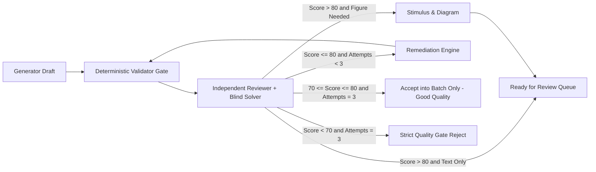

# Infynno MCAT Question Bank Generator v2.0
> **An Infynno Solutions LLP Product • [Infinite Innovations](https://infynno.com/)**

[](https://github.com/VishwamPatel-Infynno/MCAT-Question-Bank-Generator/actions/workflows/ci.yml)

An enterprise autonomous AI application for generating, quality-reviewing, and creating high-quality exam questions for the official **AAMC MCAT** (Medical College Admission Test).

Engineered by **[Infynno Solutions LLP](https://infynno.com/)**, powered by a **3-Step AI Pipeline**, **FastAPI**, **React 19**, and **PostgreSQL 16**, featuring a modern single-canvas studio, live team tracker, batch staging, AAMC SIRS reasoning skills, 100-point 4-pillar psychometric evaluation with First-Pass 100/100 calibration, and a unified 80/70 quality threshold.

---

## 📚 Comprehensive Documentation Suite

For deep-dive technical specifications, architecture diagrams, API schemas, and authoring guidelines, consult the dedicated guides in the [`docs/`](docs/) directory and repository root:

| Document | Description |
| :--- | :--- |
| **[Central Documentation Hub (docs/README.md)](docs/README.md)** | **Master Documentation Index**: Complete sitemap, role-based navigation paths, architectural overview, and cross-functional guide directory. |
| **[Client System & Workflow Guide (docs/CLIENT_SYSTEM_AND_WORKFLOW_GUIDE.md)](docs/CLIENT_SYSTEM_AND_WORKFLOW_GUIDE.md)** | **Primary Client Deliverable**: End-to-end operational walkthrough, 3-step wizard, 2 calibrated generation scopes (5 Questions [1 Job] and 50 Questions [10 Jobs]), Low/Medium/High difficulty tiers, AI Copilot Studio, Hero Landing & Quick-Start Presets, pgvector Semantic RAG shield, Export Studio (paper, CSV, JSON, study guide), Blind-Solver safeguard, Deduplication workflow, AAMC Split-Pane reading mode, canonical Editorial Cards Question Bank, mentor explanations, and token transparency. |
| **[UI/UX Design System (DESIGN.md)](DESIGN.md)** | Authoritative design tokens, dual obsidian/alabaster themes, streamlined 3-step wizard with decomposed summary/advanced drawers, decomposed QuestionCard components, `QuestionCopilotStrip`, `HeroLanding`, decomposed Export Studio panes (`ExportScopeSelector`, `ExportDataFormatPane`, `StudyGuideExportPane`), modular stylesheets (`study-guide-modal.css`, `question-copilot.css`, `stage-inspector.css`), accessible modal focus-trapping contracts (`Modal`, `ConfirmationModal`, `DeletePassageModal`), live batch retry telemetry (`AUTO-RETRYING X/3`), typography scale, component contracts, accessibility criteria (WCAG AA), and micro-animations. |
| **[Architecture & Multi-Agent Workflow](docs/ARCHITECTURE.md)** | Complete workflow diagrams, 3-step pipeline specifications, Blind-Solver Dual Validation, Deduplication & Anti-Collision Subsystem, AI Copilot Studio & in-flight tooling, pgvector Semantic RAG & HNSW vector indexing (`VECTOR(1536)`), 5-Slot Cognitive Blueprints with replenishment rotation, hard 36-call slot budget, Strict Quality Gate, single-threshold 80/70 quality model, global worker semaphores, background batch runner with 3-trial retries, SSE pipeline, and PostgreSQL 16 ERD. |
| **[REST & SSE API Reference](docs/API.md)** | Complete FastAPI endpoint documentation (48 endpoint operations across 42 unique paths including root `/metrics`), pgvector semantic search & RAG endpoints, deduplication, duplicate clustering, auto-resolve & refill endpoints, question restoration (`/restore`), permanent purges (`/permanent`, `/purge-batch`), batch generation schemas, 3-trial batch controls (`/stop`, `/retry`, `/cancel-all`), Prometheus `/metrics` exposition, AI Copilot suite (`/enhance-instructions`, `/refine-question`, `/audit-passage`, `/study-guide`), SSE event stream contracts, filter parameters, and cURL examples. |
| **[Testing & Quality Assurance Guide](docs/TESTING_AND_QA.md)** | Complete test specifications for the 517 passing deterministic unit/integration tests across 77 modules (527 total backend tests across 78 files), 150 frontend unit tests across 18 test files, 15 TestSprite-generated Playwright E2E scripts in `e2e/` (run manually, not in CI), Ruff & Oxlint code hygiene standards, and CI pipeline. |
| **[Token Usage & Cost Tracking](docs/TOKEN_TRACKING.md)** | Verified rate cards per model: DeepInfra DeepSeek ($0.20 in / $0.60 out per 1M tokens standard), Anthropic Claude Haiku 5.5 ($0.10 in / $0.50 out with tiers and prompt-cache rates), OpenAI gpt-4o-mini, text-embedding-3-small ($0.02 per 1M tokens), token-billed gpt-image-2.5-flare images, AI Copilot rate cards, hard 36-call slot budget, exact mathematical cost formulas, multi-agent accumulation, and UI observability. |
| **[Installation, Setup & Deployment](docs/SETUP_AND_CONFIG.md)** | Step-by-step setup, Docker PostgreSQL 16 guide with `pgvector/pgvector:pg16`, environment variables reference (73 Settings fields), modern `uv` workflow, database duplicate cleanup (`pnpm run db:clean-duplicates`), predev port cleanup, production deployment, linters, and troubleshooting. |
| **[MCAT Psychometric Rubric & Standards](docs/MCAT_RUBRIC.md)** | Official 4 AAMC sections standards, 100-point 4-pillar evaluation rubric (25 pts per pillar), First-Pass 100/100 Calibration Directive, 5-Slot Cognitive Blueprints for CARS and Science, domain and experimental condition rotation tables, Blind-Solver algorithmic verification, unified 80/70 quality thresholds, and cognitive distractor trap engineering. |
| **[Backend Developer Guide](backend/README.md)** | Layer separation, modular workflow engine (`engine.py`, `stream_emitter.py`, `slot_worker.py`, `engine_layout.py`, `review_loop.py`, `passage_prep.py`, `passage_blueprints.py`, `dedup_inflight.py`, `live_job_store.py`, `node_generator.py`, `node_reviewer.py`, `node_finalize.py`, `nodes.py`), AI Copilot in-flight services, pgvector Semantic RAG, Blind-Solver agent, CQRS repositories (`question_queries.py`, `question_mutations.py`, `mappers.py`, `query_builders.py`), schema migrations (`schema_migrations.py`), 3-trial retry engine, testing (517 deterministic tests across 77 modules, 527 total backend tests across 78 files), and seeding scripts. |
| **[Frontend Workstation Guide](frontend/README.md)** | Modern React 19 architecture, decomposed component directories (`wizard/`, `question/`, `passage/`, `bank/`, `batch/`, `validated/`, `modals/`, `layout/`, `common/`), top-level views, modular stylesheets, 150 frontend unit tests across 18 test files, hooks, predev port cleaner, and local development instructions. |
| **[Glossary (docs/GLOSSARY.md)](docs/GLOSSARY.md)** | Project-specific terms (slot, blueprint, trial, refill cycle, quality gate, score tiers, statuses, soft vs hard duplicate, blind solver, fail closed, and more) with pointers to the code that defines them. |
| **[Contributing Guide (CONTRIBUTING.md)](CONTRIBUTING.md)** | Setup prerequisites (including `uv`), verification commands, architectural principles and PR workflow. |
| **[Design Plans (design-plans/)](design-plans/passage-editorial-desk-audit.md)** | Design audit plans. The Passage Editorial Desk audit is marked resolved. |
| **[Archived QA Report (docs/archive/)](docs/archive/QA_VERIFICATION_REPORT.md)** | Historical v2.0 sign-off snapshot (November 2, 2026); figures are not updated. See the Testing guide for current numbers. |

---

## 🚀 Key System Capabilities

### 1. Multi-Agent Quality Pipeline with Strict Quality Gate

The diagram is a simplification of `route_after_review` (`workflow/routes.py`): a draft the blind solver flags is also sent to remediation, and an item accepted as Good Quality still goes through image generation when it needs a figure. Terms such as slot, trial and quality gate are defined in the [Glossary](docs/GLOSSARY.md).
- **Generator and Optional Fused Self-Critique (`generator.py` / `fused_generator_node`)**: By default (`ALWAYS_INDEPENDENT_REVIEW=True`) the generator produces the draft only, and the independent reviewer plus the blind solver audit every draft; they run concurrently unless `PARALLEL_REVIEW_AND_SOLVE=false`. Setting `ALWAYS_INDEPENDENT_REVIEW=false` switches to fused mode: the draft and a 100-point self-critique come back in one round-trip, and a self-score above the threshold skips the independent review.
- **Option Symmetry & Anti-Guessability Engine**: Keeps the spread between the longest and shortest option within `max(3, ceil(0.20 x mean option length))` words (`agents/standards.py`, checked by `agents/validators.py`; `agents/option_balancer.py` scores symmetry and shuffles key positions) and enforces parallel grammatical syntax so students cannot guess the answer using "longest option" cues.
- **Anti-AI Formatting Standard**: Strictly forbids em dashes (`—`), en dashes (`–`), or double hyphens (`--`); enforces standard single hyphens (`-`) for human editorial authenticity.
- **3-Part Structured Mentor Explanations (`MentorExplanationView.jsx`)**: Renders pedagogical explanations across three specialized visual cards:
  - **Card 1: Why Option [Key] is Correct** (Emerald / Success styling): Establishes the core intuition and step-by-step deductive or mathematical proof confirming why the correct key is incontrovertible.
  - **Card 2: Why Other Options are Incorrect** (Amber / Warning styling): Features individual itemized sub-cards for every incorrect distractor, dissecting the exact flaw, tempting misconception, and disqualifying factor.
  - **Card 3: Primary Cognitive Trap Spotlight** (Purple / Violet styling): Highlights the dominant cognitive failure mode, explaining the precise psychological error mechanism and providing a student defense strategy to neutralize the trap under real exam conditions.
- **Automatic (Smart AI Choice) Cognitive Trap Engine**: Supports 25 curated primary trap ids (for example `CONCEPT_CONFUSION`, `FORMULA_MISAPPLICATION`, `CORRELATION_CAUSATION`, `SCOPE_SHIFT`; the list lives in `generation_options.primary_trap` of `backend/app/data/mcat_dependent_taxonomy.json`) alongside a default `"Automatic"` mode. In Smart AI mode, the generator agent analyzes the scientific research study or CARS passage, options, and distractors to intelligently select the most fitting trap, which is tracked in `primary_trap`, saved to PostgreSQL, and displayed as a top-strip purple badge chip on candidate cards and repository views.
- **100-Point 4-Pillar Psychometric Audit & First-Pass 100/100 Directive**: Evaluates candidate questions across four rigorous 25-point pillars (*Authenticity & Tone*, *Clarity & Scientific Logic*, *Distractor Traps & Symmetry*, *Explanation Rigor*). The generator is explicitly mandated to aim for a perfect 100/100 on the initial draft, and the reviewer awards full points when all criteria are met without artificial dampening.
- **AAMC Scientific Inquiry & Reasoning Skills (SIRS)**: Integrates official AAMC SIRS skills (Skill 1: Knowledge of Scientific Concepts, Skill 2: Scientific Reasoning and Problem-solving, Skill 3: Reasoning About Design and Execution of Research, Skill 4: Data-based and Statistical Reasoning) and CARS Reasoning Skills (Foundations of Comprehension, Reasoning Within the Text, Reasoning Beyond the Text).
- **Independent Psychometric Auditor (`reviewer.py`)**: Independently audits every candidate item by default (after each remediation too) across 4 equal 25-point pillars (*Authenticity & Tone*, *Clarity & Scientific Logic*, *Distractor Traps*, *Explanation & Key Accuracy*).
- **Remediation Engine Agent (`regenerator.py`)**: Triggered when the score is $\le 80$ or the review fails (for example a blind-solver disagreement). Digests the exact weaknesses and recommendations to repair borderline distractors and expand step-by-step proofs, within `MAX_REGENERATION_ATTEMPTS = 3` iterations.
- **Strict Quality Gate**: A score above $80$ passes (`ai_validated`). After the maximum attempts (`MAX_REGENERATION_ATTEMPTS = 3`), a score of $70$ to $80$ is accepted as Good Quality and kept in the batch only (`batch_only`); a score below $70$ halts the workflow, bypasses image generation and discards the candidate to protect repository integrity.
- **Reviewer-Regenerator Visual Preservation Boundary**: The Reviewer agent receives the complete Accompanying Visual Stimulus Specification and is governed by an anti-deduction audit boundary preventing it from penalizing references to "Figure 1" in standalone stems as unanswerable flaws. The Regenerator is mandated by Rule 12 to preserve `image_needed: True` and retain figure references, ensuring empirical scientific and clinical data are delivered via publication-grade figures.
- **Medical Imaging & Visual Stimulus Subsystem (`image_generator.py` & `medical_imaging.py`)**: Synthesizes publication-grade scientific figures and clinical diagnostic stimuli across 7 medical modalities (Radiology CT/MRI/X-Ray, Histopathology H&E, Gross Anatomy specimens, Cellular Electron Microscopy TEM/SEM, Physiology/ECG Traces, Clinical Pathology, and SVG Vector Diagrams) with active full-modality spectrum encouragement preventing 2D line plot clustering, autonomous AI visual discretion for standalone questions, and automated content safety retry fallback for educational textbook schematics (strictly disabled for CARS in compliance with official AAMC exam regulations).
- **Python Type Precision & Structured Contracts**: Fully typed backend runtime with mandatory `dict[str, Any]` annotations, `AgentUsageEntry` TypedDict, and strongly typed `SlotLedger` state.

### 2. Dual First-Class AI Inference & Precision Cost Accounting
- **Inference Engines**: Multi-provider support switchable via `ACTIVE_LLM_PROVIDER`:
  - **DeepInfra**: DeepSeek-V4.1-Flash-1017 High-Throughput Reasoning Engine ($0.20 input / $0.60 output per 1M tokens, standard price) + FLUX-2-klein-4b visual stimuli ($0.014/unit).
  - **Anthropic**: Claude Haiku 5.5 is the configured default ($0.10 input / $0.50 output per 1M tokens) with native prompt cache read/write rates; other Claude models are priced from the LiteLLM registry or per-family fallbacks in `core/pricing.py`.
  - **OpenAI**: `gpt-4o-mini` default text model ($0.15 / $0.60 per 1M tokens) and token-billed `gpt-image-2.5-flare` images; its key (or the DeepInfra key) is also used for `text-embedding-3-small` embeddings.
- **Micro-Dollar Tracking**: Every request computes exact USD costs rounded to 7 decimal places:
  $$\text{Cost (USD)} = \left(\frac{\text{Prompt Tokens}}{1,000,000} \times R_{\text{in}}\right) + \left(\frac{\text{Completion Tokens}}{1,000,000} \times R_{\text{out}}\right) + \text{Cache Costs}$$
- **Granular Observability**:
  - Live 4-milestone pipeline visualizer with active stopwatch, everyday status indicators (*Passed quality check*, *No figure needed*), and collapsible event log tray.
  - QuestionCard badges displaying total tokens and cost.
  - Psychometric Review Audit Modal itemized table showing prompt tokens, completion tokens, and cost per agent cycle.
  - Question Bank metrics strip tracking accumulated repository-wide tokens and total expenditure.

### 3. Production PostgreSQL 16 Tier (SQLAlchemy Async + asyncpg)
- **Native JSONB Columns**: Stores options, review rubrics, evolution histories, and granular per-agent token tracking.
- **UUID4 Traceability**: Automatic UUID4 generation for every question (`id`), execution run (`run_id`), batch set (`batch_id`), and combination matrix (`combination_id`).
- **Docker Compose Setup**: Instant container initialization of `pgvector/pgvector:pg16` bound to `127.0.0.1:5432` with pre-ping connection pooling (see the optional `app` profile under Quickstart).
- **Zero-Downtime Auto-Migration**: Automatically runs non-destructive schema migrations and full-text search indexing on startup.

### 4. Modern Enterprise Minimalist UI (Dual Theme: Dark & Light)
- **Linear/Vercel-Inspired Aesthetic**: Hairline borders (`rgba(255, 255, 255, 0.06)` dark / `#e8ecf2` light), quiet obsidian and alabaster surfaces, and zero multi-card clutter.
- **Hero Landing Screen (`HeroLanding.jsx`)**: Minimalist welcome canvas presenting official AAMC MCAT sections and instant 1-click exam presets (`HERO_PRESETS` in `wizardConstants.js`) with dedicated icon mappings.
- **3-Step Guided Question Wizard (`GuidedWizard.jsx`)**: Streamlined step-by-step authoring workflow supporting 2 calibrated generation scopes (**5 Questions** [1 Single Job] and **50 Questions** [10-Job Batch]), 3 calibrated difficulty tiers (**Low**, **Medium**, **High**), interactive syllabus navigation, and a compact review summary table with collapsible advanced settings accordion.
- **Dedicated Generation & Review Workspace**: Clean, distraction-free full-width canvas (`maxWidth: 1040px`) hosting live multi-agent synthesis, telemetry, and batch staging without cramped column docks.
- **Editorial Question Presentation**: Scientific research passages and CARS essays formatted in serif typography with line-height `1.68` for fatigue-free reading; circular option badges (`A`, `B`, `C`, `D`), canonical Question Bank Editorial Cards view (legacy grid mode removed), top metadata strip with purple primary trap badge chips, AAMC Scaled Score and SIRS badges, 3-card structured mentor explanations (*Why Correct*, *Why Other Options Incorrect* with itemized distractor cards, and *Primary Cognitive Trap Spotlight*), and inline editing.
- **Instant Theme Switching**: Seamless toggle between Dark and Light themes with WCAG AA compliance via the `T` key shortcut.
- **Full Keyboard Navigation & WCAG AA Accessibility**: `⌘/Ctrl + Enter` (Generate), `T` (Theme), `/` (Search Bank), `Escape` (Close Modals/Editors). Single-key shortcuts are ignored while typing in a field. All 5 primary workspace views feature native semantic `<button>` elements, dynamic `aria-pressed` on filter pills, `aria-current="step"` on steppers, `aria-expanded` on collapsible drawers, and explicit `aria-label`s on selection checkboxes and bulk actions.

### 5. Publication & Export Studio (`ExportPrintModal.jsx`)
The export dialog offers four formats, chosen with a pill selector:
- **Paper (print / PDF)**: Two layouts selected by `paperMode`: a **student paper** (candidate metadata header, questions and answer sheet) and a **study pack** (each stimulus paired with its stem, correct key, trap analysis and rationales). Print layout lives in `utils/export/htmlDoc.js` and `printPaperCss.js`.
- **CSV (`mcat_question_bank.csv`)**: Normalized tabular dataset of questions, options, keys, rubrics and token metrics.
- **JSON (`mcat_question_bank.json`)**: Full hierarchical export preserving JSONB metadata, agent evolutions and psychometric scores.
- **Study guide**: Markdown guide synthesized by the `/api/ai/study-guide` endpoint (copy or download) plus an **Anki-compatible TSV deck** download.
- **Decomposed Export Panes**: Modularized into specialized subcomponents:
  - `ExportScopeSelector.jsx`: Scope, section, and difficulty targeting.
  - `ExportDataFormatPane.jsx`: Format configurations for CSV and JSON.
  - `StudyGuideExportPane.jsx`: Study guide compilation and Anki TSV download.

### 6. Question Deduplication, Collision Avoidance & Duplicate Override (API)
- **Multi-Metric Mathematical Similarity**: Stem similarity blends Token Containment (35%), 1-Gram Jaccard (25%), 2-Gram Jaccard (20%) and SequenceMatcher Ratio (20%); the overall score then factors in answer-option overlap and correct-answer-key similarity (`services/dedup_metrics.py`).
- **Scoped Reference Pool**: Real-time evaluation scoped to the exact **Section** and **Subtopic** in PostgreSQL, plus sibling items drafted in the active batch session.
- **Three Thresholds** (`core/config.py`): a **hard** duplicate at `DUPLICATE_HARD_THRESHOLD = 0.75` (engine, batch clustering and resolution), a **soft** variety warning from `DUPLICATE_SOFT_THRESHOLD = 0.60`, and the stricter `DUPLICATE_API_THRESHOLD = 0.80` used by the on-demand `POST /api/questions/check-duplicate` check.
- **Autonomous Anti-Collision Loop**: If a candidate item reaches the hard threshold ($\ge 0.75$), the engine re-prompts the generator with an explicit avoidance directive and a different trap, steering generation toward alternative presentations or distinct mechanisms (`workflow/dedup_inflight.py`).
- **Autonomous Set-Preserving Duplicate Resolution (`batch_resolution.py`)**: Batches automatically detect pairwise duplicate clusters (at or above the hard threshold), purge redundant drafts, and dispatch in-place replenishment trials while strictly preserving reading passages and target question quotas.
- **Permanent Audit Trail**: The backend flags duplicates on each question and lets a reviewer override a flag (`POST /api/questions/{id}/override-duplicate`, stored as `is_duplicate_override` and `overridden_at`). The current frontend has no duplicate-risk badge, compare modal or override control; it exposes the duplicate check call only through `services/api.js`. TODO: verify whether a UI for overrides is planned.

### 7. AI Copilot Studio & In-Flight Assistance (`QuestionCopilotStrip.jsx` / `ai_copilot.py`)
- **Real-Time Educator Tooling**: Context-aware floating assistant strip providing 4 focused cognitive tools:
  - **Prompt Enhancement (`/api/ai/enhance-instructions`)**: Refines authoring prompts with explicit AAMC phrasing, SIRS reasoning verbs, and distractor constraints.
  - **Question Refinement (`/api/ai/refine-question`)**: Proposes targeted fixes for ambiguous wording, key clarity, distractor symmetry, or cognitive trap calibration.
  - **Passage Audit (`/api/ai/audit-passage`)**: A local readability computation (`services/readability.py`, no LLM call) reporting word count, Flesch-Kincaid grade, reading ease, empirical data density and an alignment score.
  - **Study Guide Generator (`/api/ai/study-guide`)**: Synthesizes high-yield clinical takeaway sheets and active recall summaries from passage sets.

### 8. Streamlined Hero Landing & Quick-Start Presets (`HeroLanding.jsx` / `wizard.css`)
- **Clean Two-Action Canvas**: Focuses the educator on two clear primary pathways: **"Create Questions"** (launching the Guided Wizard) and **"Question Bank"** (navigating to the verified repository).
- **Instant Section Quick-Start Presets**: 4 preset buttons (`HERO_PRESETS` in `components/wizard/wizardConstants.js`), each preconfiguring the wizard with a section, difficulty and 50 questions:
  - **Chem / Phys (CP)**: Medium, single shared passage per set.
  - **CARS**: Medium, single shared passage per set.
  - **Bio / Biochem (BB)**: High, single shared passage per set.
  - **Psych / Soc (PS)**: Medium, independent (no passage) questions.
- **Accessible WCAG AA Semantics**: Implemented with native semantic `<button>` controls, explicit `aria-label`s on brand link and preset chips (`aria-label={"Start with " + preset.label + " preset"}`), and decorative icons hidden via `aria-hidden="true"`.

### 9. pgvector Semantic RAG & Anti-Collision Shield (`rag.py`, `embeddings.py`, `dedup_clustering.py`)
- **1536-Dimensional Neural Embeddings**: Generates real-time vector embeddings for questions and passages via OpenAI `text-embedding-3-small` stored in PostgreSQL `VECTOR(1536)`.
- **HNSW Vector Cosine Index**: High-speed indexing (`ix_questions_embedding_hnsw`, plus `ix_passages_embedding_hnsw`) using `vector_cosine_ops` and pgvector's default HNSW build parameters; no `m`, `ef_construction` or `ef_search` values are set in code (`db/schema_migrations.py`).
- **Dual-Layer Anti-Collision Shield**: Combines pgvector semantic similarity distance ($1 - \text{cosine\_similarity}$) with n-gram lexical overlap (hard threshold $\ge 0.75$), eliminating conceptual repetition before items reach the bank.
- **Hierarchical Clustering**: Exposes `GET /api/batches/{batch_id}/duplicate-clusters` (and `POST /api/batches/{batch_id}/resolve-duplicates`) to group duplicate items into clusters for batch resolution.

### 10. 5-Slot Cognitive Blueprints, Domain Rotation & Hard Slot Budget (`passage_blueprints.py`, `slot_worker.py`)
- **Pedagogical Passage Slot Specialization**: Standardized 5-slot cognitive blueprints ensuring every passage set contains an authentic distribution of reasoning skills:
  - **CARS**: Slot 1 Central Claim / Main Thesis, Slot 2 Local Detail & Passage Evidence, Slot 3 Rhetorical Function / Author's Stance, Slot 4 Reasoning Beyond the Text (Novel Scenario Application), Slot 5 Reasoning Beyond the Text (Challenge / Weaken Assumptions).
  - **Science**: Slot 1 Scientific Concept & Principle Foundation, Slot 2 Data, Figure & Graph Interpretation, Slot 3 Experimental Design & Methodological Rationale, Slot 4 Scientific Reasoning & Problem Solving / Downstream Mechanism, Slot 5 Novel Experimental Condition / Hypothesis Testing.
- **Modulo Attempt Rotation (`resolve_slot_domain_index`)**: When an item requires regeneration or replenishment, the worker rotates deterministically through 10 CARS slot-4 application domains or 10 Science slot-5 experimental conditions:
  $$\text{domain\_index} = (\text{base\_index} + \text{attempt}) \bmod 10$$
  where `base_index` is `N - 1` for a thematic angle labelled `Set #N` (otherwise a hash of the passage, batch or run id) and `attempt` is the replenishment attempt number (0 for the first draft).
- **Hard 36-Call LLM Slot Budget**: Enforces a strict ceiling of `MAX_LLM_CALLS_PER_SLOT = 36` (3 attempts $\times$ 12 calls) per slot to prevent runaway token costs and guarantee predictable batch execution.

---

## ⚡ Quickstart Guide

Prerequisites: Python 3.11+, Node.js 24, pnpm (the version pinned by `packageManager` in `package.json`; enable it with `corepack enable`), Docker with Compose, and [`uv`](https://docs.astral.sh/uv/). `uv` is required because `pnpm dev`, `pnpm test`, `pnpm run lint:all` and the database scripts all run through `uv run`. See [CONTRIBUTING.md](CONTRIBUTING.md) and [docs/SETUP_AND_CONFIG.md](docs/SETUP_AND_CONFIG.md) for details.

### 1. Start PostgreSQL with pgvector (Docker)
```bash
docker compose up -d
```
*Spins up PostgreSQL 16 with `pgvector` extension (`pgvector/pgvector:pg16`) on `127.0.0.1:5432` (loopback only) with database `mcat_db`.*

### 2. Backend Setup
```bash
cp .env.example .env   # then add a provider API key, or set OFFLINE_MODE=true for mock data

# Option A: uv workflow (recommended; `pnpm dev` uses `uv run`)
uv venv
source .venv/bin/activate
uv pip install -r backend/requirements-dev.txt

# Option B: Standard Python venv (works for running uvicorn and pytest directly;
# the `uv run` based pnpm scripts still need uv installed)
python3 -m venv .venv
source .venv/bin/activate
pip install -r backend/requirements-dev.txt

# Start FastAPI server
PYTHONPATH=backend uvicorn app.main:app --port 8000 --reload
```
*`pyproject.toml` declares no dependencies (`[tool.uv] package = false`), so `uv run` relies on `.venv` already being populated by the install step above. Backend runs on **[http://localhost:8000](http://localhost:8000)** (OpenAPI docs at `/docs`).*

### 3. Frontend Setup
```bash
# Install dependencies using pnpm
pnpm install

# Start development server (backend + frontend together, frees ports 8000 and 5173 first)
pnpm dev
```
*Frontend runs on **[http://localhost:5173](http://localhost:5173)**.*

### Optional: full stack in Docker (`app` profile)
```bash
docker compose --profile app up -d --build   # postgres + backend + nginx web
# open http://127.0.0.1:8080
```
*The `app` profile adds the `backend` (`backend/Dockerfile`, one Uvicorn worker) and `web` (`frontend/Dockerfile`, nginx serving the Vite build and proxying `/api/` to the backend) services. Only the web port `127.0.0.1:8080` and Postgres `127.0.0.1:5432` are published; the backend port 8000 is not. Without the profile, `docker compose up -d` still starts only Postgres. Details: [docs/SETUP_AND_CONFIG.md](docs/SETUP_AND_CONFIG.md) section 6.1.1.*

### Frontend environment variables
Read from the repository-root `.env` (see `.env.example` section 11b):

| Variable | Purpose |
| :--- | :--- |
| `VITE_API_ACCESS_KEY` | Optional shared secret sent by the frontend as `X-API-Key`; must match `API_ACCESS_KEY` on the backend. Also a build argument of the `web` Docker image. |
| `VITE_ALLOWED_HOSTS` | Extra hostnames (comma-separated) the Vite dev server accepts, for example a tunnel hostname. |

---

## 🧪 Automated Testing & Linters

Run the full backend test suite covering schemas, routing logic, strict quality gates, SVG & FLUX synthesis, pgvector operations, and token calculations:

```bash
# Backend: 78 test files, 527 tests collected; 10 live_e2e tests are deselected by default,
# so 517 run by default. 90 of them are marked requires_db: without a reachable PostgreSQL,
# 427 run and 90 skip cleanly (TESTING_AND_QA.md holds the current numbers).
# conftest.py strips provider keys and enables OFFLINE_MODE: no default test ever calls a live LLM
source .venv/bin/activate
pytest -v  # pyproject.toml sets the test path, PYTHONPATH and the "not live_e2e" marker

# Run backend linter and formatter check
ruff check .
ruff format --check .
```

Verify frontend code hygiene, unit tests, unused CSS, and the production bundle (these mirror the CI jobs in `.github/workflows/ci.yml`):

```bash
# Frontend unit tests (Vitest: 150 tests across 18 test files)
pnpm test:frontend

# Frontend linter (oxlint; the last run reported 169 files, 106 rules, 0 warnings, 0 errors)
pnpm lint

# Fails on CSS classes nothing uses
pnpm --dir frontend run check:css

# Production build (Vite 8)
pnpm build
```

Browser end-to-end tests: `e2e/` holds 15 generated Playwright scripts (`TC001`-`TC015`). They are run by hand against a running app (`python3 e2e/<file>`), are not part of CI, and Playwright is not listed in any requirements file, so install it first (for example `pip install playwright && playwright install chromium`). See [docs/TESTING_AND_QA.md](docs/TESTING_AND_QA.md).

### Monorepo Orchestration Scripts Reference

| Command | Action |
| :--- | :--- |
| `pnpm dev` | Starts FastAPI backend (port 8000) and Vite frontend (port 5173) with automatic port cleanup |
| `pnpm run clean:ports` | Kills lingering processes on ports 8000 and 5173 (`scripts/clean-ports.mjs`) |
| `pnpm run sync:taxonomy` | Syncs `mcat_dependent_taxonomy.json` from backend to frontend constants |
| `pnpm run db:seed` | Seeds 4 sample questions into PostgreSQL (`backend/scripts/seed_questions.py`) |
| `pnpm run db:clean-duplicates` | Purges discarded questions (archived duplicates and reviewer discards; passages are untouched) from PostgreSQL; run `uv run python scripts/clean_duplicate_artifacts.py --dry-run` first to list them |
| `pnpm run benchmark:concurrency` | Executes in-process ASGI high-concurrency load benchmark across 20-100 workers (`scripts/benchmark_concurrency.py`) |
| `pnpm run lint:all` | Runs full-stack linting (`uv run ruff check .` + `pnpm --dir frontend lint`) |
| `pnpm run test:all` | Runs full-stack test suites (backend pytest + frontend Vitest) |
| `pnpm run format` | Formats all Python files via Ruff |
| `pnpm --dir frontend run check:css` | Scans for unused or missing CSS classes across all JSX and CSS files |

Note: `pnpm test` runs the backend suite only, and `pnpm lint` runs the frontend linter only. All `uv run` scripts need `uv` installed and `.venv` populated (see Quickstart).

For complete test specifications and the 15 TestSprite Playwright E2E browser scenarios, consult [`docs/TESTING_AND_QA.md`](docs/TESTING_AND_QA.md).

---

## 📁 Repository Structure

A directory-level map. Per-file listings live in [`backend/README.md`](backend/README.md) and [`frontend/README.md`](frontend/README.md) so they have a single place to stay current.

```
Question Bank Generator/
├── README.md                    # Project overview & documentation index
├── DESIGN.md                    # Authoritative UI/UX Design System Guide (tokens, dual themes, split-pane)
├── CONTRIBUTING.md              # Setup prerequisites, verification commands, architectural principles, PR workflow
├── LICENSE                      # MIT License text (see License & Attribution below)
├── docker-compose.yml           # PostgreSQL 16 + pgvector (default) and optional backend/web `app` profile
├── .dockerignore                # Keeps secrets, tests and node_modules out of image builds
├── pyproject.toml               # Python tooling configuration (pytest, ruff, asyncio); declares no dependencies
├── uv.lock                      # uv lockfile
├── package.json                 # Monorepo pnpm orchestration scripts (with predev port cleaner)
├── pnpm-workspace.yaml          # Pnpm workspace definition (frontend/)
├── pnpm-lock.yaml               # Deterministic package lockfile
├── .env.example                 # Environment variables template (copy to .env)
├── .github/
│   ├── workflows/ci.yml         # CI: backend lint & format, backend tests (Postgres service), frontend lint/test/css check/build, advisory dependency audit
│   ├── ISSUE_TEMPLATE/          # Bug report and feature request templates
│   ├── PULL_REQUEST_TEMPLATE.md # Pull request checklist
│   └── dependabot.yml           # Dependency update configuration
├── .claude/skills/              # Project skills for Claude Code (pipeline, backend, frontend, dev-env, verify, docs-sync, git workflow)
├── design-plans/                # Design audit plans (passage-editorial-desk-audit.md, resolved)
├── docs/                        # Documentation suite
│   ├── README.md                # Master Documentation Index & role-based sitemap
│   ├── ARCHITECTURE.md          # Multi-agent architecture, quality gate & Blind-Solver
│   ├── API.md                   # REST & SSE API specification (48 operations across 42 unique paths including root /metrics)
│   ├── CLIENT_SYSTEM_AND_WORKFLOW_GUIDE.md # Client system & operational workflow guide
│   ├── TESTING_AND_QA.md        # Pytest, Vitest and Playwright E2E specs and quality gates
│   ├── TOKEN_TRACKING.md        # Multi-provider inference pricing & cost engine
│   ├── SETUP_AND_CONFIG.md      # Installation, deployment (73 Settings fields) & FAQs
│   ├── MCAT_RUBRIC.md           # 100-point psychometric rubric & authoring standards
│   ├── GLOSSARY.md              # Project-specific terms with code pointers
│   └── archive/QA_VERIFICATION_REPORT.md # Historical v2.0 QA sign-off snapshot (not updated)
├── scripts/                     # Repository-level scripts (run from the repo root via pnpm)
│   ├── clean-ports.mjs          # Frees ports 8000 and 5173 (pnpm run clean:ports, run by predev)
│   ├── clean_duplicate_artifacts.py # Discarded-question cleanup utility (pnpm run db:clean-duplicates)
│   └── benchmark_concurrency.py # In-process ASGI high-concurrency load benchmark (pnpm run benchmark:concurrency)
├── e2e/                         # 15 Playwright scripts (TC001-TC015), standard_prd.json and a TestSprite test plan; run by hand, not in CI
├── backend/
│   ├── README.md                # Backend developer guide
│   ├── Dockerfile               # Multi-stage python:3.11-slim image (one Uvicorn worker, non-root)
│   ├── requirements.txt         # Runtime dependencies
│   ├── requirements-dev.txt     # Adds pytest, pytest-asyncio, pytest-cov, ruff
│   ├── scripts/
│   │   └── seed_questions.py    # Seeds 4 sample questions (pnpm run db:seed)
│   ├── tests/                   # 78 test files (527 tests; 10 marked live_e2e are deselected by default)
│   │   ├── conftest.py          # Fixtures: offline DB probe, credential stripping, async client, patch_llm
│   │   ├── factories.py         # Shared builders (make_draft, make_question, make_request, ...)
│   │   └── test_*.py            # Test modules, including test_optimizations.py and test_optimizations_fullstack.py
│   └── app/
│       ├── main.py              # FastAPI app with lifespan context & security headers
│       ├── core/                # config.py (Settings), pricing.py, concurrency.py, logging.py, errors.py
│       ├── data/                # mcat_dependent_taxonomy.json, thematic_angles.py
│       ├── middleware/          # telemetry.py (Prometheus request timing)
│       ├── db/                  # base.py, session.py (async engine, scoped_session), init_db.py, schema_migrations.py (migrations & HNSW indexes)
│       ├── models/              # SQLAlchemy models: batch, job, passage, question
│       ├── repositories/        # Data access layer (question_queries/mutations/repository, batch, job, passage, mappers, query_builders, _filters)
│       ├── schemas/             # Pydantic schemas: mcat, question, status, token, workflow, extractors
│       ├── services/            # ai_copilot, rag, embeddings, dedup_*, batch_runner/worker/concurrency/resolution, csv_export, metrics, readability
│       ├── agents/              # generator, reviewer, regenerator, blind_solver, image_generator, medical_imaging, option_balancer, batch_planner, draft_parser, validators, standards, prompts, prompt_builder, mock fixtures
│       ├── workflow/            # engine, engine_layout (SlotLedger), slot_worker, review_loop, passage_prep, passage_blueprints, dedup_inflight, live_job_store, node_generator/reviewer/finalize (nodes.py re-exports them), routes, sse, state, stream_emitter
│       └── api/                 # admin.py, router.py, security.py, utils.py and v1/ routers (ai, batches, config, generation, health, metrics, passages, questions, taxonomy)
└── frontend/
    ├── README.md                # Frontend developer guide
    ├── Dockerfile               # Node 24 build stage + nginx runtime image
    ├── nginx.conf               # SPA serving, gzip, /api/ proxy for SSE
    ├── nginx-security-headers.conf # Shared security headers snippet
    ├── package.json             # React 19 dependencies & scripts
    ├── vite.config.js           # Vite build configuration
    ├── index.html               # HTML entry document
    ├── public/                  # Static assets
    ├── scripts/check-unused-css.mjs # Unused/missing CSS class checker (pnpm --dir frontend run check:css)
    └── src/
        ├── App.jsx, main.jsx    # Application shell and entry point
        ├── index.css            # Stylesheet aggregator (imports styles/*)
        ├── styles/              # Modular domain stylesheets (tokens, base, layout, wizard, question, batch, bank, passage, modals, print, ...)
        ├── views/               # Lazy-loaded screens: AiValidatedQuestionsView, BatchActivityView, PassageBankView, QuestionBankView
        ├── components/          # Feature folders: wizard/, question/ (includes QuestionCopilotStrip.jsx), passage/, bank/, batch/, validated/, modals/, layout/, common/
        ├── hooks/               # Stateful hooks (useAppState, useQuestionBank, usePassageBank, useBatchActivity, useGeneratorForm, useKeyboardShortcuts, useTheme, ...)
        ├── constants/           # mcat.js, mcatTraps.js, mcat_dependent_taxonomy.json (synced copy)
        ├── services/api.js      # SSE event reader & REST client (34 exports)
        └── utils/               # Pure helpers; export/ holds csv.js, json.js, htmlDoc.js, printPaperCss.js behind export/index.js
```

---

## 📄 License & Attribution
The [`LICENSE`](LICENSE) file in this repository contains the **MIT License** (copyright 2026 Vishwam Patel / Infynno Solutions). TODO: verify intended license: earlier versions of this README described the project as proprietary with all rights reserved, which conflicts with the LICENSE file.

Infynno MCAT Question Bank Generator is engineered and maintained by **[Infynno Solutions LLP](https://infynno.com/)**.
