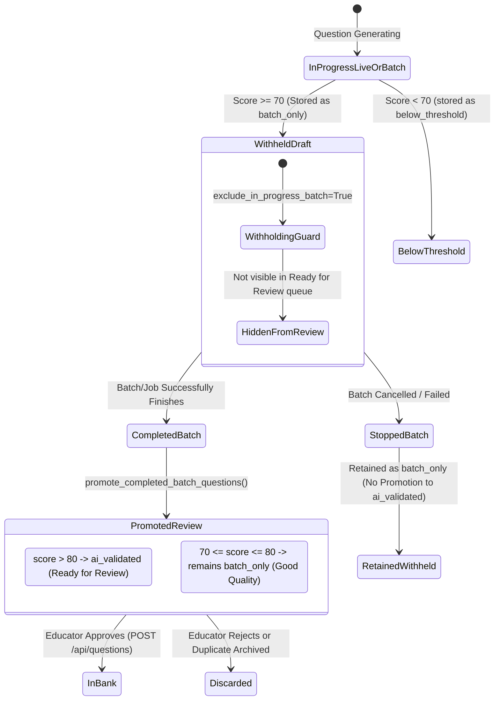

# Infynno MCAT Question Bank Generator - REST & SSE API Reference

Engineered by **[Infynno Solutions LLP](https://infynno.com/)** (*"Infinite Innovations"*).

This document provides a comprehensive technical reference for all REST endpoints and Server-Sent Events (SSE) streaming protocols exposed by the FastAPI backend on port `8000`.

---

## 1. Base URL & Protocol Information

- **Base URL**: `http://localhost:8000` (or configured deployment host)
- **Content Type**: `application/json` (REST endpoints), `text/event-stream` (Live generation SSE stream)
- **CORS Policy & Security Headers**: Restricted to trusted origins (`http://localhost:5173`, etc.) with OWASP security headers (`X-Content-Type-Options`, `X-Frame-Options`, `X-XSS-Protection`).
- **Autonomous Inference Gateway**: Multi-provider inference engine supporting three providers: **DeepInfra** (DeepSeek V4.1 Flash at $0.20 in / $0.60 out per 1M tokens, standard price; the default), **Anthropic** (Claude Haiku 5.5 / Sonnet / Opus with prompt cache read/write rates) and **OpenAI** (default model `gpt-4o-mini`), switchable via `ACTIVE_LLM_PROVIDER` (`deepinfra`, `anthropic` or `openai`). All routes live under `/api/...` (there is no `/v1` URL prefix; `v1` is only the backend package name), e.g. `/api/ai/enhance-instructions`.
- **MCAT 4-Choice Purity**: All question endpoints enforce strictly 4 options ($A, B, C, D$) with length symmetry and zero multi-choice artifacts.
- **Payload Compression & Middlewares**: Integrated with Starlette `GZipMiddleware(minimum_size=1000)` for automated GZip compression on HTTP responses $\ge 1\text{ KB}$ (`Content-Encoding: gzip`), while bypassing micro-responses and SSE streams. Every response carries an `X-Request-ID` header for log correlation.

---

## 1.1 HTTP Middleware & Network Transfer Optimization

The backend runs an ASGI middleware stack that governs network optimization and security across all HTTP interactions:

| Middleware | Role | Behavior |
| :--- | :--- | :--- |
| **`GZipMiddleware`** | Bandwidth optimization | Automatically applies GZip compression (`Content-Encoding: gzip`) to JSON and CSV payloads $\ge 1\text{ KB}$ when requested via `Accept-Encoding: gzip` (yielding 70–85% size reductions on `/api/export`, bulk `/api/questions`, and batch details). Small responses ($<1\text{ KB}$) and Server-Sent Events (`text/event-stream` at `/api/generate`) bypass compression. |
| **`SecurityHeadersMiddleware`** | OWASP Security Headers | Automatically injects `X-Content-Type-Options: nosniff`, `X-Frame-Options: DENY`, `X-XSS-Protection: 1; mode=block`, `Referrer-Policy: strict-origin-when-cross-origin`, and `Permissions-Policy: geolocation=(), camera=(), microphone=()`. |
| **`RequestContextMiddleware`** | Traceability & Ingestion Caps | Extracts or assigns an `X-Request-ID` bound to all server logs and echoed back on responses; rejects requests whose declared `Content-Length` exceeds `MAX_REQUEST_BODY_MB` with HTTP 413, and also counts bytes as they stream in so chunked bodies without a `Content-Length` are cut off at the same limit (`{"detail": "Request body exceeds N MB.", "code": "payload_too_large"}`). |
| **`TelemetryMiddleware`** | Observability | Records request latency histograms and HTTP status counters exposed at `/metrics`. The `endpoint` label is the matched route template (for example `/api/batches/{batch_id}`) or `unmatched`; methods outside the standard set are recorded as `OTHER`; label values are escaped. |

---

## 1.2 Authentication, Rate Limits & Errors

### Shared-secret gate (`API_ACCESS_KEY`)
- When the server sets `API_ACCESS_KEY`, every mutating request (`POST`, `PUT`, `PATCH`, `DELETE`) under `/api` must send the same value in the `X-API-Key` header (constant-time comparison). A missing or wrong key returns `401` with `{"detail": "A valid X-API-Key header is required for this operation."}`.
- `GET` requests are never gated. `POST /api/questions/check-duplicate` is exempt from the key (read-only check) but is rate limited in its own bucket (see below). `GET /metrics` (root) is outside `/api` and is not gated by this key.
- Behind the bundled Docker `web` proxy, nginx injects `X-API-Key` itself from its `API_ACCESS_KEY` environment variable, so browsers do not need to send it, and anyone who can reach the web port can call the mutating API. Direct clients (curl, scripts, the local Vite dev server) still send the header themselves.
- With `API_ACCESS_KEY` empty (the default) all routes are open. This is a shared secret for deployments behind a gateway, not per-user authentication. The SSE `POST /api/generate` call must send the header too.

### Admin diagnostics (`x-admin-key`)
- `ADMIN_API_KEY` defaults to empty. With no key configured nobody is treated as admin, so `GET /api/config` and `GET /api/health` always return the masked payload (see 3.33 and 3.34). With a key configured, an `x-admin-key` header that matches it (constant-time) unlocks the full payload.
- `GET /metrics` and `GET /api/metrics` are open while `ADMIN_API_KEY` is unset. Once it is set, a request without a matching `x-admin-key` header returns `403` (`{"detail": "A valid x-admin-key is required for metrics."}`), so scrapers must send that header.

### Rate limits and concurrency caps (cost guards)
| Guard | Applies to | Setting | Failure |
| :--- | :--- | :--- | :--- |
| Per-client sliding window (60 s, keyed by the transport peer address; IPv6 clients grouped by /64; `X-Forwarded-For` is honored only through Uvicorn's `FORWARDED_ALLOW_IPS`) | `POST /api/generate`, `POST /api/batches/start`, `POST /api/batches/{batch_id}/retry`, `POST /api/batches/{batch_id}/refill`, `POST /api/ai/enhance-instructions`, `POST /api/ai/refine-question`, `POST /api/ai/study-guide` | `GENERATION_RATE_LIMIT_PER_MINUTE` (default `30`, `0` disables) | `429` `{"detail": "Too many generation requests. Please slow down."}` with a `Retry-After` header (seconds) |
| Active batch cap | `POST /api/batches/start`, `POST /api/batches/{batch_id}/retry`, `POST /api/batches/{batch_id}/refill` | `MAX_ACTIVE_BATCHES` (default `5`, `0` disables) | `429` `{"detail": "N batches are already running. Wait for one to finish or stop one."}` (no `Retry-After`) |

`POST /api/questions/check-duplicate` also counts against `GENERATION_RATE_LIMIT_PER_MINUTE` but in its own bucket, so duplicate checks never consume the generation allowance; it still needs no `X-API-Key`. `POST /api/ai/audit-passage` is not rate limited (it makes no LLM call).

### Request size limits
| Endpoint | Limit |
| :--- | :--- |
| `POST /api/questions/check-duplicate` | `section` 100, `subtopic` 300, `question_stem` 5000 characters; at most 10 `options`, each option field 2000 characters |
| `POST /api/ai/enhance-instructions` | `instructions` 3000, `section` 100 characters |
| `POST /api/ai/refine-question` | `question` must serialize to at most 50,000 characters of JSON; `action` 50 characters |
| `POST /api/ai/study-guide` | 1 to 100 questions; each at most 50,000 characters of JSON and 300,000 characters in total |
| `POST /api/generate`, `POST /api/batches/start` (`GenerationRequest`) | `thematic_angle` 2000, `content_domains` at most 30 items of 200 characters, `passing_threshold` 0 to 100, `model_name` matching `^[A-Za-z0-9][A-Za-z0-9._:/@+\-]*$`; other free-text taxonomy fields have 100 to 500 character caps |

A `model_name` that is not one of the server-configured models is refused when the request carries no `api_key` (the caller's own key may use any model). Error text in the terminal `workflow_rejected` event of the generation stream (`error` and `errors`) passes through `sanitize_error_text`, so raw provider text does not reach the client.

### Status codes and error body
| Status | When |
| :--- | :--- |
| `400` | `POST /api/batches/{batch_id}/retry` when no incomplete job can be retried |
| `401` | Missing or wrong `X-API-Key` while `API_ACCESS_KEY` is set |
| `403` | `GET /metrics` or `GET /api/metrics` without a matching `x-admin-key` while `ADMIN_API_KEY` is set |
| `404` | Question, passage or batch not found; also `POST /api/questions` and `POST /api/questions/batch` for a question that carries both `batch_id` and `job_id` when that batch does not exist (manual approvals without `job_id` still auto-create the batch) (`{"detail": "Question not found"}`, `"Passage not found"`, `"Batch not found"`); question without an image |
| `409` | `POST /api/batches/{batch_id}/refill` while the batch is still running (`{"detail": "This batch is still running."}`); `POST /api/batches` when the batch id already exists |
| `413` | Body larger than `MAX_REQUEST_BODY_MB` (`code: payload_too_large`; streamed bodies are counted too), or more than 500 questions in `POST /api/questions/batch` |
| `415` | Unsupported stored image type or location on the image endpoint |
| `422` | Request validation failure (FastAPI default), invalid question status on `POST /api/questions` / `POST /api/questions/batch`, invalid batch status on `POST /api/batches` |
| `429` | Rate limit or active-batch cap (see above) |
| `500` | Unhandled error: `{"detail": "Internal server error.", "code": "internal_error"}` (details are logged server side only); endpoint-specific 500s such as `{"detail": "Failed to enhance instructions."}` |
| `503` | `GET /api/health/ready` when the database does not answer |

Every response carries an `X-Request-ID` header (a safe caller-supplied value is echoed, otherwise one is generated).

---

## 2. API Endpoints Summary (48 Operations across 42 Unique Endpoint Paths)

| Method | Endpoint | Description |
| :--- | :--- | :--- |
| `POST` | `/api/generate` | Triggers multi-agent workflow and streams real-time SSE events (Candidate Staged) |
| `POST` | `/api/ai/enhance-instructions` | **AI Copilot**: Calibrates raw educator instructions into an authentic AAMC prompt mandate |
| `POST` | `/api/ai/refine-question` | **AI Copilot**: Performs live editorial refinement on question stem, distractors, or explanations |
| `POST` | `/api/ai/audit-passage` | **AI Diagnostics**: Evaluates passage Flesch-Kincaid grade level, empirical density, and AAMC alignment |
| `POST` | `/api/ai/study-guide` | **AI Synthesis**: Generates high-yield study guide, executive summaries, trap checklists, and flashcards |
| `POST` | `/api/questions` | **Admin Review Gate**: Persists an approved candidate question into the Question Bank |
| `POST` | `/api/questions/batch` | **Admin Review Gate**: Bulk-persists an array of approved candidates atomically |
| `GET` | `/api/questions` | Lists saved questions with filtering (`status` defaults to `in_bank`, `all` disables it), pagination (`limit`/`offset`; without a `limit` at most `MAX_LIST_LIMIT` = 2000 rows are returned), `slim` projection, and repository token metrics |
| `GET` | `/api/questions/counts` | Returns question counts grouped by lifecycle status (`in_bank`, `ai_validated`, `batch_only`, `below_threshold`, `discarded`, `deleted`, `total`) |
| `GET` | `/api/questions/{question_id}` | Retrieves a single question by UUID4 primary key |
| `POST` | `/api/questions/{question_id}/override-duplicate` | **Admin Review Gate**: Explicitly overrides duplicate collision alert and approves into bank |
| `POST` | `/api/questions/{question_id}/restore` | **Admin Action**: Restores a soft-deleted question and its linked passage back to active status |
| `POST` | `/api/questions/check-duplicate` | Evaluates candidate question draft against the bank using pgvector semantic RAG and lexical metrics |
| `POST` | `/api/questions/semantic-search` | **Semantic Search**: Performs pgvector cosine distance or hybrid (vector + full-text) search over questions |
| `POST` | `/api/questions/rag-context` | **RAG Prompt Grounding**: Retrieves high-yield exemplars ($\ge 90$) and anti-collision neighbor avoidance stems |
| `POST` | `/api/questions/backfill-embeddings` | **Admin Action**: Triggers batch population of 1536-dimensional vector embeddings for questions |
| `DELETE` | `/api/questions/{question_id}` | **Admin Action**: Soft-deletes a question by UUID4, preserving it for batch progress history |
| `POST` | `/api/questions/delete-batch` | **Admin Action**: Bulk soft-deletes multiple questions atomically, preserving batch progress |
| `DELETE` | `/api/questions/{question_id}/permanent` | **Admin Action**: Permanently hard-deletes a single question from PostgreSQL by ID, bypassing soft-delete flags |
| `POST` | `/api/questions/purge-batch` | **Admin Action**: Permanently hard-deletes multiple questions by IDs from PostgreSQL, eliminating database ghost records |
| `POST` | `/api/questions/update-status` | **Admin Action**: Bulk-updates question lifecycle status (any of the 9 `QuestionStatus` values) |
| `PATCH` | `/api/questions/{question_id}/status` | Updates lifecycle status for an individual question |
| `GET` | `/api/questions/{question_id}/image` | Serves visual stimulus (AI raster image or Vector SVG diagram) with a sandboxing `Content-Security-Policy` header |
| `GET` | `/api/passages` | Lists shared reading passages with query filtering, search, sorting (`sort_by`), pagination (`limit`/`offset`), and active question counts (`total_count`) |
| `GET` | `/api/passages/{passage_id}` | Retrieves a single reading passage along with all its linked active questions |
| `POST` | `/api/passages` | Admin endpoint to create or update a shared reading passage record |
| `DELETE` | `/api/passages/{passage_id}` | Admin endpoint to soft-delete a passage and its linked questions, preserving batch progress history |
| `POST` | `/api/passages/{passage_id}/restore` | Admin endpoint to restore a soft-deleted passage record (404 if not found) |
| `GET` | `/api/batches` | Lists generation batches (newest first; `section`, `status`, `limit` 1-500 default 100, `offset`) with active running counts and global concurrency metrics. Rows omit `request_payload`; client API keys are never stored or returned |
| `GET` | `/api/batches/{batch_id}` | Retrieves a generation batch with all jobs and grouped questions. Supports conditional HTTP validation via `If-None-Match`/`ETag` with `304 Not Modified` fast-path and `slim` diagnostic projection |
| `POST` | `/api/batches/start` | Launches an asynchronous background batch generation (jobs of up to 5 questions: 5 Qs = 1 job, 50 Qs = 10 jobs) |
| `POST` | `/api/batches/{batch_id}/stop` | **Batch Control**: Gracefully halts active background jobs for a batch without deleting questions |
| `POST` | `/api/batches/{batch_id}/retry` | **Batch Control**: Resumes incomplete sets for manually paused batches with remaining trials (HTTP 400 when 3 trials exhausted) |
| `POST` | `/api/batches/cancel-all` | **Batch Control**: Gracefully halts all active background batches across the system |
| `DELETE` | `/api/batches/{batch_id}` | Deletes a generation batch and cascades delete to jobs and questions |
| `POST` | `/api/batches` | Admin endpoint to create an empty batch record (create-only: `409` if the id exists; status and counters are ignored) |
| `GET` | `/api/batches/{batch_id}/duplicate-clusters` | Clusters batch questions by similarity to identify leader items and redundant duplicates |
| `POST` | `/api/batches/{batch_id}/resolve-duplicates` | Resolves duplicate clusters by keeping designated leaders and archiving (default) or hard-deleting duplicates |
| `POST` | `/api/batches/{batch_id}/refill` | Replenishes batch question deficit up to target count using pedagogical thematic variations |
| `GET` | `/api/export` | Exports `in_bank` questions in standardized JSON or CSV format (`format` is the only parameter) |
| `GET` | `/api/health` | Service health and database connectivity; public (masked) payload by default, full provider/model diagnostics with a valid `x-admin-key` |
| `GET` | `/api/health/live` | Liveness probe: `200 {"status": "alive"}` while the process serves requests; never touches the database |
| `GET` | `/api/health/ready` | Readiness probe: `200` when the database answers, `503` otherwise (for orchestrators and load balancers); `/api/health` reports `degraded` when the database is down |
| `GET` | `/api/config` | Retrieves runtime parameters and pricing constants (25 fields masked, 36 fields with a valid `x-admin-key`); supports `ETag`/`304` |
| `GET` | `/api/sections` | Returns official AAMC MCAT sections, syllabus hierarchy, skills, and pacing (`ETag`/`304`, cacheable) |
| `GET` | `/api/taxonomy` | Returns the complete official AAMC Dependent Taxonomy JSON tree (`ETag`/`304`, cacheable) |
| `GET` | `/metrics` | Root Prometheus/OpenMetrics text exposition endpoint (concurrency, status counts, token burn, HTTP traffic); `403` on a wrong `x-admin-key` when `ADMIN_API_KEY` is set |
| `GET` | `/api/metrics` | Versioned alias for Prometheus/OpenMetrics exposition |

---

## 3. Endpoints Specification

### 3.1 Start Multi-Agent Generation (SSE Stream)
`POST /api/generate`

Initiates the multi-agent generation and psychometric evaluation workflow. Per-attempt rejections arrive as the non-terminal `question_rejected` event; `workflow_rejected` is terminal (all slots rejected) and, like `workflow_error`, carries `cumulative_usage`. When the server sets `API_ACCESS_KEY`, send it as the `X-API-Key` header (see section 1.2; `POST /api/questions/check-duplicate` stays open). The route is rate limited per client IP (`429` with `Retry-After`). While a long LLM stage is quiet the stream emits an SSE comment line (`: keepalive`) every 15 seconds so proxies keep the connection open; clients ignore comment lines. Returns a live Server-Sent Events stream delivering step-by-step agent telemetry, intermediate drafts, review rubrics, token usage, and candidate question payloads. Supports single-item and live 5-question set generation.

#### Request Headers
```http
Content-Type: application/json
Accept: text/event-stream
```

#### Request Body
Length limits: `section` 100, `subtopic` 300, `question_stem` 5000 characters; at most 10 `options`, each field at most 2000 characters. The call needs no `X-API-Key` but is rate limited (own bucket, `GENERATION_RATE_LIMIT_PER_MINUTE`).
```json
{
  "section": "chem_phys",
  "subtopic": "Thermodynamics & Reaction Kinetics",
  "difficulty": "medium",
  "aamc_skill": "Skill 2: Scientific Reasoning and Problem-solving",
  "allow_ai_images": false,
  "require_image": false,
  "require_passage_image": false,
  "visual_type": "None",
  "additional_instructions": "Include experimental Lineweaver-Burk data interpretation with explicit Km and Vmax calculation distractor traps.",
  "questions_to_generate": 1,
  "passage_mode": "single_passage",
  "interaction_type": "single_choice",
  "primary_trap": "Calculation_Formula_Trap",
  "combination_id": "CMB00001",
  "run_id": "d81f668e-c768-45b7-9fb6-ba1ee2bdbba3",
  "batch_id": null,
  "auto_save": false,
  "passing_threshold": 80
}
```

| Field | Type | Required | Default | Description |
| :--- | :--- | :--- | :--- | :--- |
| `section` | `string` | **Yes** | - | `chem_phys`, `cars`, `bio_biochem`, `psych_soc` |
| `subtopic` | `string` | No | `null` | Categorized syllabus topic |
| `difficulty` | `string` | No | `"medium"` | `low`, `medium`, `high` |
| `aamc_skill` | `string` | No | `null` | Official AAMC SIRS Skill (1-4) or CARS Skill |
| `allow_ai_images` | `boolean` | No | `false` | Whether AI is permitted to generate visual stimuli across all 7 medical/scientific modalities with full pedagogical and creative freedom |
| `require_image` | `boolean` | No | `false` | Force visual stimulus generation for the question stem |
| `require_passage_image`| `boolean` | No | `false` | Force visual diagram generation for the shared passage stimulus |
| `visual_type` | `string` | No | `"None"` | Visual stimulus generation type: `"None"`, `"AI_FLUX_Image"`, `"SVG_Diagram"`, `"AI_Image"`, or `"AI_OpenAI_Image"` (`"None"` plus the four `KNOWN_VISUAL_TYPES`) |
| `additional_instructions` | `string` | No | `null` | Educator instructions specifying constraints, clinical scenarios, or pedagogical rules strictly enforced across passage generation, question generation, and remediation critique cycles (max 4000 characters) |
| `questions_to_generate` | `integer` | No | `5` | Quantity to generate (Wizard UI provides `5` [1 Single Job] and `50` [10-Job Batch]; backend permits 1 to 50) |
| `passage_mode` | `string` | No | `"single_passage"` | `"single_passage"` (all Qs linked to 1 passage) or `"independent"` (standalone discretes) |
| `interaction_type` | `string` | No | `"single_choice"` | Standard 4-choice single choice item |
| `primary_trap` | `string` | No | `null` | Cognitive trap selection: an explicit trap name (the frontend offers the names in `frontend/src/constants/mcatTraps.js`; the frontend may send `"Automatic"` for Smart AI choice) or `null`; the API stores the string as given |
| `subject` | `string` | No | `null` | Taxonomy subject (e.g. `General Chemistry`) |
| `unit` | `string` | No | `null` | Taxonomy unit (e.g. `Atomic Structure and Periodicity`) |
| `topic` | `string` | No | `null` | Taxonomy topic (e.g. `Periodic Trends`) |
| `subskill` | `string` | No | `null` | Granular AAMC subskill focus |
| `likely_mistake_pattern`| `string` | No | `null` | Targeted student misconception pattern |
| `combination_id` | `string` | No | Auto UUID4 | Unique matrix combination code (e.g. `CMB00001`) |
| `run_id` | `string` | No | Auto UUID4 | Execution run UUID4 |
| `batch_id` | `string` | No | `null` | Optional batch identifier grouping questions |
| `auto_save` | `boolean` | No | `false` | Auto-persist to DB (`false` retains Admin Review Gate) |
| `passing_threshold` | `integer` | No | `80` | Quality benchmark passing threshold score, `0` to `100` (defaults to config.PASSING_SCORE_THRESHOLD = 80; config.BATCH_PASSING_SCORE_THRESHOLD = 70 for batch jobs) |
| `model_name` | `string` | No | Gateway Default | Model identifier override (max 200 characters; must match `^[A-Za-z0-9][A-Za-z0-9._:/@+\-]*$` and, without your own `api_key`, be a server-configured model) |
| `api_key` | `string` | No | `null` | Ephemeral API key override (max 500 characters; never stored on batch records) |
| `job_id` | `string` | No | `null` | Optional batch job UUID4 binding questions to a specific job (max 64 characters; set by the batch runner) |
| `content_domain` | `string` | No | `null` | Manager-matrix content domain, e.g. `General_Chemistry` |
| `content_domains` | `list[string]` | No | `null` | Multi-selected content domains |
| `question_type` | `string` | No | `null` | Manager-matrix question type, e.g. `Passage_Based_Set`, `Independent_Discrete` |
| `passage_required` | `string` or `boolean` | No | `null` | `"Yes"`/`"No"`; normalized by the request validator (CARS is always `"Yes"`) |
| `passage_id` | `string` | No | `null` | Shared UUID for questions linked to the same passage |
| `shared_stimulus` | `string` | No | `null` | Pre-generated shared passage text (max 20000 characters) |
| `passage_questions` | `integer` | No | `null` | Number of passage questions, e.g. `5` |
| `passage_count` | `integer` | No | `null` | Number of passage-type items (0 to 50); overwritten by the validator |
| `passage_question_count` | `integer` | No | `5` | Questions linked to the shared passage (0 to 50); overwritten by the validator |
| `image_required` | `string` or `boolean` | No | `null` | `"Yes"`/`"No"` matrix flag |
| `thematic_angle` | `string` | No | `null` | Optional angle/scenario focus to keep passages diverse across jobs |

> `custom_prompt` is not a field of `GenerationRequest`; use `additional_instructions`. `passage_mode`, `passage_required`, `passage_count` and `passage_question_count` are resolved by a model validator into an all-passage or all-independent set (CARS is always passage-based).

#### SSE Event Format
Events are delivered as standard Server-Sent Events lines: `data: {JSON_PAYLOAD}\n\n`. Each payload is a dump of the `WorkflowEvent` model with these top-level keys:

| Key | Type | Description |
| :--- | :--- | :--- |
| `event_id` | `string` | Unique event UUID4 |
| `run_id` | `string` or `null` | Execution run UUID4 (per-question run id for slot events) |
| `batch_id` | `string` or `null` | Batch UUID4 |
| `event_type` | `string` | One of the event types below |
| `agent_name` | `string` | `Question Writer & Reviewer`, `Question Improver`, `Quality Reviewer`, `Blind-Solver Dual Validation`, `Diagram & Chart Maker`, `Passage Writer`, `Quality Gate`, `System`, or `System Error` |
| `message` | `string` | Human-readable progress message |
| `data` | `object` or `null` | Event-specific payload; `batch_id` and `job_id` are stamped in when not already present |
| `timestamp` | `string` | ISO 8601 UTC timestamp |

| `event_type` | Terminal | Notes |
| :--- | :--- | :--- |
| `workflow_start` | No | `data`: `total_questions`, `single_count`, `passage_count`, `batch_id`, `passage_id` plus shared passage fields |
| `agent_start` | No | An agent began a stage (writer, improver, reviewer, blind solver, diagram maker, passage writer) |
| `agent_complete` | No | `data` carries stage results, e.g. `draft`, `review`, `score`, `latest_usage`, `index`, `total`, `stage` |
| `agent_action` | No | Anti-collision regeneration after a duplicate was detected (`similarity_score`, `matched_question_stem`, `assigned_trap`) |
| `batch_progress` | No | Multi-question runs: `current_index`, `total_count`, `stage`, passage flags |
| `question_generated` | No | A question passed the quality gate: `data.question`, `index`, `total` |
| `question_rejected` | No | One attempt was rejected (score or duplicate); the slot may retry |
| `question_failed` | No | A slot failed after retries: `index`, `error` (and `attempts_exhausted`) |
| `workflow_complete` | Yes | `data`: `questions`, `question` (first), `batch_id`, `passage_id`, `cumulative_usage`, `usage_breakdown` |
| `workflow_rejected` | Yes | All slots rejected: `rejections`, `total_rejected`, `cumulative_usage` |
| `workflow_error` | Yes | `error`, `errors` and `cumulative_usage` when all slots failed; just `error` on an unexpected exception |

```
data: {"event_id": "...", "run_id": "d81f668e-...", "batch_id": "...", "event_type": "workflow_start", "agent_name": "System", "message": "...", "data": {"total_questions": 1, "batch_id": "...", "job_id": "..."}, "timestamp": "2026-10-26T12:00:00+00:00"}

data: {"event_id": "...", "event_type": "agent_start", "agent_name": "Question Writer & Reviewer", "message": "...", "data": {...}, ...}

data: {"event_id": "...", "event_type": "agent_complete", "agent_name": "Question Writer & Reviewer", "message": "...", "data": {"draft": {...}, "score": 94, "latest_usage": {"prompt_tokens": 720, "completion_tokens": 480, "total_tokens": 1200, "cost_usd": 0.0002117}, "index": 1, "total": 1, "stage": "drafting"}, ...}

data: {"event_id": "...", "event_type": "workflow_complete", "agent_name": "System", "message": "...", "data": {"questions": [...], "question": {...}, "cumulative_usage": {...}, "usage_breakdown": [...]}, ...}
```

While a long LLM stage is quiet the stream also emits the comment line `: keepalive` every 15 seconds; clients ignore it. The exact `data` keys inside each event are produced by `backend/app/workflow/`; fields not listed above: TODO: verify.

---

### 3.2 List Questions
`GET /api/questions`

Lists saved questions from the Question Bank repository with optional filtering, lexical/FTS search, and repository token metrics.

#### Query Parameters
| Parameter | Type | Required | Description |
| :--- | :--- | :--- | :--- |
| `section` | `string` | No | Filter by section (`chem_phys`, `cars`, `bio_biochem`, `psych_soc`) |
| `difficulty` | `string` | No | Filter by difficulty (`low`, `medium`, `high`) |
| `search` | `string` | No | Hybrid full-text lexical search query on stem, passage, subtopic, and ID (`%` and `_` are matched literally, not as LIKE wildcards) |
| `combination_id`| `string` | No | Filter by matrix combination code |
| `run_id` | `string` | No | Filter by execution run UUID4 |
| `batch_id` | `string` | No | Filter by batch run UUID4 |
| `passage_id` | `string` | No | Filter by shared stimulus passage UUID4 |
| `status` | `string` | No | Filter by lifecycle status. Defaults to `in_bank`; pass `all` to disable the status filter. Accepts any `QuestionStatus` value: `in_bank`, `ai_validated`, `batch_only`, `below_threshold`, `discarded`, `approved`, `rejected_below_threshold`, `error`, `failed` |
| `sort_by` | `string` | No | Sorting criteria: `newest` (default), `oldest`, `highest_score`, `lowest_score` |
| `limit` | `integer` | No | Optional maximum number of questions to return (`1` to `500`); when omitted the result is capped at `MAX_LIST_LIMIT` (2000). Default order is `created_at` descending with `id` descending as the tie-break |
| `offset` | `integer` | No | Optional number of questions to skip for server-side pagination |
| `slim` | `boolean` | No | When `true`, omits heavy diagnostic fields (`stage_outcomes`, `iterations_history`, `token_usage_details`) to reduce network payload by 70%+ |

#### Response (`200 OK`)
```json
{
  "questions": [
    {
      "id": "e2a39281-b51c-4b6b-88a2-11e2f389a9c1",
      "section": "chem_phys",
      "section_label": "Chemical and Physical Foundations of Biological Systems",
      "subtopic": "Thermodynamics & Reaction Kinetics",
      "difficulty": "medium",
      "status": "in_bank",
      "mcat_scaled_score": null,
      "aamc_skill": "Skill 2: Scientific Reasoning and Problem-solving",
      "question_stem": "Under physiological conditions, which thermodynamic parameter governs the spontaneous folding of a globular protein?",
      "options": [
        {"id": "A", "text": "A negative enthalpy change from peptide bonds"},
        {"id": "B", "text": "A favorable conformational entropy of the backbone"},
        {"id": "C", "text": "A large positive entropy change of the solvent"},
        {"id": "D", "text": "A zero net free energy change at equilibrium"}
      ],
      "correct_answer_id": "C",
      "explanation": "Why Option C is Correct: The hydrophobic effect drives protein folding...",
      "final_score": 94,
      "total_tokens": 1200,
      "cost_usd": 0.0002117,
      "primary_trap": "Calculation_Formula_Trap",
      "created_at": "2026-10-26T12:00:00Z"
    }
  ],
  "total_count": 42,
  "bank_total_count": 75,
  "total_tokens": 48200,
  "total_cost_usd": 0.00845
}
```

> [!NOTE]
> - `total_count`: Total number of active questions matching the exact active query filters (`section`, `difficulty`, `search`, etc.), used directly by the frontend `usePagination` hook in server-driven mode.
> - `bank_total_count`: Global count of questions within the selected status across the entire repository.

---

### 3.3 Get Question Status Counts
`GET /api/questions/counts`

Returns real-time question counts grouped by lifecycle status for dashboard tabs, metrics strips, and deletion monitors. Note that soft-deleted questions are tracked under `"deleted"` and excluded from `"total"` active items.

#### Response (`200 OK`)
```json
{
  "in_bank": 42,
  "ai_validated": 15,
  "below_threshold": 3,
  "discarded": 5,
  "batch_only": 10,
  "deleted": 2,
  "total": 75
}
```

#### cURL Example
```bash
curl -X GET http://localhost:8000/api/questions/counts
```

---

### 3.4 Get Single Question
`GET /api/questions/{question_id}`

Retrieves a single question by UUID4 primary key, including complete 4-pillar review rubrics, evolution histories, and per-agent token tracking.

#### Response (`200 OK`)
```json
{
  "id": "e2a39281-b51c-4b6b-88a2-11e2f389a9c1",
  "section": "chem_phys",
  "section_label": "Chemical and Physical Foundations of Biological Systems",
  "subtopic": "Thermodynamics & Reaction Kinetics",
  "difficulty": "medium",
  "status": "in_bank",
  "is_duplicate_override": false,
  "duplicate_info": {
    "is_duplicate": false,
    "similarity_score": 0.22,
    "matched_question_id": null,
    "matched_question_stem": null,
    "match_reason": null,
    "is_overridden": false,
    "overridden_at": null
  },
  "question_stem": "Under physiological conditions, which thermodynamic parameter...",
  "options": [
    {"id": "A", "text": "A negative enthalpy change from peptide bonds"},
    {"id": "B", "text": "A favorable conformational entropy of the backbone"},
    {"id": "C", "text": "A large positive entropy change of the solvent"},
    {"id": "D", "text": "A zero net free energy change at equilibrium"}
  ],
  "correct_answer_id": "C",
  "explanation": "...",
  "image_url": "data:image/png;base64,iVBORw0KGgoAAAANSUhEUg...",
  "image_svg": null,
  "image_description": "Axial contrast-enhanced CT scan of the abdomen demonstrating appendiceal wall thickening and fat stranding.",
  "visual_type": "AI_OpenAI_Image",
  "visual_medical_category": "radiology",
  "visual_clinical_description": "Axial contrast-enhanced CT scan of the abdomen demonstrating appendiceal wall thickening and fat stranding.",
  "image_needed": true,
  "final_score": 94,
  "review_rubric": {
    "authenticity_score": 24,
    "clarity_score": 23,
    "distractor_score": 24,
    "explanation_score": 23,
    "total_score": 94,
    "strengths": ["Excellent scientific register", "Plausible distractor traps"],
    "weaknesses": []
  },
  "iteration_count": 1,
  "token_usage_details": [
    {
      "agent": "Question Generator",
      "iteration": 1,
      "prompt_tokens": 720,
      "completion_tokens": 480,
      "total_tokens": 1200,
      "cost_usd": 0.0002117,
      "calls": 1
    }
  ]
}
```

---

### 3.5 Serve Question Visual Stimulus
`GET /api/questions/{question_id}/image`

Serves the visual stimulus image (AI raster image across all 7 medical modalities or Vector SVG diagram) for a question. Decodes `data:` URI images, serves stored SVG, and redirects to external `http(s)` image URLs. Every non-redirect response carries `Content-Security-Policy: sandbox; default-src 'none'; style-src 'unsafe-inline'` (plus the global `X-Content-Type-Options: nosniff`) so an image opened directly can never run script on the API origin.

#### Medical Modality Delivery
The endpoint serves images generated across all 7 supported modalities:
- **Radiology**: CT, MRI, X-Ray, Sonogram (`image/png` or `image/jpeg`)
- **Histopathology**: H&E tissue biopsies and cytology micrographs (`image/png` or `image/jpeg`)
- **Gross Anatomy**: Anatomical atlas illustrations (`image/png` or `image/jpeg`)
- **Cellular Microscopy**: TEM/SEM electron micrographs (`image/png` or `image/jpeg`)
- **Physiology & ECG Traces**: 12-lead rhythm strips and PV loops (`image/png` or `image/svg+xml`)
- **Clinical Pathology**: Clinical lesion and fundoscopy photography (`image/png` or `image/jpeg`)
- **Scientific Diagrams**: Scalable vector reaction mechanisms and kinetics plots (`image/svg+xml`)

#### Response Negotiation
- SVG Vector Graphic (stored `image_svg`, used when there is no `image_url`): `Content-Type: image/svg+xml`, served with the sandboxing CSP header above. The backend does not sanitize the SVG; the sandbox header is the protection.
- Base64 `data:` URI raster image: `Content-Type` is the data URI's media type, which must be one of `image/png`, `image/jpeg`, `image/webp` or `image/gif` (a data URI with no media type is treated as `image/jpeg`)
- External image URL (`https://` or `http://`): `HTTP 307 Temporary Redirect` to the stored URL

#### Error Responses
- `HTTP 404 Not Found`: `{"detail": "Question not found"}` when the question UUID does not exist, or `{"detail": "No visual stimulus image found for this question"}` when it has neither `image_url` nor `image_svg`.
- `HTTP 415 Unsupported Media Type`: `{"detail": "Unsupported image type"}` for a `data:` URI whose media type is not in the allowed list, or `{"detail": "Unsupported image location"}` when `image_url` is neither a `data:` URI nor an `http(s)` URL.
- `HTTP 500`: `{"detail": "Invalid base64 image encoding"}` when a `data:` URI cannot be decoded.

#### cURL Example
```bash
curl -X GET http://localhost:8000/api/questions/e2a39281-b51c-4b6b-88a2-11e2f389a9c1/image -O
```

---

### 3.6 Approve & Persist Single Question (Admin Review Gate)
`POST /api/questions`

Persists an approved candidate question from the staging deck into the permanent Question Bank repository.

#### Request Body
Accepts a complete `Question` schema object.

#### Response (`200 OK`)
```json
{
  "success": true,
  "question": {
    "id": "e2a39281-b51c-4b6b-88a2-11e2f389a9c1",
    "status": "in_bank",
    "section": "chem_phys"
  }
}
```

---

### 3.7 Bulk Approve Questions (Atomic Batch)
`POST /api/questions/batch`

Bulk-persists an array of approved candidate questions into the Question Bank repository in a single atomic SQL transaction.

#### Request Body
```json
[
  { "id": "uuid-1", "section": "chem_phys", "status": "in_bank", ... },
  { "id": "uuid-2", "section": "chem_phys", "status": "in_bank", ... }
]
```

#### Response (`200 OK`)
```json
{
  "success": true,
  "saved_count": 5,
  "ids": ["uuid-1", "uuid-2", "uuid-3", "uuid-4", "uuid-5"]
}
```

---

### 3.8 Update Question Status
`PATCH /api/questions/{question_id}/status`

Updates the lifecycle status of an individual question. Accepts any of the 9 `QuestionStatus` values (`in_bank`, `ai_validated`, `batch_only`, `below_threshold`, `discarded`, `approved`, `rejected_below_threshold`, `error`, `failed`); any other value is rejected with `422`. Unknown question id returns `404`.

#### Request Body
```json
{
  "status": "in_bank"
}
```

#### Response (`200 OK`)
```json
{
  "success": true,
  "question_id": "e2a39281-b51c-4b6b-88a2-11e2f389a9c1",
  "status": "in_bank"
}
```

---

### 3.9 Bulk Update Question Status
`POST /api/questions/update-status`

Bulk updates lifecycle status for multiple questions in a single atomic transaction (`ids` max 1000; `status` accepts the same 9 `QuestionStatus` values as the single-question endpoint, otherwise `422`).

#### Request Body
```json
{
  "ids": ["uuid-1", "uuid-2", "uuid-3"],
  "status": "in_bank"
}
```

#### Response (`200 OK`)
```json
{
  "success": true,
  "updated_count": 3,
  "status": "in_bank"
}
```

---

### 3.10 Manually Override Question Duplicate Alert
`POST /api/questions/{question_id}/override-duplicate`

Admin/Reviewer override endpoint: explicitly dismisses a duplicate collision alert on a question, marks `is_duplicate_override=true`, records the override timestamp in `duplicate_info`, and updates lifecycle status to `in_bank`.

#### Response (`200 OK`)
```json
{
  "success": true,
  "question": {
    "id": "e2a39281-b51c-4b6b-88a2-11e2f389a9c1",
    "status": "in_bank",
    "is_duplicate_override": true,
    "duplicate_info": {
      "is_duplicate": true,
      "similarity_score": 0.86,
      "matched_question_id": "ref-uuid-1",
      "matched_question_stem": "Existing question stem...",
      "match_reason": "High question stem textual overlap (86%)",
      "is_overridden": true,
      "overridden_at": "2026-10-28T17:15:00Z"
    }
  }
}
```

#### cURL Example
```bash
curl -X POST http://localhost:8000/api/questions/e2a39281-b51c-4b6b-88a2-11e2f389a9c1/override-duplicate
```

---

### 3.11 On-Demand Question Duplicate Check
`POST /api/questions/check-duplicate`

Evaluates a candidate question draft against the existing Question Bank repository (scoped to the same Section & Subtopic) using hybrid pgvector semantic cosine similarity and lexical metrics, returning real-time similarity metrics and collision status.

#### Request Body
```json
{
  "section": "chem_phys",
  "subtopic": "Thermodynamics & Reaction Kinetics",
  "question_stem": "Under standard physiological conditions, which thermodynamic parameter...",
  "options": [
    {"id": "A", "text": "Option A"},
    {"id": "B", "text": "Option B"},
    {"id": "C", "text": "Option C"},
    {"id": "D", "text": "Option D"}
  ]
}
```

#### Response (`200 OK`)
```json
{
  "success": true,
  "duplicate_check": {
    "is_duplicate": true,
    "similarity_score": 0.88,
    "matched_question_id": "e2a39281-b51c-4b6b-88a2-11e2f389a9c1",
    "matched_question_stem": "Under physiological conditions, which thermodynamic parameter...",
    "match_reason": "High question stem textual overlap (88%)",
    "is_overridden": false,
    "overridden_at": null
  }
}
```

---

### 3.12 Semantic & Hybrid Question Search (pgvector + FTS)
`POST /api/questions/semantic-search`

Finds semantically similar questions from the Question Bank repository using native PostgreSQL `pgvector` HNSW cosine distance (`vector_cosine_ops`) or hybrid retrieval combining vector similarity with PostgreSQL full-text search (`ts_rank_cd`). Request limits: `query` 2-2000 characters, `limit` 1-50 (default 10), `hybrid` default `true`, `min_similarity` 0.0-1.0 (default 0.4; applied only when `hybrid` is `false`).

Each result carries `id`, `section`, `subtopic`, `question_stem`, `correct_answer_id`, `explanation`, `final_score`, `similarity`, `retrieval_method`, `options` (may be `null`), `distractor_analysis` (may be `null`) and `primary_trap` (may be `null`). `retrieval_method` is `pgvector_cosine` (vector match), `hybrid_pgvector_fts` (vector and full-text both matched; `similarity` is the blended score) or `fts_lexical` (full-text match only). The dataclass default `vector` is never returned by the search paths.

#### Request Body
```json
{
  "query": "What is the primary thermodynamic effect of catalyst addition?",
  "section": "chem_phys",
  "subtopic": "Thermodynamics & Reaction Kinetics",
  "limit": 10,
  "hybrid": true,
  "min_similarity": 0.40
}
```

#### Response (`200 OK`)
```json
{
  "success": true,
  "count": 1,
  "query": "What is the primary thermodynamic effect of catalyst addition?",
  "results": [
    {
      "id": "e2a39281-b51c-4b6b-88a2-11e2f389a9c1",
      "section": "chem_phys",
      "subtopic": "Thermodynamics & Reaction Kinetics",
      "question_stem": "Under physiological conditions, which thermodynamic parameter is altered by the addition of an enzyme catalyst?",
      "correct_answer_id": "A",
      "explanation": "Catalysts stabilize transition states and lower activation energy without altering Gibbs free energy (delta G).",
      "final_score": 96,
      "similarity": 0.8842,
      "retrieval_method": "hybrid_pgvector_fts",
      "options": [{"id": "A", "text": "..."}],
      "distractor_analysis": null,
      "primary_trap": null
    }
  ]
}
```

---

### 3.13 RAG Exemplar & Anti-Collision Prompt Context
`POST /api/questions/rag-context`

Retrieves psychometric benchmark exemplars ($\ge 90$ score), nearest neighbor avoidance stems, and common cognitive traps historically recorded for a section and subtopic. Injected into Generator prompts during workflow execution to anchor difficulty and guarantee novelty.

#### Request Body
```json
{
  "section": "bio_biochem",
  "subtopic": "Enzymology",
  "thematic_angle": "Allosteric regulation and cooperativity",
  "limit": 3
}
```

#### Response (`200 OK`)
```json
{
  "success": true,
  "rag_context": {
    "exemplars": [
      {
        "id": "q-101",
        "question_stem": "How does an uncompetitive inhibitor affect apparent Km and Vmax?",
        "final_score": 95,
        "correct_answer_id": "A"
      }
    ],
    "avoidance_stems": [
      "Which change occurs to Km and Vmax in competitive inhibition?"
    ],
    "common_traps": [
      "Scope_Shift",
      "Extremum_Trap"
    ],
    "prompt_context": "[AAMC PSYCHOMETRIC BENCHMARK EXEMPLARS]:\nExemplar #1 (Score: 95/100): Stem: How does an uncompetitive inhibitor affect apparent Km and Vmax? | Key: A\n\n[STRICT NOVELTY & ANTI-DUPLICATION CONSTRAINT]:\nThe Question Bank already contains questions testing:\n- Which change occurs to Km and Vmax in competitive inhibition?\nYou MUST formulate a completely novel scenario testing an unaddressed variable, mechanism, or relationship."
  }
}
```

---

### 3.14 Vector Embedding Backfill Utility
`POST /api/questions/backfill-embeddings`

Scans active questions in PostgreSQL lacking 1536-dimensional vector embeddings and populates them in configurable batches. Safe to trigger at runtime or as an idempotent data migration task.

#### Request Body
```json
{
  "batch_size": 50
}
```

#### Response (`200 OK`)
```json
{
  "success": true,
  "backfilled": 41,
  "remaining": 0
}
```

---

### 3.15 Delete Question
`DELETE /api/questions/{question_id}`

Soft-deletes a question by UUID4 primary key (`is_deleted = true`, `deleted_at = ISO UTC timestamp`). This removes the item from active Question Bank and Review Queue views while preserving batch progress counts and foreign key relations.

#### Response (`200 OK`)
```json
{
  "success": true
}
```

---

### 3.16 Bulk Delete Questions
`POST /api/questions/delete-batch`

Soft-deletes multiple questions atomically in a single SQL transaction (`is_deleted = true`, `deleted_at = ISO UTC timestamp`), preserving batch progress and integrity.

#### Request Body
```json
{
  "ids": ["uuid-1", "uuid-2"]
}
```

#### Response (`200 OK`)
```json
{
  "success": true,
  "deleted_count": 2
}
```

---

### 3.17 Permanently Delete Single Question
`DELETE /api/questions/{question_id}/permanent`

Permanently hard-deletes a single question from PostgreSQL by its UUID4 primary key via `hard_delete_question`, completely bypassing soft-deletion flags. This action permanently frees foreign keys and cleanses the database of duplicate or discarded test artifacts.

#### Parameters
| Parameter | Type | In | Required | Description |
| :--- | :--- | :--- | :--- | :--- |
| `question_id` | `string` | path | Yes | UUID4 primary key of the question to permanently delete |

#### cURL Example
```bash
curl -X DELETE "http://localhost:8000/api/questions/e2a39281-b51c-4b6b-88a2-11e2f389a9c1/permanent" \
  -H "Accept: application/json"
```

#### Response (`200 OK`)
```json
{
  "success": true
}
```

#### Error Response (`404 Not Found`)
```json
{
  "detail": "Question not found"
}
```

---

### 3.18 Bulk Permanently Purge Questions
`POST /api/questions/purge-batch`

Permanently purges multiple questions from PostgreSQL in a single atomic SQL transaction via `hard_delete_questions_batch`. Eliminates ghost artifacts, discarded batch duplicates, and orphaned draft items permanently from database tables.

#### Request Body
```json
{
  "ids": [
    "e2a39281-b51c-4b6b-88a2-11e2f389a9c1",
    "7a1f590b-193e-436d-9861-f09c2a7e780d"
  ]
}
```

| Field | Type | Required | Description |
| :--- | :--- | :--- | :--- |
| `ids` | `list[string]` | Yes | Array of UUID4 question identifiers to permanently purge |

#### cURL Example
```bash
curl -X POST "http://localhost:8000/api/questions/purge-batch" \
  -H "Content-Type: application/json" \
  -d '{"ids": ["e2a39281-b51c-4b6b-88a2-11e2f389a9c1", "7a1f590b-193e-436d-9861-f09c2a7e780d"]}'
```

#### Response (`200 OK`)
```json
{
  "success": true,
  "purged_count": 2
}
```

---

### 3.19 Restore Soft-Deleted Question
`POST /api/questions/{question_id}/restore`

Restores a soft-deleted question back to active status (`is_deleted = false`, `deleted_at = null`). If the question is linked to a shared reading passage that was also soft-deleted, the linked passage is automatically restored to active status as well.

#### Parameters
| Parameter | Type | In | Required | Description |
| :--- | :--- | :--- | :--- | :--- |
| `question_id` | `string` | path | Yes | UUID4 primary key of the question to restore |

#### Response (`200 OK`)
```json
{
  "success": true,
  "question": {
    "id": "e2a39281-b51c-4b6b-88a2-11e2f389a9c1",
    "section": "chem_phys",
    "section_label": "Chemical and Physical Foundations of Biological Systems",
    "subtopic": "Thermodynamics & Reaction Kinetics",
    "difficulty": "medium",
    "status": "in_bank",
    "is_deleted": false,
    "deleted_at": null,
    "mcat_scaled_score": null,
    "aamc_skill": "Skill 2: Scientific Reasoning and Problem-solving",
    "question_stem": "Under physiological conditions, which thermodynamic parameter governs the spontaneous folding of a globular protein?",
    "options": [
      {"id": "A", "text": "A negative enthalpy change from peptide bonds"},
      {"id": "B", "text": "A favorable conformational entropy of the backbone"},
      {"id": "C", "text": "A large positive entropy change of the solvent"},
      {"id": "D", "text": "A zero net free energy change at equilibrium"}
    ],
    "correct_answer_id": "C",
    "explanation": "Why Option C is Correct: The hydrophobic effect drives protein folding...",
    "final_score": 94,
    "total_tokens": 1200,
    "cost_usd": 0.0002117,
    "primary_trap": "Calculation_Formula_Trap",
    "created_at": "2026-10-26T12:00:00Z"
  }
}
```

#### Error Response (`404 Not Found`)
```json
{
  "detail": "Question not found"
}
```

---

### 3.20 Start Background Batch Generation
`POST /api/batches/start`

Launches an asynchronous background batch generation. Creates 1 batch record (`target_count` = `questions_to_generate`, 1 to 50) and `ceil(target_count / 5)` job records of up to 5 questions each: a 5-question batch has 1 job, a 50-question batch has 10 jobs, a 12-question batch has 3 jobs (5, 5, 2). Returns `202 Accepted` immediately while generation runs in the background. Rate limited and subject to the `MAX_ACTIVE_BATCHES` cap (see section 1.2); failures to initialize return `500` `{"detail": "Failed to initialize background batch."}`.

#### Request Body
Accepts a `GenerationRequest` payload (same schema as `POST /api/generate`).

#### Response (`202 Accepted`)
Example for a 50-question request (10 jobs; only the first job is shown):
```json
{
  "success": true,
  "message": "Background batch 6ba7b810-9dad-11d1-80b4-00c04fd430c8 launched with 10 jobs (50 questions total).",
  "batch": {
    "id": "6ba7b810-9dad-11d1-80b4-00c04fd430c8",
    "section": "chem_phys",
    "subtopic": "Thermodynamics & Reaction Kinetics",
    "difficulty": "medium",
    "passage_mode": "single_passage",
    "target_count": 50,
    "actual_count": 0,
    "total_jobs": 10,
    "completed_jobs": 0,
    "failed_jobs": 0,
    "error_message": null,
    "total_tokens": 0,
    "cost_usd": 0.0,
    "status": "in_progress",
    "request_payload": {"...": "GenerationRequest dump without api_key"},
    "created_at": "2026-10-26T12:00:00+00:00",
    "updated_at": null
  },
  "jobs": [
    {
      "id": "job-uuid-1",
      "batch_id": "6ba7b810-9dad-11d1-80b4-00c04fd430c8",
      "job_number": 1,
      "status": "pending",
      "target_count": 5,
      "actual_count": 0,
      "trial_count": 1,
      "passage_id": null,
      "total_tokens": 0,
      "prompt_tokens": 0,
      "completion_tokens": 0,
      "cost_usd": 0.0,
      "error_message": null,
      "created_at": "2026-10-26T12:00:00+00:00",
      "started_at": null,
      "completed_at": null
    }
  ]
}
```
For a 5-question request the message reads `launched with 1 job (5 questions total).` and `jobs` has a single entry.

---

### 3.21 List Batches & Concurrency Metrics
`GET /api/batches`

Lists generation batches with job progress counts, active running batch numbers, and real-time global concurrency metrics.

#### Query Parameters
- `section` (optional): Filter by MCAT section.
- `status` (optional): Filter by batch status. The 8 valid batch statuses are `pending`, `in_progress`, `running`, `completed`, `partially_completed`, `failed`, `cancelled`, `stopped`.
- `limit` (optional): Page size, `1` to `500`, default `100`. Batches are returned newest first.
- `offset` (optional): Number of batches to skip, `>= 0`, default `0`.

`active_running_batches` is the database count of batches with status `in_progress` (respecting `section`); `concurrency_metrics` comes from the in-process runner. Rows omit `request_payload`.

#### Response (`200 OK`)
```json
{
  "batches": [
    {
      "id": "6ba7b810-9dad-11d1-80b4-00c04fd430c8",
      "section": "chem_phys",
      "subtopic": "Thermodynamics & Reaction Kinetics",
      "difficulty": "medium",
      "target_count": 50,
      "actual_count": 50,
      "total_jobs": 10,
      "completed_jobs": 10,
      "failed_jobs": 0,
      "status": "completed",
      "created_at": "2026-10-26T12:00:00Z"
    }
  ],
  "active_running_batches": 1,
  "concurrency_metrics": {
    "active_running_batches": 1,
    "global_max_concurrent_jobs": 4,
    "global_max_concurrent_llm_calls": 10,
    "active_batch_ids": ["6ba7b810-9dad-11d1-80b4-00c04fd430c8"]
  }
}
```

---

### 3.22 Get Single Batch with Grouped Jobs & Questions
`GET /api/batches/{batch_id}?slim=true`

Retrieves a generation batch along with all jobs (augmented with their generated questions) and flat question records. Questions are organized so clients can readily inspect questions per job.

#### Query Parameters
| Parameter | Type | Required | Description |
| :--- | :--- | :--- | :--- |
| `slim` | `boolean` | No | When `true` (default), questions omit heavy diagnostic blobs (`stage_outcomes`, `iterations_history`, `token_usage_details`) to optimize network telemetry bandwidth by >90% during live polling. Pass `slim=false` to retrieve complete diagnostic histories. |

#### Request Headers
| Header | Type | Required | Description |
| :--- | :--- | :--- | :--- |
| `If-None-Match` | `string` | No | Optional HTTP entity tag (ETag) from a prior request. If the batch aggregate state is unchanged, the server returns `304 Not Modified` immediately without querying jobs or questions. |

#### Response Headers
| Header | Type | Description |
| :--- | :--- | :--- |
| `ETag` | `string` | Weak SHA-256 slice signature computed over batch aggregate state: `"{hash[:16]}"` based on `id`, `updated_at`, `completed_jobs`, `failed_jobs`, `actual_count`, `status`, `total_tokens`, `slim`, and a question-level fingerprint (question count, soft-deleted count, newest `updated_at` and `deleted_at` among the batch's questions), so question edits and deletes that do not touch the batch row still invalidate it. |
| `Cache-Control` | `string` | `private, no-cache` (allows client-side validation caching while ensuring revalidation on subsequent polls). |

#### Conditional Caching & 304 Fast-Path
To prevent redundant database queries and JSON serialization during high-frequency telemetry polling (e.g., adaptive 1.5s intervals during active generation), `GET /api/batches/{batch_id}` executes a fast conditional check against the batch aggregate row:
1. Computes `raw_sig = f"{b.id}:{b.updated_at}:{b.completed_jobs}:{b.failed_jobs}:{b.actual_count}:{b.status}:{b.total_tokens}:{slim}"`.
2. Hashes to 16-hex weak ETag: `etag = f'"{hashlib.sha256(raw_sig.encode()).hexdigest()[:16]}"'`.
3. If `If-None-Match == etag`, returns `304 Not Modified` with zero response body, bypassing the expensive `get_jobs_by_batch_id` and `get_questions` queries entirely.

#### Response (`200 OK`)
```json
{
  "batch": {
    "id": "6ba7b810-9dad-11d1-80b4-00c04fd430c8",
    "section": "chem_phys",
    "target_count": 50,
    "actual_count": 50,
    "status": "completed"
  },
  "jobs": [
    {
      "id": "job-uuid-1",
      "job_number": 1,
      "status": "completed",
      "target_count": 5,
      "actual_count": 5,
      "questions": [...]
    }
  ],
  "questions": [...],
  "total_questions_count": 50
}
```

#### Response (`304 Not Modified`)
- Status: `304 Not Modified`
- Headers: `ETag: "8f3a1c9e2b4d5a7f"`, `Cache-Control: private, no-cache`
- Body: None (0 bytes)

#### cURL Examples

**Initial Request (200 OK with ETag):**
```bash
curl -i -X GET "http://localhost:8000/api/batches/6ba7b810-9dad-11d1-80b4-00c04fd430c8?slim=true"

# HTTP/1.1 200 OK
# Content-Type: application/json
# ETag: "8f3a1c9e2b4d5a7f"
# Cache-Control: private, no-cache
#
# {"batch": {"id": "6ba7b810-9dad-11d1-80b4-00c04fd430c8", ...}, "jobs": [...], "questions": [...], "total_questions_count": 50}
```

**Subsequent Poll with Conditional Revalidation (304 Not Modified):**
```bash
curl -i -X GET "http://localhost:8000/api/batches/6ba7b810-9dad-11d1-80b4-00c04fd430c8?slim=true" \
  -H 'If-None-Match: "8f3a1c9e2b4d5a7f"'

# HTTP/1.1 304 Not Modified
# ETag: "8f3a1c9e2b4d5a7f"
# Cache-Control: private, no-cache
```

---

### 3.23 Stop Single Batch
`POST /api/batches/{batch_id}/stop`

Gracefully halts active background jobs for a specific batch. Cancels running asyncio sub-tasks and updates remaining pending jobs to `"cancelled"` status without deleting questions already generated and saved to PostgreSQL.

#### Response (`200 OK`)
```json
{
  "success": true,
  "message": "Batch 6ba7b810-9dad-11d1-80b4-00c04fd430c8 execution stopped.",
  "batch": {
    "id": "6ba7b810-9dad-11d1-80b4-00c04fd430c8",
    "status": "partially_completed"
  }
}
```

---

### 3.24 Resume Incomplete Batch Jobs (3-Trials Policy)
`POST /api/batches/{batch_id}/retry`

Resumes incomplete, failed, or cancelled jobs for a batch into the global worker pool. Rate limited and subject to the `MAX_ACTIVE_BATCHES` cap (see section 1.2). 

#### 3-Trial Ceiling & Policy Rules
- **Autonomous Retries**: Incomplete sets automatically undergo in-flight autonomous retries up to **3 trials maximum** during active batch execution.
- **Controlled Manual Resumption**: The manual `/retry` endpoint is strictly reserved for manually stopped or cancelled batches where incomplete jobs still have trials remaining (`trial_count < 3`).
- **HTTP 400 Enforcement**: If all incomplete sets have already reached the maximum 3-trial limit or have completed, the endpoint rejects the request with **HTTP 400 Bad Request**:
  ```json
  {
    "detail": "All incomplete sets in batch 6ba7b810-9dad-11d1-80b4-00c04fd430c8 have already reached the maximum 3-trial limit or have already completed, and cannot be retried."
  }
  ```

#### Request Body (Optional)
Optionally accepts an updated `GenerationRequest` payload to override parameters (e.g. difficulty or guidance) during retry.

A retry only stops and relaunches the batch runner when at least one retryable job exists; with nothing to retry the running batch is left alone (and the endpoint answers `400`). If the background launch itself fails, the batch is marked `failed` and its cached request is cleared. The active-batch cap check reserves its slot atomically, so a burst of simultaneous start/retry/refill calls cannot exceed `MAX_ACTIVE_BATCHES`.

#### Response (`200 OK`)
```json
{
  "success": true,
  "message": "Resuming incomplete jobs for batch 6ba7b810-9dad-11d1-80b4-00c04fd430c8.",
  "batch": {
    "id": "6ba7b810-9dad-11d1-80b4-00c04fd430c8",
    "status": "in_progress"
  },
  "jobs": [
    {
      "id": "job-uuid-3",
      "job_number": 3,
      "status": "pending",
      "trial_count": 2,
      "target_count": 5,
      "actual_count": 0
    }
  ]
}
```

---

### 3.25 Cancel All Active Batches
`POST /api/batches/cancel-all`

System-wide administrative action that gracefully halts all currently executing background batches. Cancels active worker tasks, sets status to `"cancelled"` or `"partially_completed"`, and safely flushes aggregate metrics to the database.

#### Response (`200 OK`)
```json
{
  "success": true,
  "message": "Successfully stopped 2 running batches.",
  "stopped_count": 2
}
```

---

### 3.26 Delete Batch
`DELETE /api/batches/{batch_id}`

Cancels any active runner task for the batch, then permanently deletes the generation batch record and cascades deletion to all associated jobs and question items.

#### Response (`200 OK`)
```json
{
  "success": true,
  "message": "Batch 6ba7b810-9dad-11d1-80b4-00c04fd430c8 deleted successfully."
}
```

---

### 3.27 Create or Update Batch Record
`POST /api/batches`

Admin endpoint to create an empty generation batch record in PostgreSQL. It is create-only: if the id already exists the call returns `409` and the stored row is untouched. Client-supplied `status`, counters (`actual_count`, `completed_jobs`, `failed_jobs`, `total_tokens`, `cost_usd`), `error_message` and `request_payload` are ignored; the batch is stored as an empty `completed` batch, so no `in_progress` zombie can be created here (runs start through `POST /api/batches/start`). A `status` outside the valid set returns `422`.

#### Response (`200 OK`)
```json
{
  "success": true,
  "batch": {
    "id": "6ba7b810-9dad-11d1-80b4-00c04fd430c8",
    "section": "chem_phys",
    "status": "completed"
  }
}
```

---

### 3.28 Get Batch Duplicate Clusters
`GET /api/batches/{batch_id}/duplicate-clusters`

Performs pairwise similarity clustering on questions within a batch to identify redundant items and designate primary leader questions. Automatically excludes previously discarded questions.

#### Query Parameters
| Parameter | Type | Required | Default | Description |
| :--- | :--- | :--- | :--- | :--- |
| `threshold` | `float` | No | `config.DUPLICATE_HARD_THRESHOLD` (`0.75`) | Minimum similarity threshold for clustering (range: `0.5` to `1.0`) |

#### Response (`200 OK`)
```json
{
  "batch_id": "6ba7b810-9dad-11d1-80b4-00c04fd430c8",
  "total_active_questions": 50,
  "unique_questions_count": 48,
  "duplicate_clusters_count": 1,
  "total_duplicate_questions": 2,
  "archived_duplicates_count": 0,
  "auto_resolved": false,
  "clusters": [
    {
      "cluster_id": "cluster-1",
      "leader_question": {
        "id": "q-lead-uuid",
        "question_stem": "Which thermodynamic parameter governs protein folding...",
        "final_score": 94
      },
      "duplicates": [
        {
          "question": {
            "id": "q-dup-uuid",
            "question_stem": "What thermodynamic force drives spontaneous globular protein folding...",
            "final_score": 91
          },
          "similarity_score": 0.88,
          "similarity_reason": "High semantic overlap in thermodynamic parameters"
        }
      ]
    }
  ]
}
```

---

### 3.29 Resolve Batch Duplicates
`POST /api/batches/{batch_id}/resolve-duplicates`

Resolves duplicate clusters in a batch (it never reopens a completed or failed batch: the batch status is left as it was) by preserving the designated leader question and either archiving (`action="archive"`, the default; sets status `discarded`, recoverable) or permanently deleting (`action="delete"`) redundant duplicate questions. Under `action="delete"`, duplicates are hard-deleted from PostgreSQL via `hard_delete_questions_batch`. Refreshes batch aggregates and computes any remaining question deficit.

#### Request Body
```json
{
  "action": "archive",
  "cluster_ids": ["cluster-1"],
  "custom_leader_ids": ["q-lead-uuid"]
}
```

| Field | Type | Required | Default | Description |
| :--- | :--- | :--- | :--- | :--- |
| `action` | `string` | No | `"archive"` | Resolution action: `"archive"` (marks status as `discarded`; default) or `"delete"` (permanently hard-deletes duplicates) |
| `cluster_ids` | `list[str]`| No | `null` | Specific cluster IDs to resolve (null resolves all clusters in batch) |
| `custom_leader_ids` | `list[str]`| No | `null` | Optional list of question IDs to designate as leaders over default score leaders |

#### Response (`200 OK`)
```json
{
  "success": true,
  "message": "Successfully resolved 1 cluster(s). 1 duplicate question(s) archived.",
  "action": "archive",
  "resolved_clusters_count": 1,
  "archived_count": 1,
  "remaining_active_questions": 49,
  "target_count": 50,
  "deficit": 1
}
```

`archived_count` is the number of duplicate questions modified by the chosen action; it is returned for `delete` as well (the message then says `deleted`). When the batch has no duplicate clusters the response is instead:
```json
{
  "success": true,
  "message": "No duplicate clusters found in this batch.",
  "resolved_clusters": 0,
  "archived_count": 0,
  "remaining_active": 50
}
```
Unknown batch returns `404` `{"detail": "Batch not found"}`.

---

### 3.30 Refill Batch Question Deficit
`POST /api/batches/{batch_id}/refill`

Replenishes a batch up to its target question count by launching targeted background jobs for archived or missing questions with diverse pedagogical thematic angles to avoid re-generating similar concepts. Rate limited and subject to the `MAX_ACTIVE_BATCHES` cap (see section 1.2). Returns `409` `{"detail": "This batch is still running."}` while the batch's runner is active.

#### Response (`200 OK`)
```json
{
  "success": true,
  "message": "Launched refill generation for 1 replacement questions across 1 job(s).",
  "deficit": 1,
  "jobs_launched": 1,
  "jobs": [
    {
      "id": "refill-job-uuid",
      "batch_id": "6ba7b810-9dad-11d1-80b4-00c04fd430c8",
      "job_number": 11,
      "status": "pending",
      "target_count": 1,
      "actual_count": 0,
      "trial_count": 1
    }
  ],
  "batch": {
    "id": "6ba7b810-9dad-11d1-80b4-00c04fd430c8",
    "target_count": 50,
    "status": "in_progress"
  }
}
```
Job and batch objects are full `GenerationJob` / `GenerationBatch` dumps (abbreviated here); the `job_number` shown is illustrative. When the batch already has at least `target_count` active questions the endpoint returns `{"success": true, "message": "...No refill needed.", "deficit": 0, "active_count": N}` without launching jobs.

---

### 3.31 Passages Management Endpoints
`GET /api/passages` | `GET /api/passages/{passage_id}` | `POST /api/passages` | `DELETE /api/passages/{passage_id}` | `POST /api/passages/{passage_id}/restore`

- **List Passages (`GET /api/passages`)**: Lists reading passages with query filtering (`section`, `subtopic`), text search (`search`), sorting (`sort_by`), and server-driven pagination (`limit`, `offset`). Soft-deleted passages are excluded by default.
- **Get Single Passage (`GET /api/passages/{passage_id}`)**: Retrieves a reading passage along with its complete array of linked active questions.
- **Create/Update Passage (`POST /api/passages`)**: Admin endpoint to persist or modify a shared stimulus passage. The body is a `Passage`: `text` is required; `id` (auto UUID4), `title`, `word_count`, `section`, `subtopic`, `image_url`, `image_svg`, `image_description`, `question_count` (default 0), `is_deleted` (default false), `deleted_at`, `created_at` and `updated_at` are optional. The passage text field is `text` (not `passage_text`). The `passages` table also has an `embedding` vector column, but the `Passage` schema does not expose it, so it never appears in these payloads.
- **Delete Passage (`DELETE /api/passages/{passage_id}`)**: Admin endpoint to soft-delete a reading passage record and its associated questions (`is_deleted = true`, `deleted_at = ISO UTC timestamp`). This hides them from active catalog and review views while preserving linked batch job histories, passages IDs, and execution metrics (`actual_count`) 100% intact.

#### Query Parameters for Listing Passages (`GET /api/passages`)
| Parameter | Type | Required | Description |
| :--- | :--- | :--- | :--- |
| `section` | `string` | No | Filter by section (`chem_phys`, `cars`, `bio_biochem`, `psych_soc`) |
| `subtopic` | `string` | No | Filter by specific subtopic / foundational concept |
| `search` | `string` | No | Search query matching passage text, title, subtopic or ID (`%` and `_` are matched literally) |
| `sort_by` | `string` | No | Sorting order: `newest` (default, created_at descending), `oldest` (created_at ascending), `title` (alphabetical by subtopic/title), `questions` (descending linked active question count) |
| `limit` | `integer` | No | Maximum number of records to return ($1 \le \text{limit} \le 500$; when omitted the result is capped at `MAX_LIST_LIMIT` = 2000) |
| `offset` | `integer` | No | Number of records to skip for pagination ($\ge 0$, default: `0`) |

#### List Passages Response (`GET /api/passages`)
```json
{
  "passages": [
    {
      "id": "550e8400-e29b-41d4-a716-446655440000",
      "title": null,
      "text": "In evaluating the nature of scientific inquiry...",
      "word_count": null,
      "section": "cars",
      "subtopic": "Philosophy & Epistemology",
      "image_url": null,
      "image_svg": null,
      "image_description": null,
      "question_count": 5,
      "is_deleted": false,
      "deleted_at": null,
      "created_at": "2026-10-26T12:00:00+00:00",
      "updated_at": null
    }
  ],
  "total_count": 1
}
```

> [!NOTE]
> `total_count` reflects the total number of non-deleted passages matching the active `section`, `subtopic`, and `search` criteria, enabling accurate server-side page count calculation in `usePassageBank` and `PaginationBar`.

#### cURL Example for Listing Passages

```bash
curl -X GET "http://localhost:8000/api/passages?section=cars&sort_by=questions&limit=10&offset=0" \
  -H "Accept: application/json"
```

#### Single Passage Response (`GET /api/passages/{passage_id}`)
```json
{
  "passage": {
    "id": "550e8400-e29b-41d4-a716-446655440000",
    "title": null,
    "text": "In evaluating the nature of scientific inquiry...",
    "word_count": null,
    "section": "cars",
    "subtopic": "Philosophy & Epistemology",
    "image_url": null,
    "image_svg": null,
    "image_description": null,
    "question_count": 5,
    "is_deleted": false,
    "deleted_at": null,
    "created_at": "2026-10-26T12:00:00+00:00",
    "updated_at": null
  },
  "questions": [
    { "id": "q-1", "question_stem": "The author's central thesis...", "status": "in_bank" },
    { "id": "q-2", "question_stem": "Based on paragraph 3...", "status": "in_bank" }
  ]
}
```

#### Create or Update Passage Request (`POST /api/passages`)
```json
{
  "id": "550e8400-e29b-41d4-a716-446655440000",
  "title": null,
  "text": "In evaluating the nature of scientific inquiry...",
  "word_count": null,
  "section": "cars",
  "subtopic": "Philosophy & Epistemology",
  "image_url": null,
  "image_svg": null,
  "image_description": null
}
```

#### Create or Update Passage Response (`200 OK`)
```json
{
  "success": true,
  "passage": {
    "id": "550e8400-e29b-41d4-a716-446655440000",
    "title": null,
    "text": "In evaluating the nature of scientific inquiry...",
    "word_count": null,
    "section": "cars",
    "subtopic": "Philosophy & Epistemology",
    "image_url": null,
    "image_svg": null,
    "image_description": null,
    "question_count": 5,
    "is_deleted": false,
    "deleted_at": null,
    "created_at": "2026-10-26T12:00:00+00:00",
    "updated_at": null
  }
}
```

#### cURL Example for Creating or Updating a Passage
```bash
curl -X POST "http://localhost:8000/api/passages" \
  -H "Content-Type: application/json" \
  -d '{
    "id": "550e8400-e29b-41d4-a716-446655440000",
    "section": "cars",
    "subtopic": "Philosophy & Epistemology",
    "text": "In evaluating the nature of scientific inquiry..."
  }'
```

#### Delete Passage Response (`DELETE /api/passages/{passage_id}`)
```json
{
  "success": true,
  "deleted_id": "550e8400-e29b-41d4-a716-446655440000",
  "deleted_questions_count": 5
}
```

- **Restore Passage (`POST /api/passages/{passage_id}/restore`)**: Admin endpoint that restores a soft-deleted passage record. Returns `{"success": true, "restored_id": "<id>"}`, or `404 Not Found` with `{"detail": "Passage not found"}` when the passage does not exist.

#### Delete Passage Error Response (`404 Not Found`)
```json
{
  "detail": "Passage not found"
}
```

#### cURL Example for Passage Deletion
```bash
curl -X DELETE "http://localhost:8000/api/passages/550e8400-e29b-41d4-a716-446655440000"
```

---

### 3.32 Export Repository
`GET /api/export`

Exports every non-deleted question with status `in_bank` in standardized JSON or CSV format. The bank is read internally in pages of 500 rows (newest first), so large banks are not loaded in one query; the output format is unchanged. CSV cells that start with `=`, `+`, `-`, `@`, a tab or a carriage return are prefixed with a single quote to neutralize spreadsheet formula injection. There are no filters; `format` is the only parameter, and questions in other statuses (for example `ai_validated`) are never exported. The response is an attachment (`mcat_question_bank.json` or `mcat_question_bank.csv`).

#### Query Parameters
- `format`: `"json"` (default) or `"csv"` (any other value is rejected with `422`)

#### CSV Header Columns (Strict 4-Choice Format):
`ID, Run_ID, Batch_ID, Combination_ID, Section, Subcategory, Difficulty, MCAT_Scaled_Score, AAMC_Skill, Content_Domain, Question_Type, Interaction_Type, Primary_Trap, Passage_Required, Visual_Type, Image_URL, Image_Description, Stimulus, Question Stem, Option A, Option B, Option C, Option D, Correct Answer, Explanation, Final Score, Cycles, Created At`

#### cURL Example
```bash
curl -X GET "http://localhost:8000/api/export?format=csv" -o mcat_question_bank.csv
```

---

### 3.33 Service Health Check
`GET /api/health`

Reports service status, database connectivity and active pricing. The payload depends on the caller: without a valid `x-admin-key` (always the case while `ADMIN_API_KEY` is empty) the response is the **public (masked)** shape; with a matching `x-admin-key` it is the **admin** shape. `status` is `healthy` when the database answers and `degraded` otherwise.

#### Public Response (`200 OK`, 18 fields)
```json
{
  "engine": "Infynno Cognitive Architecture v2.0",
  "visual_engine": "Infynno Visual Studio v2.0",
  "ai_engine_ready": true,
  "max_regenerations": 3,
  "passing_threshold": 80,
  "batch_passing_threshold": 70,
  "cost_per_million_input": 0.2,
  "cost_per_million_output": 0.6,
  "image_width": 1024,
  "image_height": 1024,
  "image_iters": 0,
  "current_image_cost_usd": 0.014,
  "status": "healthy",
  "exam": "AAMC MCAT",
  "database": "connected",
  "database_connected": true,
  "database_status": "ready",
  "offline_mode": false
}
```

#### Admin Response (`200 OK`, 24 fields)
The 12 shared runtime fields (`engine` through `current_image_cost_usd`) and the 5 status fields (`status`, `exam`, `database`, `database_connected`, `database_status`), plus 7 provider fields (no `offline_mode`):
```json
{
  "default_text_model": "deepinfra/deepseek-ai/DeepSeek-V4.1-Flash-1017",
  "default_image_model": "black-forest-labs/FLUX-2-klein-4b",
  "active_provider": "deepinfra",
  "active_image_provider": "deepinfra",
  "has_anthropic_key": false,
  "has_deepinfra_key": true,
  "has_openai_key": false
}
```
Only booleans for key presence are returned, never key values. `GET /api/health/live` and `GET /api/health/ready` are documented in the summary table.

---

### 3.34 Runtime Configuration & Settings
`GET /api/config`

Retrieves the runtime engine configuration, worker concurrency limits, and pricing parameters. Without a valid `x-admin-key` (always the case while `ADMIN_API_KEY` is empty) the response is the **masked** payload of 25 fields; with a matching `x-admin-key` it is the **admin** payload of 36 fields (adds model names, provider selection and key-presence booleans). The active provider can be `deepinfra`, `anthropic` or `openai`.

#### Caching
The response carries a weak-style `ETag` (first 16 hex characters of a SHA-256 of the payload, quoted). Send it back as `If-None-Match` to receive `304 Not Modified` (empty body). `Cache-Control` is `public, max-age=300, stale-while-revalidate=60` for the masked payload and `private, no-cache` for the admin payload.

#### Masked Response (`200 OK`, 25 fields)
```json
{
  "engine": "Infynno Cognitive Architecture v2.0",
  "visual_engine": "Infynno Visual Studio v2.0",
  "ai_engine_ready": true,
  "max_regenerations": 3,
  "passing_threshold": 80,
  "batch_passing_threshold": 70,
  "cost_per_million_input": 0.2,
  "cost_per_million_output": 0.6,
  "image_width": 1024,
  "image_height": 1024,
  "image_iters": 0,
  "current_image_cost_usd": 0.014,
  "default_max_tokens": 4096,
  "reviewer_max_tokens": 4096,
  "default_temperature": 0.2,
  "generator_temperature": 0.5,
  "regenerator_temperature": 0.2,
  "reviewer_temperature": 0.1,
  "blind_solver_temperature": 0.1,
  "enable_blind_solver": true,
  "blind_solver_confidence_threshold": 88,
  "global_max_concurrent_jobs": 4,
  "global_max_concurrent_llm_calls": 10,
  "workflow_max_worker_retries": 2,
  "image_cost_base_rate": 0.014
}
```

#### Admin Response (`200 OK`, 36 fields)
All 25 masked fields plus these 11 (values shown are defaults for `ACTIVE_LLM_PROVIDER=deepinfra`):
```json
{
  "default_text_model": "deepinfra/deepseek-ai/DeepSeek-V4.1-Flash-1017",
  "default_image_model": "black-forest-labs/FLUX-2-klein-4b",
  "active_provider": "deepinfra",
  "active_image_provider": "deepinfra",
  "has_anthropic_key": false,
  "has_deepinfra_key": true,
  "has_openai_key": false,
  "openai_model": "gpt-4o-mini",
  "openai_image_model": "gpt-image-2.5-flare",
  "deepinfra_image_model": "black-forest-labs/FLUX-2-klein-4b",
  "fast_model_cascade": ["deepinfra/deepseek-ai/DeepSeek-V4.1-Flash-1017"]
}
```
Values reflect environment overrides (for example `DEFAULT_MAX_TOKENS`); the examples above are the code defaults.

---

### 3.35 Official AAMC Sections & Syllabus Hierarchy
`GET /api/sections`

Returns the complete cached syllabus hierarchy across all 4 official AAMC MCAT sections, including subjects, units, topics, subtopics, reasoning skills, and target pacing. The payload is built once at import time and served with an `ETag` (`If-None-Match` returns `304`) and `Cache-Control: public, max-age=3600, stale-while-revalidate=300`.

#### Response (`200 OK`)
```json
{
  "exam": "MCAT",
  "exam_full_name": "Medical College Admission Test (AAMC)",
  "selection_flow": ["section", "subject", "unit", "topic", "subtopic", "skill", "subskill"],
  "sections": [
    {
      "id": "chem_phys",
      "code": "CP",
      "label": "Chemical and Physical Foundations of Biological Systems",
      "pacing": {"time_limit_mins": 95, "total_questions": 59, "seconds_per_question": 96},
      "subtopics": ["Thermodynamics & Kinetics", "Fluids & Optics"],
      "subjects": [
        {
          "name": "General Chemistry",
          "units": [
            {
              "name": "Thermodynamics and Kinetics",
              "topics": [
                {"name": "Reaction Rates and Rate Laws", "subtopics": ["Rate constants", "Activation energy"]}
              ]
            }
          ]
        }
      ],
      "skills": []
    }
  ],
  "skills": [],
  "aamc_skills": [],
  "generation_options": {
    "difficulty": ["Low", "Medium", "High"],
    "question_type": ["single_choice", "multi_choice"],
    "content_domain": ["Foundational Concept", "Scientific Inquiry"],
    "primary_trap": ["Calculation_Formula_Trap", "Extreme_Language", "Scope_Shift"]
  }
}
```

---

### 3.36 Official AAMC Dependent Taxonomy Tree
`GET /api/taxonomy`

Returns the comprehensive hierarchical AAMC Dependent Taxonomy tree powering the multi-level Guided Wizard selection flow.

#### Response (`200 OK`)
Returns the raw taxonomy document: `schema_version`, `exam`, `selection_flow`, `sections` (subjects, units, topics, subtopics), `skills`, `generation_options` and `generation_form_fields`. Served with an `ETag` (`If-None-Match` returns `304`) and `Cache-Control: public, max-age=3600, stale-while-revalidate=300`.

---

### 3.37 Prometheus & OpenMetrics Telemetry
`GET /metrics` and `GET /api/metrics`

Native zero-dependency Prometheus/OpenMetrics exposition endpoint for real-time observability. Open while `ADMIN_API_KEY` is unset; once it is set, a request without a matching `x-admin-key` header gets `403` (see section 1.2). The `endpoint` label of the HTTP series is the matched route template or `unmatched`, and unusual methods are reported as `OTHER`. Responses use `Cache-Control: no-cache, no-store, must-revalidate`. Exposes application health, database connectivity, background batch concurrency limits, active worker jobs, question repository distributions, cumulative token and micro-cost consumption, and HTTP request counters and latencies with normalized route paths.

#### Response (`200 OK`, `text/plain; version=0.0.4; charset=utf-8`)
```text
# HELP mcat_up Operational status of the MCAT Question Bank application (1 = up).
# TYPE mcat_up gauge
mcat_up 1
# HELP mcat_database_connected Database connection state (1 = connected, 0 = disconnected).
# TYPE mcat_database_connected gauge
mcat_database_connected 1
# HELP mcat_offline_mode Application offline mode configuration flag.
# TYPE mcat_offline_mode gauge
mcat_offline_mode 0
# HELP mcat_batches_active Number of active running background generation batches.
# TYPE mcat_batches_active gauge
mcat_batches_active 0
# HELP mcat_worker_jobs_active Number of currently executing worker jobs.
# TYPE mcat_worker_jobs_active gauge
mcat_worker_jobs_active 0
# HELP mcat_global_max_concurrent_jobs Maximum permitted parallel background jobs.
# TYPE mcat_global_max_concurrent_jobs gauge
mcat_global_max_concurrent_jobs 4
# HELP mcat_global_max_concurrent_llm_calls Maximum permitted simultaneous LLM inference calls.
# TYPE mcat_global_max_concurrent_llm_calls gauge
mcat_global_max_concurrent_llm_calls 10
# HELP mcat_questions_total Total question count categorized by repository status.
# TYPE mcat_questions_total gauge
mcat_questions_total{status="total"} 42
mcat_questions_total{status="in_bank"} 30
mcat_questions_total{status="ai_validated"} 8
mcat_questions_total{status="batch_only"} 4
mcat_questions_total{status="discarded"} 0
# HELP mcat_tokens_consumed_total Total tokens consumed across all agent generations.
# TYPE mcat_tokens_consumed_total counter
mcat_tokens_consumed_total 128450
# HELP mcat_inference_cost_usd_total Cumulative LLM and image inference spend in USD.
# TYPE mcat_inference_cost_usd_total counter
mcat_inference_cost_usd_total 0.054210
# HELP mcat_http_requests_total Total number of HTTP requests processed by endpoint and status.
# TYPE mcat_http_requests_total counter
mcat_http_requests_total{endpoint="/api/sections",method="GET",status="200"} 12
mcat_http_requests_total{endpoint="/api/questions/{id}",method="GET",status="200"} 4
# HELP mcat_http_request_duration_seconds Total execution time spent processing HTTP requests in seconds.
# TYPE mcat_http_request_duration_seconds summary
mcat_http_request_duration_seconds_sum{endpoint="/api/sections",method="GET"} 0.048120
mcat_http_request_duration_seconds_count{endpoint="/api/sections",method="GET"} 12
```

---

### 3.38 AI Copilot & Assistive Operations

Provides AI-native interactive capabilities for prompt calibration, in-flight question refinement, passage quality diagnostics, and post-generation study guide synthesis.

#### 1. Enhance Educator Instructions
`POST /api/ai/enhance-instructions`

Transforms brief educator bullet points into an authentic, calibrated AAMC psychometric prompt mandate ensuring anti-guessing symmetry, cognitive trap coverage, and clinical passage relevance.

##### Request Body (`application/json`)
```json
{
  "instructions": "make distractors tricky around competitive inhibition Km values",
  "section": "chem_phys",
  "topic": "Enzyme Kinetics",
  "difficulty": "Hard"
}
```

##### Response (`200 OK`)
```json
{
  "enhanced_instructions": "PSYCHOMETRIC AUTHORING MANDATE (Enzyme Kinetics):\n- Focus on competitive vs. noncompetitive inhibition distinctions.\n- Design distractor traps targeting student misconceptions around apparent Km increases versus unchanged Vmax.\n- Ensure strict option length symmetry within 3 words and eliminate outlier grammatical cues.\n- Contextualize through clinical pharmacodynamics and drug screening assays."
}
```

##### cURL Example
```bash
curl -X POST "http://localhost:8000/api/ai/enhance-instructions" \
  -H "Content-Type: application/json" \
  -d '{
    "instructions": "make distractors tricky around competitive inhibition Km values",
    "section": "chem_phys",
    "topic": "Enzyme Kinetics",
    "difficulty": "Hard"
  }'
```

---

#### 2. Refine Question Item
`POST /api/ai/refine-question`

Executes targeted editorial refinements on an individual question item. Supports presets:
- `polish_distractor`: Balances option length parity and sharpens cognitive traps.
- `simplify_explanation`: Structures explanations into concise, high-yield clinical takeaways.
- `invert_sibling`: Generates an inverted twin question testing the complementary principle.
- `custom`: Applies arbitrary educator instructions.

##### Request Body (`application/json`)
```json
{
  "action": "simplify_explanation",
  "instruction": "Make the explanation more concise with 3 clinical bullet points",
  "question": {
    "question_stem": "A competitive inhibitor is added to an enzymatic reaction. Which parameter changes?",
    "options": [
      {"id": "A", "text": "Apparent Km increases, while Vmax remains unaltered"},
      {"id": "B", "text": "Apparent Km decreases, while Vmax remains unaltered"},
      {"id": "C", "text": "Both apparent Km and Vmax decrease proportionally"},
      {"id": "D", "text": "Vmax decreases, while apparent Km remains unchanged"}
    ],
    "correct_answer_id": "A",
    "explanation": "Verbose paragraph detailing historical kinetic experiments..."
  }
}
```

##### Response (`200 OK`)
```json
{
  "question": {
    "question_stem": "A competitive inhibitor is added to an enzymatic reaction. Which parameter changes?",
    "options": [
      {"id": "A", "text": "Apparent Km increases, while Vmax remains unaltered"},
      {"id": "B", "text": "Apparent Km decreases, while Vmax remains unaltered"},
      {"id": "C", "text": "Both apparent Km and Vmax decrease proportionally"},
      {"id": "D", "text": "Vmax decreases, while apparent Km remains unchanged"}
    ],
    "correct_answer_id": "A",
    "explanation": "• High-Yield Rule: Competitive inhibitors bind active sites reversibly.\n• Mechanism: Higher substrate concentration overcomes inhibition, increasing apparent Km.\n• Clinical Takeaway: Vmax remains identical because saturating substrate displaces the inhibitor."
  }
}
```

##### cURL Example
```bash
curl -X POST "http://localhost:8000/api/ai/refine-question" \
  -H "Content-Type: application/json" \
  -d '{
    "action": "simplify_explanation",
    "instruction": "Make explanation high-yield",
    "question": {
      "question_stem": "Which parameter changes?",
      "options": [
        {"id": "A", "text": "Km increases, Vmax stays same"},
        {"id": "B", "text": "Km decreases, Vmax stays same"},
        {"id": "C", "text": "Both Km and Vmax decrease"},
        {"id": "D", "text": "Vmax decreases, Km stays same"}
      ],
      "correct_answer_id": "A",
      "explanation": "Detailed explanation..."
    }
  }'
```

---

#### 3. Audit Reading Passage
`POST /api/ai/audit-passage`

Performs algorithmic and psychometric diagnostics on a reading passage, computing Flesch-Kincaid Grade Level, Flesch Reading Ease, Empirical Data Density (numerical data & statistical markers), and AAMC Alignment Index.

##### Request Body (`application/json`)
```json
{
  "passage_text": "Positron emission tomography (PET) measures biochemical transformations in vivo using radiolabeled tracers..."
}
```

##### Response (`200 OK`)
```json
{
  "word_count": 420,
  "sentence_count": 18,
  "flesch_reading_ease": 42.6,
  "flesch_kincaid_grade": 13.4,
  "empirical_density_score": 78,
  "aamc_alignment_score": 92,
  "recommendations": [
    "Passage complexity satisfies authentic AAMC college-junior level standards (Grade 13-14).",
    "Empirical data density is well-balanced with quantitative observations."
  ]
}
```

##### cURL Example
```bash
curl -X POST "http://localhost:8000/api/ai/audit-passage" \
  -H "Content-Type: application/json" \
  -d '{"passage_text": "Positron emission tomography measures biochemical transformations..."}'
```

---

#### 4. Synthesize Study Guide & Flashcards
`POST /api/ai/study-guide`

Synthesizes an array of generated questions into an executive high-yield study pack, containing core concepts, cognitive trap checklists, flashcard drill pairs, and printable markdown.

##### Request Body (`application/json`)
```json
{
  "questions": [
    {
      "question_stem": "A competitive inhibitor alters which parameter?",
      "correct_answer_id": "A",
      "options": [{"id": "A", "text": "Apparent Km increases, Vmax unchanged"}],
      "explanation": "Overcome by high substrate.",
      "cognitive_trap": "Misidentifying noncompetitive vs competitive"
    }
  ]
}
```

##### Response (`200 OK`)
```json
{
  "title": "MCAT High-Yield Study Guide: Enzyme Kinetics",
  "executive_summary": "Core mastery of reversible enzyme inhibition, Lineweaver-Burk graphical interpretations, and pharmacological relevance.",
  "trap_checklist": [
    "Trap: Assuming competitive inhibitors lower Vmax (Vmax remains identical at infinite [S]).",
    "Trap: Confusing uncompetitive inhibition (parallel line shifts) with noncompetitive."
  ],
  "flashcards": [
    {
      "front": "What happens to Km and Vmax during competitive inhibition?",
      "back": "Apparent Km increases; Vmax remains unaltered."
    }
  ],
  "markdown_export": "# High-Yield Study Guide\n\n## Executive Summary\n..."
}
```

##### cURL Example
```bash
curl -X POST "http://localhost:8000/api/ai/study-guide" \
  -H "Content-Type: application/json" \
  -d '{"questions": [{"question_stem": "Sample stem", "options": [{"id": "A", "text": "Sample"}], "correct_answer_id": "A", "explanation": "Sample explanation"}]}'
```

---

## 4. Question Lifecycle Statuses & Review Queue Withholding

Every generated question item transitions through explicit, strictly guarded states defined in `QuestionStatus`:



### Lifecycle Status Definitions

| Status | Persistence Level | Description |
| :--- | :--- | :--- |
| **`batch_only`** | Batch Storage | Active generation withholding status. Staged questions with score $\ge 70$ stay in `batch_only` while a batch is in progress to prevent partial/draft questions from leaking into the reviewer queue. Promoted to `ai_validated` upon clean batch completion if score $> 80$; remains `batch_only` (Good Quality) if between 70 and 80. |
| **`ai_validated`** | Review Queue | Questions that achieved a score $> 80$ (`config.PASSING_SCORE_THRESHOLD`) through autonomous generation and blind-solver dual validation, whose parent batch has completed or that were authored in standalone runs. Visible in the "Ready for Review" workspace tab. |
| **`in_bank`** | Published Bank | Authoritative, published questions approved by an educator or admin. Included in all production exports, test assemblies, and study packs. |
| **`below_threshold`** | Rejected Audit | Questions scoring $< 70$ that failed remediation after 3 regeneration cycles. Preserved in audit telemetry but excluded from review queues. |
| **`discarded`** | Archive | Questions archived or deleted during duplicate cluster resolution or dismissed by educators. Excluded from active count aggregations. |
| **`approved`** | Published Bank | Reserved: the pipeline never persists it (kept for compatibility; the DB CHECK constraint is unchanged). |
| **`rejected_below_threshold`** | Audit History | Reserved legacy audit status; never persisted by the pipeline. |
| **`error` / `failed`** | Execution Log | Reserved: not persisted by the pipeline today (kept for compatibility). |

### Withholding & Promotion Safeguards
- **In-Progress Guard**: `GET /api/questions` and `GET /api/questions/counts` strictly filter out questions belonging to batches where `status == 'in_progress'`.
- **Atomic Promotion**: When a batch completes, `promote_completed_batch_questions(batch_id)` executes an atomic SQL update promoting questions with `final_score > 80` to `ai_validated`.
- **Failure Safety**: If a batch is stopped or cancelled, questions remain in `batch_only` status and never transition to `ai_validated`, ensuring educators only review batches that finished completely.

### Soft-Deletion & Batch Integrity Safeguards
- **Non-Destructive Deletion**: Calling `DELETE /api/questions/{question_id}` or `POST /api/questions/delete-batch` sets `is_deleted = true` and `deleted_at = now()`. The question is excluded from normal queries (`include_deleted=false` by default) but remains in PostgreSQL.
- **Batch History Preservation**: Because soft-deleted questions retain their records in the database, the parent batch's progress counter (`actual_count`), linked jobs, and historical review percentages remain 100% intact without breaking relational integrity.
- **Restoration**: Soft-deleted questions can be restored at any time via `POST /api/questions/{question_id}/restore`. If the item belongs to a shared passage that was also soft-deleted, the passage is automatically revived alongside the question.
- **Status Counts**: The `GET /api/questions/counts` endpoint provides real-time visibility into active status distributions and includes the total count of soft-deleted items under `"deleted"`.
