# System Architecture & Multi-Agent Workflow

Engineered by **[Infynno Solutions LLP](https://infynno.com/)** (*"Infinite Innovations"*).

This document details the software architecture, multi-agent design patterns, state management, database schema, background batch execution services, and frontend systems powering the **Infynno MCAT Question Bank Generator v2.0**.

---

## 1. High-Level Architecture Overview

The system is constructed as an asynchronous, event-driven multi-agent workflow orchestrated by the engine in `app/workflow/engine.py` (with per-slot execution isolated in `slot_worker.py`, lifecycle agent nodes partitioned across `node_generator.py`, `node_reviewer.py`, and `node_finalize.py` unified by the `nodes.py` facade, review loop in `review_loop.py`, gate routing in `routes.py`; there is no LangGraph runtime) and served via **FastAPI** with **Server-Sent Events (SSE)** to a high-performance **React 19** frontend featuring a streamlined **3-Step Guided Question Wizard**, a dedicated full-width **Generation & Review Workspace**, and an enterprise **Batch Execution Engine**.

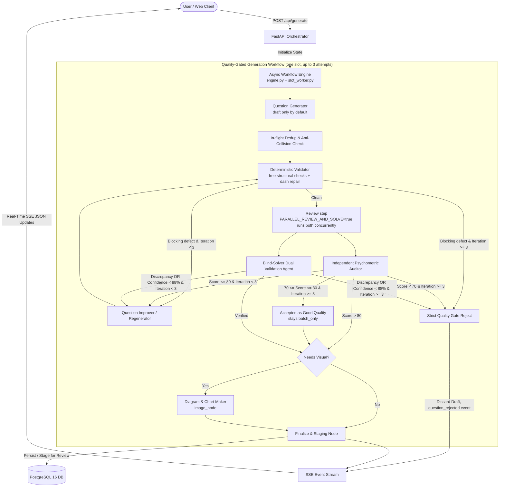

> The image node runs only after the reviewer gate and the blind solver have both passed. With the default `ALWAYS_INDEPENDENT_REVIEW=true` the generator drafts only (`generate_question`); the self-critique fused path (`generate_question_with_self_critique`) is used only when that flag is `false`, and then a self-score above the threshold skips the independent reviewer.

### 1.2 Dual First-Class AI Inference Architecture

The multi-agent workflow is architected with a decoupled, provider-agnostic inference layer orchestrated by **LiteLLM**. The active inference engine is switchable on demand via the `ACTIVE_LLM_PROVIDER` environment variable without code modifications (`deepinfra` is the default; `anthropic` and `openai` are also wired in `core/config.py`, the latter with `OPENAI_MODEL=gpt-4o-mini` by default):

1. **DeepInfra Provider (`ACTIVE_LLM_PROVIDER=deepinfra`)**:
   - **Primary Model**: `deepinfra/deepseek-ai/DeepSeek-V4.1-Flash-1017`
   - **Characteristics**: Extreme throughput (~110-140 tok/s), 1,024,000-token context window, sub-second TTFT (Time-To-First-Token).
   - **Official Rate Card**: $0.20 input / $0.60 output per 1M tokens (standard price; $0.006 cached input; a 51% promo of $0.098 / $0.294 is also listed by DeepInfra).
   - **Visual Stimuli**: Integrated with `black-forest-labs/FLUX-2-klein-4b` ($0.014/unit base rate).

2. **Anthropic Provider (`ACTIVE_LLM_PROVIDER=anthropic`)**:
   - **Primary Model**: `ANTHROPIC_MODEL`, default `claude-haiku-5-5`. Any model id containing `claude` (or prefixed `anthropic/`) is treated as an Anthropic model by `config.is_anthropic_model`; the code does not enforce a fixed alias list.
   - **Characteristics**: High nuance and instruction obedience, 200,000-token context window.
   - **Official Rate Card (Claude Haiku 5.5)**: $0.10 input / $0.50 output per 1M tokens ($\le$ 100K prompt); $0.50 input / $2.50 output (> 100K prompt).
   - **Prompt Caching Accounting**: First-class tracking for Anthropic ephemeral cache read ($0.01 / 1M tokens) and cache creation ($0.125 / 1M tokens) with automatic mathematical price calculations.

All providers use the same configured temperature parameters (`GENERATOR_TEMPERATURE = 0.5` for drafting variety, `PASSAGE_TEMPERATURE = 0.7`, `REGENERATOR_TEMPERATURE = 0.2`, `REVIEWER_TEMPERATURE = 0.1`, `BLIND_SOLVER_TEMPERATURE = 0.1`; the second blind-solver sample uses `BLIND_SOLVER_TEMPERATURE + 0.2`) and feed identical Pydantic transfer schemas into the workflow state.

### 1.3 Autonomous In-Flight AI Copilot Suite

The application integrates an autonomous, in-flight AI Copilot suite (`app/services/ai_copilot.py`) accessible across the authoring workflow and review surfaces. Educators can calibrate rough instructions into authoritative AAMC mandates, refine active question drafts (distractors, traps, mentor explanations), audit reading passages for readability and empirical density, and synthesize high-yield clinical study guides:

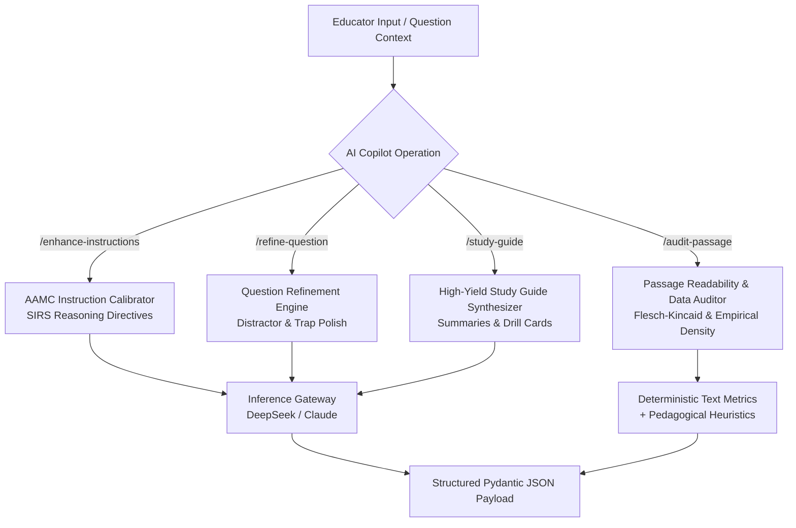

### 1.4 pgvector Semantic RAG & Anti-Collision Loop

To guarantee semantic variety and prevent conceptual collisions across generations, the repository utilizes native PostgreSQL `pgvector` indexing with high-dimensional embeddings (`vector(1536)`, `EMBEDDING_DIMENSION`). High-scoring exemplars are retrieved to ground prompts, while nearest-neighbor avoidance stems steer the generator away from previously tested hypotheses:

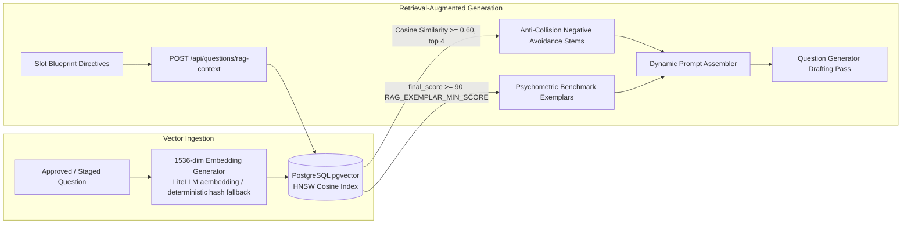

### 1.5 5-Slot Cognitive Passage Set Specialization & Attempt Rotation

Passage-based sets enforce a five-tier cognitive blueprint (`app/workflow/passage_blueprints.py`) ensuring distinct pedagogical archetypes for CARS and Science sections. When a slot is re-attempted after a rejection (`WORKFLOW_MAX_WORKER_RETRIES = 2`, so up to 3 attempts per slot), the slot-specific application domain (CARS slot 4) or experimental condition (science slot 5) rotates through a 10-entry pool so a retry does not repeat the same perturbation:

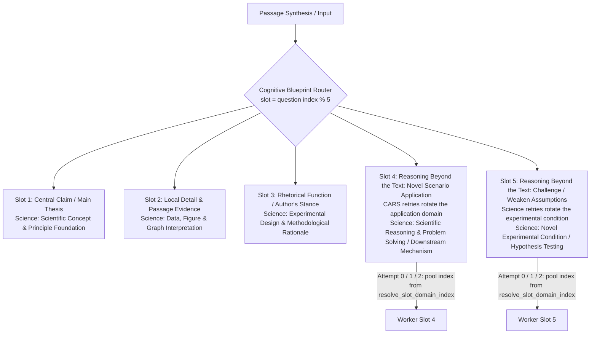

### 1.6 ASGI Middleware Pipeline & Network Optimization

All HTTP traffic entering the FastAPI service passes through an ordered, high-performance ASGI middleware stack designed to optimize network bandwidth, ensure strict security headers, correlate distributed logs, and capture telemetry:

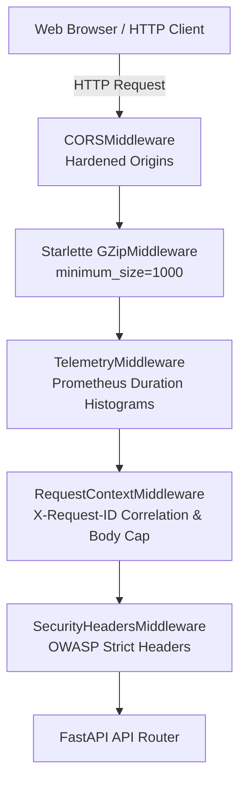

The order above is the request-processing order, outermost first, as registered in `backend/app/main.py` (`add_middleware` calls are applied in reverse: SecurityHeaders, RequestContext, Telemetry, GZip, then CORS last, which makes CORS outermost).

1. **GZip Response Compression (`GZipMiddleware`)** (second in the stack, after CORS):
   - Configured with `minimum_size=1000` (1 KB threshold).
   - Automatically compresses large JSON exports, question batches, and bank datasets by **70–85%**, cutting network transfer latency.
   - Bypasses micro-responses ($<1\text{ KB}$, e.g. health checks and heartbeats) to prevent compression CPU overhead.
   - Bypasses Server-Sent Events (`text/event-stream` at `/api/generate`), allowing immediate chunk-by-chunk event delivery without buffering delays.
2. **Security Headers (`SecurityHeadersMiddleware`)**:
   - Injects `X-Content-Type-Options: nosniff`, `X-Frame-Options: DENY`, `X-XSS-Protection: 1; mode=block`, `Referrer-Policy: strict-origin-when-cross-origin`, and restrictive `Permissions-Policy`.
3. **Request Correlation & Size Enforcement (`RequestContextMiddleware`)**:
   - Inspects or generates an `X-Request-ID`, binds it to Python log context via `bind_log_context`, and echoes it on every HTTP response.
   - Enforces `MAX_REQUEST_BODY_MB`: a declared `Content-Length` over the limit gets HTTP 413 before the body is read, and bytes are also counted as they stream in so chunked bodies without a `Content-Length` are cut off at the same limit (the handler then sees a disconnect).
4. **Prometheus Telemetry (`TelemetryMiddleware`)**:
   - Observes request latency in seconds and increments Prometheus status counters by endpoint and HTTP verb.

---

## 2. Multi-Agent Quality-Gated Workflow

The workflow enforces a strict psychometric quality contract. A question **must score higher than 80 out of 100** on the psychometric rubric (`PASSING_SCORE_THRESHOLD`) and pass **Blind-Solver independent validation** to be approved for publication. The one exception is the final remediation cycle (iteration 3): a draft that still scores between 70 and 80 (`threshold - 10` up to `threshold`) and whose blind solver verifies the key is accepted as **Good Quality** and kept as `batch_only` (see `route_after_review` in `workflow/routes.py`); a draft below 70, or one the blind solver rejects, is rejected at that point.

### 2.1 Workflow State Diagram

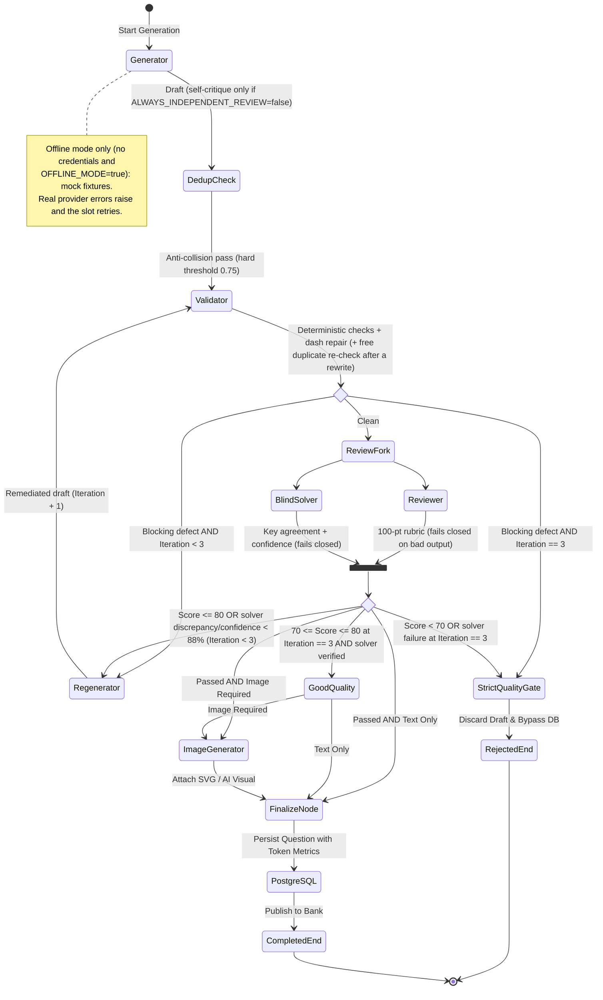

Notes on the diagram: with `PARALLEL_REVIEW_AND_SOLVE=true` (the default) the reviewer and blind solver run concurrently and the solver verdict is applied after the reviewer verdict has been routed (a solver failure on a draft that fails review still bills the solver). With it `false` the solver runs only after the reviewer gate passes. A failed solver verdict caps the review's `total_score` at 75 and sets `passed = False` (`build_solver_update` in `node_reviewer.py`). If the reviewer score is at or below the threshold, or the review is marked not passed, the draft is routed to the Regenerator while iteration < 3; the blind solver failure at iteration 3 is always a rejection (`review_loop.py`).

### 2.2 Reviewer-Regenerator Visual Preservation Lifecycle

To ensure that standalone questions requiring medical imaging or scientific figures are never inadvertently stripped during remediation, the workflow implements an explicit visual preservation boundary:

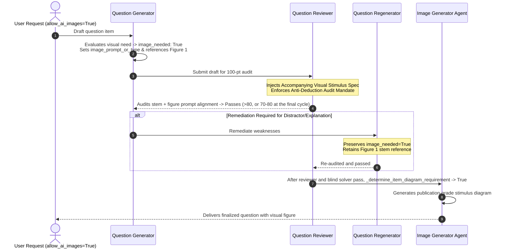

### 2.3 Unified Quality Threshold Architecture

The system implements a unified psychometric quality threshold model to ensure uncompromising question quality across both live single sessions and batch generation jobs:

| Gate | Governing Threshold | Scope & Application | System Consequence |
| :--- | :---: | :--- | :--- |
| **Quality Gate** | **$> 80$ Points**<br>`PASSING_SCORE_THRESHOLD = 80` | Applied to every candidate question drafted in live sessions or batch workers (`config.passes_quality_gate`, strictly greater than). | Questions scoring $> 80$ qualify for the **AI Validated** repository (`status = 'ai_validated'`) once their batch completes, or straight away for standalone runs. Candidate items scoring $\le 80$ are remediated while iteration < 3. |
| **Good Quality hold** | **$70 \le \text{score} \le 80$**<br>`BATCH_PASSING_SCORE_THRESHOLD = PASSING_SCORE_THRESHOLD - 10` | Reached at the final remediation cycle (iteration 3) in `route_after_review`, and by `determine_question_status` for persisted scores. | Accepted and stored as `batch_only` (Good Quality). Scores below 70 are rejected at iteration 3 and persisted statuses below 70 are `below_threshold`. |

> `route_after_review` and `determine_question_status` treat 70 as inclusive (`>= threshold - 10`); `config.passes_quality_gate` (strictly `> PASSING_SCORE_THRESHOLD`) is the only gate helper left in `core/config.py` (the unused `passes_batch_quality_gate` was removed).

### 2.4 Passage Set Cognitive Blueprints & Attempt Replenishment Rotation

For passage-based question sets (standard 5-question passage blocks), the generator enforces pedagogical slot blueprints defined in [`backend/app/workflow/passage_blueprints.py`](../backend/app/workflow/passage_blueprints.py):

#### Cognitive Slot Archetypes
The static blueprints are `CARS_PASSAGE_SET_BLUEPRINTS` and `SCIENCE_PASSAGE_SET_BLUEPRINTS` in `passage_blueprints.py` (exact archetype strings below; the slot is `question index % 5`). In live mode `extract_passage_slot_blueprints` asks the LLM for passage-grounded directives and appends them to these static directives; offline or on failure it builds deterministic paragraph-anchored directives (`premise_excerpt`) instead.
- **Critical Analysis and Reasoning Skills (CARS)**:
  - **Slot 1** (`CARS1`): `Central Claim / Main Thesis`: the author's overarching thesis or primary communicative purpose.
  - **Slot 2** (`CARS1`): `Local Detail & Passage Evidence`: direct comprehension of a concept or relationship in the early paragraphs.
  - **Slot 3** (`CARS2`): `Rhetorical Function / Author's Stance`: the function of a phrase, metaphor or cited example in the middle of the passage.
  - **Slot 4** (`CARS3`): `Reasoning Beyond the Text: Novel Scenario Application`: extrapolation to a new scenario; the scenario domain is drawn from `CARS_SLOT4_APPLICATION_DOMAINS`.
  - **Slot 5** (`CARS3`): `Reasoning Beyond the Text: Challenge / Weaken Assumptions`: a counter-finding that challenges an assumption in the concluding paragraphs.
- **Science Sections (Chem/Phys, Bio/Biochem, Psych/Soc)**:
  - **Slot 1** (`Skill_1`): `Scientific Concept & Principle Foundation`.
  - **Slot 2** (`Skill_4`): `Data, Figure & Graph Interpretation`.
  - **Slot 3** (`Skill_3`): `Experimental Design & Methodological Rationale`.
  - **Slot 4** (`Skill_2`): `Scientific Reasoning & Problem Solving / Downstream Mechanism`.
  - **Slot 5** (`Skill_2`): `Novel Experimental Condition / Hypothesis Testing`: predict the outcome of a follow-up perturbation drawn from `SCIENCE_SLOT5_EXPERIMENTAL_CONDITIONS`.

#### Dynamic Replenishment Attempt Rotation (`resolve_slot_domain_index`)
Both rotation pools (`CARS_SLOT4_APPLICATION_DOMAINS`, `SCIENCE_SLOT5_EXPERIMENTAL_CONDITIONS`) have **10** entries; the full lists are in [`MCAT_RUBRIC.md`](MCAT_RUBRIC.md) §9.2. When a slot is re-attempted after rejection:
- `resolve_slot_domain_index(req, attempt)` returns an index 0-9:
  - If `req.thematic_angle` contains `job #N` or `set #N`: `(N - 1 + attempt) % 10`.
  - Otherwise, if a seed string exists (`passage_id`, else `batch_id`, else `thematic_angle`, else `run_id`): `(abs(hash(seed)) + attempt) % 10`. This uses Python's built-in `hash`, so the index is only stable within one process unless `PYTHONHASHSEED` is fixed.
  - With no seed at all: `attempt % 10`.
- The retry directive in `slot_worker.py` applies the rotated domain only to question indexes `idx % 5 == 3` for CARS (the slot 4 position) and `idx % 5 == 4` for science sections (the slot 5 position); all other slots get a generic "formulate a completely distinct question" retry directive.
- `passage_prep._build_batch_worker_request` also embeds the rotated domain or condition in the slot directive when no dynamically extracted blueprints are supplied.
- The former `MODALITY_ROTATION_BY_SECTION` table (unused outside tests) was removed from `passage_blueprints.py`; medical modality selection lives in `agents/medical_imaging.py` (`MedicalModality` ids) and the prompt builder.

#### Per-Slot Hard Call Budget
- **Budget Ceiling**: `MAX_LLM_CALLS_PER_SLOT = 36` (default; `0` disables the cap). It is a flat cap on LLM calls (drafts, duplicate rewrites, regenerations, review and solve samples) across all attempts of one slot. The "3 attempts x 12 calls" figure in older notes is only the rationale for the number, not a computed quantity.
- Once the budget is exhausted, the review loop and the slot retry loop stop before paying for another call and reject the slot with a clear reason (`LLM call budget (36) exhausted for this question slot.`).

---

## 3. Agent Specifications & Prompt Engineering

The system coordinates specialized autonomous engines with a deterministic quality gate:

### 3.1 Question Generator and Optional Fused Self-Critique (`fused_generator_node` / `generator.py`)
- **Mission**: Primary workflow entry point. Synthesizes a high-yield clinical or scientific scenario for the selected AAMC MCAT section with 4 distinct options (A, B, C, D). With the default `ALWAYS_INDEPENDENT_REVIEW=true`, `fused_generator_node` calls the draft-only `generate_question` (the independent reviewer re-scores every draft anyway, so a self-critique would be paid for and discarded). Only when `ALWAYS_INDEPENDENT_REVIEW=false` does it call `generate_question_with_self_critique`, which also returns an internal 100-point self-critique in the same LLM round trip. The node's usage entry is named `Question Generator`; the SSE stage is shown as `Question Writer & Reviewer`.
- **Core Prompt Strategy**:
  - Uses section-specific rules (e.g., enzyme kinetics and thermodynamics for Chem/Phys, rhetorical thesis and authorial intent for CARS, molecular pathways and biochemical regulation for Bio/Biochem, and behavioral theories and sociological stratification for Psych/Soc).
  - Explicitly crafts 1 definitive correct key and 3 sophisticated distractors representing realistic cognitive biases, arithmetic sign inversions, or calculation traps.
  - **Option Symmetry & Anti-Guessability Engine**: Enforces word count parity: the spread between the longest and shortest option may be at most `max(3, ceil(0.20 x mean option length))` words (`agents/standards.py`; the prompt text says "within 3 words of each other, or within 20% of the average length when options average more than 15 words"), plus parallel grammatical syntax and balanced epistemic qualification.
  - **Anti-AI Punctuation Standard**: Strictly forbids em dashes (`—`), en dashes (`–`), or double hyphens (`--`); enforces standard single hyphens (`-`).
  - **3-Part Structured Mentor Explanations**: Generates a rigorous 3-card explanation layout:
    1. *Why Option [Key] is Correct*: Establishes core intuition and step-by-step mathematical or deductive proof.
    2. *Why Other Options are Incorrect*: Itemized distractor cards dissecting why each wrong choice fails and why students are tempted.
    3. *Primary Cognitive Trap Spotlight*: Dedicated spotlight with exact Trap classification, Error Mechanism, and actionable Student Defense Strategy.
  - **Automatic (Smart AI Choice) Cognitive Trap Engine**: When `primary_trap` is `"Automatic"`, the generator evaluates the drafted item and selects the best-fit trap from the taxonomy in `backend/app/data/mcat_dependent_taxonomy.json` (`generation_options.primary_trap`, exposed as `PRIMARY_TRAPS` in `schemas/mcat.py`). It contains **25** UPPER_SNAKE ids: `CONCEPT_CONFUSION`, `WRONG_BASE`, `UNIT_CONVERSION`, `FORMULA_MISAPPLICATION`, `SIGN_CONVENTION`, `PROPORTIONALITY_ERROR`, `ASSUMPTION_MISSED`, `CAUSE_EFFECT_CONFUSION`, `CORRELATION_CAUSATION`, `CONTROL_GROUP_CONFUSION`, `VARIABLE_CONFUSION`, `SAMPLE_SIZE_BIAS`, `STATISTICAL_SIGNIFICANCE`, `GRAPH_AXIS_MISREADING`, `TABLE_COMPARISON_ERROR`, `TREND_EXTRAPOLATION`, `MECHANISM_CONFUSION`, `EXCEPTION_OVERLOOKED`, `NEGATION_MISREAD`, `SCOPE_SHIFT`, `UNSUPPORTED_INFERENCE`, `PASSAGE_CONTRADICTION`, `OVERGENERALIZATION`, `DISTRACTOR_OVERINTERPRETATION`, `ANSWER_CHOICE_CONFLATION` (internal generation taxonomy, not official AAMC labels). `normalize_primary_trap` maps free text onto these ids. A companion `likely_mistake_pattern` taxonomy (23 ids such as `USES_WRONG_REFERENCE_VALUE`, `CONFUSES_KM_VMAX`) is stored as its human-readable value text. `ALT_TRAP_ROTATION` (8 ids, `schemas/mcat.py`) is used by the engine's diversity context to re-seed traps across sibling slots and attempts.
  - **Fallback Trap Detection**: If `primary_trap` is omitted or unpopulated, `detect_primary_trap` in `agents/draft_parser.py` falls back to the request override and then to regex matching of the explanation text against the taxonomy.
  - **Self-Critique Object (only when `ALWAYS_INDEPENDENT_REVIEW=false`)**: Evaluates Authenticity, Clarity, Distractor Traps, and Explanation Rigor.
- **Review Routing**:
  - With `ALWAYS_INDEPENDENT_REVIEW=true` (default) no self-critique is requested: the draft goes to the independent Auditor and the Blind Solver in every case (`fused_self_passed` is always `false`). Setting it to `false` restores the legacy shortcut: the fused path produces an honest, evidence-based self-critique, and a self-score above the passing threshold sets `fused_self_passed=true`, which skips the Auditor (the Blind Solver still runs).
  - A draft that fails the Deterministic Validator never reaches an LLM reviewer: it is regenerated with the exact findings, or rejected once attempts are exhausted.
- **Custom Authoring Instructions Priority**:
  - Accepts educator-specified pedagogical directives (`additional_instructions`) from `GenerationRequest` via Guided Wizard Step 3.
  - Bound directly to the `AgentWorkflowState` and injected with high-priority mandate into prompt builders (`app/agents/prompt_builder.py`, `app/agents/generator.py`, and `app/agents/regenerator.py`).
  - Governs scientific constraints, clinical scenarios, calculation traps, and reasoning boundaries across passage generation, question generation, and all remediation critique cycles.
- **Modular Prompt Construction (`prompt_builder.py`)**: User-turn prompt assembly, section instructions, cognitive trap specifications, and cross-item diversity calibration strings are decoupled into [`backend/app/agents/prompt_builder.py`](../backend/app/agents/prompt_builder.py) (`_build_generator_user_prompt`). The builder is decomposed into focused, single-responsibility sub-builders: `_build_pedagogy_and_trap_block` (incorporating `_build_topic_coordinates`, `_build_skill_and_domain_metadata`, `_build_mistake_pattern_directive`, and `_build_primary_trap_directive`), `_build_stimulus_context_block` (CARS constraints, shared passages, and discrete directives), `_build_visual_stimulus_block` (imaging modalities and AI necessity assessment), and `_build_mandates_and_critique_block` (option symmetry, distractor order, and self-critique rubric), ensuring pure deterministic string assembly without external LLM side effects and strict cyclomatic complexity control (< 10).
- **Inference Gateway & Fast Model Cascade**: High-throughput enterprise reasoning model (~110-140 tok/s, Temperature: `0.5` for drafting variety, with schema and rule adherence enforced by the validator and one repair retry). Powered by `DEFAULT_TEXT_MODEL` with the `FAST_MODEL_CASCADE` property naming the active provider's fallback model.

### 3.2 Blind-Solver Dual-Validation Agent (`blind_solver.py` / `blind_solver_node`)
- **Mission**: Acts as an algorithmic test candidate, solving the drafted question completely blind without access to the author's answer key, explanation, or self-critique rubric.
- **Solving Mechanism**:
  - Receives only the scientific passage or discrete scenario and the four unlabelled options ($A, B, C, D$).
  - Independently derives the scientific solution, identifies the correct key, and assigns a numerical confidence score ($0 - 100\%$).
- **Dual-Validation Contract**:
  - **Key Agreement**: The blind-solver's selected answer key must match the draft's intended `correct_answer_id`.
  - **Confidence Benchmark**: The blind-solver's confidence must satisfy $\ge 88\%$ (`BLIND_SOLVER_CONFIDENCE_THRESHOLD = 88`).
- **Fail-Closed Behavior**: Missing or invalid solver output (bad key, missing confidence) is retried once and then raises `QualityCheckUnavailableError`; an item is never certified because the solver errored. The only bypass is offline mode (no LLM credentials configured at all).
- **Independence & voting**: With `BLIND_SOLVER_SAMPLES=2` (default) two samples solve the question concurrently on different option layouts (original and reversed; a third, rotated layout only breaks a tie when `BLIND_SOLVER_SAMPLES=3`; the second and third samples use temperature `BLIND_SOLVER_TEMPERATURE + 0.2 = 0.3`). Layout variation is skipped when an option refers to another by letter. Verification needs a strict majority on the author's key, mean confidence of the agreeing samples at or above the threshold, and no majority ambiguity flag; a split vote is never verified. The optional `BLIND_SOLVER_MODEL` runs the solver on a different model than the generator, and the figure description is included when a diagram is required. Answers are parsed from standalone letters ("Option C", "THE ANSWER IS D"), and the reasoning is requested before the key.
- **Concurrency vs cost**: By default (`PARALLEL_REVIEW_AND_SOLVE=true`, `config.py`) the Auditor and the solver run concurrently (`run_review_and_solve`), saving one LLM round trip per question at the price of billing the solver even when the review fails first (that spend is still recorded in the usage breakdown). Setting it to `false` runs the solver only for drafts the Auditor routes forward, so a weak draft costs no solver tokens.
- **Per-slot call budget**: `MAX_LLM_CALLS_PER_SLOT` (default 36) caps the LLM calls spent on one question slot across all attempts (drafts, duplicate rewrites, regenerations, review and solve samples). The review loop, the duplicate-retry loop and the slot retry loop all stop before paying for another call once it is reached; the slot is rejected with a clear reason. A rewrite that is still a hard duplicate of an existing question is sent back to the regenerator before any review or solve call is spent on it.
- **Autonomous Rerouting**:
  - If the blind solver **agrees** with high confidence ($\ge 88\%$), `blind_solver_passed = True`, and the question bypasses lengthy remediation directly to the visual engine or finalize node.
  - If the blind solver **disagrees** or has low confidence ($< 88\%$), the discrepancy proves that the distractors or stem contain genuine ambiguity or misleading premises. The workflow sets `blind_solver_passed = False`, caps the review's `total_score` at 75, sets `passed = False`, appends the solver's critique to the review weaknesses, and routes the draft to the Remediation Engine while iteration < 3. At iteration 3 a failed solver verdict is always a rejection.
- **Inference Gateway**: High-throughput reasoning model (Temperature: `BLIND_SOLVER_TEMPERATURE = 0.1` for the first sample; `max_tokens = BLIND_SOLVER_MAX_TOKENS = 2048`).

### 3.3 Independent Senior Psychometric Auditor (`reviewer.py`)
- **Mission**: Acts as an impartial Senior Psychometric Auditor, independently evaluating every candidate question that passes the deterministic validator (unless the legacy `ALWAYS_INDEPENDENT_REVIEW=false` self-score shortcut applied), including after each remediation cycle. Its usage entry is named `Question Reviewer`; the SSE stage is `Quality Reviewer`. It audits only the question item (stem, options, key, explanation), not the shared passage's length or style.
- **Evaluation Rubric (100 Points)**:
  1. *MCAT Authenticity & Scientific Rigor* (0-25 points)
  2. *Clarity & Logical Soundness* (0-25 points)
  3. *Distractor Trap Quality & Anti-Guessability* (0-25 points) - the reviewer prompt treats options within the length-parity limit as fully symmetric and deducts only for an obvious length outlier or hedging qualifiers present only in the key.
  4. *Explanation & Key Rigor* (0-25 points)
- **Quality Benchmark**:
  - Passing Score: **$> 80$** points ($81 - 100$).
  - Failing Score: **$\le 80$** points ($0 - 80$); at iteration 3 a score of 70-80 is still accepted as Good Quality (see §2.3).
- **Strict Parsing**: Every pillar score must be present and within 0-25. Missing or out-of-range scores no longer default to a passing value; `call_llm_validated` makes one repair call at temperature 0 and then fails closed (a second failure raises). Reviewer `max_tokens` is `REVIEWER_MAX_TOKENS = 4096`.
- **Visual Stimulus & Medical Imaging Audit Boundary**:
  - When `draft.image_needed` is `True`, the prompt injects the complete figure specification:
    ```
    Accompanying Visual Stimulus / Medical Imaging Figure:
    - Status: Figure is REQUIRED and will be generated based on this specification.
    - Figure Description / Prompt: {draft.image_prompt_or_type}
    ```
  - **Anti-Deduction Audit Mandate**: Enforces strict instructions in `REVIEWER_SYSTEM_PROMPT`:
    * The accompanying figure IS generated and provided directly to the examinee beneath the question stem.
    * The Auditor **must not penalize or deduct points** from Clarity or Authenticity for referencing "Figure 1", "the diagram below", "the radiograph", "the histopathology slide", or "the plot".
    * The Auditor **must not instruct the author to remove the figure reference** or replace the figure with text numbers. AAMC items legitimately present empirical findings through figures.
    * The Auditor evaluates whether the stem, options, and explanation logically align with the figure described in the specification.
- **Output**: Returns numerical pillar scores, observed strengths, specific weaknesses, and actionable remediation instructions.
- **Inference Gateway**: High-throughput enterprise reasoning model (Temperature: `0.1` for objective, deterministic evaluation).

### 3.4 Autonomous Remediation Engine (`regenerator.py`)
- **Mission**: Triggered (usage entry `Question Re-Generator`, SSE stage `Question Improver`) when the score is $\le 80$, the review is marked not passed, the blind solver fails, or the deterministic validator or duplicate re-check finds a blocking defect, while iteration < 3. It digests the exact critique, distractor deficiencies, dissenting blind-solver rationales, and recommendations to repair the draft.
- **Rules & Visual Preservation**:
  - Fixes borderline ambiguities, equalizes option lengths, and sharpens distractor plausibility.
  - Deepens step-by-step rationales explaining why the key is incontrovertible and why every distractor fails.
  - **Rule 12 (Visual Stimulus & Medical Imaging Preservation)**: When an accompanying figure is specified (`orig_img_needed == True`), the regenerator **MUST preserve** `image_needed: True` and retain references to "Figure 1" or the diagnostic imaging finding. It is strictly forbidden from stripping the figure or converting empirical visual data into text math unless specifically instructed that a visual is disallowed.
  - `_parse_regenerated()` guarantees that `orig_img_needed` is preserved in the returned `QuestionDraft`.
  - Sends the updated draft back through the deterministic gate (and a free duplicate re-check) before the Reviewer re-audits it.
- **Inference Gateway**: High-throughput enterprise reasoning model (Temperature: `0.2` for disciplined remediation).

### 3.5 Strict Quality Gate (`reject_node` in `app/workflow/node_finalize.py`, routing in `routes.py`)
- **Mission**: Deterministic circuit breaker (`nodes.py` is only a re-exporting facade; `reject_node` is implemented in `node_finalize.py`). `route_after_review` works as follows (`MAX_REGENERATION_ATTEMPTS = 3`):
  - Score $> 80$ and review not failed: proceed (image node if required, else finalize).
  - Score $\le 80$ or review failed, iteration < 3: route to the Regenerator.
  - Iteration 3 and score $\ge 70$ (`threshold - 10`): accepted as **Good Quality** and proceeds (stored `batch_only`); the blind solver must still verify it, and a failed solver verdict at iteration 3 is a rejection.
  - Iteration 3 and score $< 70$: reject.
  - No review at all counts as score 0 (fail closed).
- **Safety Guarantee**:
  - **Bypasses Image Generation**: Prevents wasted computation and unnecessary token expenses.
  - **Discards from Database**: Zero substandard questions enter the PostgreSQL repository.
  - **Diagnostic Payload**: Transmits full rejection telemetry and history via the non-terminal `question_rejected` SSE event for audit inspection.

### 3.6 Infynno Visual Stimulus & Medical Imaging Subsystem (`image_generator.py` & `medical_imaging.py`)
- **Mission**: Synthesizes publication-grade scientific figures, anatomical illustrations, and clinical diagnostic stimuli for candidate questions across natural sciences (Chemical and Physical Foundations, Biological and Biochemical Foundations). Strictly disabled for CARS in compliance with official AAMC exam guidelines.
- **Autonomous Medical Modality Classification (`medical_imaging.py`)**:
  The system analyzes the question stem, reading passage, and educator custom instructions using calibrated regex pattern recognition to autonomously classify stimuli into one of seven medical and scientific modalities:
  1. *Radiology (`radiology`)*: Axial, coronal, and sagittal CT scans, MRI sequences (T1, T2, FLAIR), standard chest and skeletal radiographs, sonograms/ultrasounds, PET scans, and fluoroscopy.
  2. *Histology / Histopathology (`histology`; display label "Histopathology (H&E)")*: High-resolution light micrographs featuring hematoxylin and eosin (H&E) staining, specialized tissue biopsies, cytological smears, and cellular architectures (e.g., glomerular crescents, squamous vs. columnar epithelium, Reed-Sternberg cells).
  3. *Gross Anatomy (`gross_anatomy`)*: Detailed anatomical atlas-style illustrations of organ systems, cadaveric dissections, neurovascular bundles (e.g., Circle of Willis, brachial plexus), and cardiac cross-sections. Prompts undergo automated safety sanitization to emphasize clean medical textbook illustration and eliminate gore/trauma triggers.
  4. *Cellular Electron Microscopy (`cellular_microscopy`)*: Transmission electron micrographs (TEM) and scanning electron micrographs (SEM) highlighting cellular organelle ultrastructure (e.g., mitochondrial cristae, rough endoplasmic reticulum, Golgi cisternae, ciliary axonemes).
  5. *Physiological & ECG Traces (`physiology_trace`)*: Standard 12-lead electrocardiograms, rhythm strips (P-QRS-T complexes), cardiac action potential curves, ventricular pressure-volume (PV) loops, and spirometric flow-volume loops.
  6. *Clinical Pathology (`clinical_pathology`)*: Clinical diagnostic presentations, dermatological lesions (e.g., asymmetric pigmented macules, erythema migrans), retinal fundoscopic examinations, and ocular diagnostic photography.
  7. *Scientific Diagrams (`scientific_diagram`)*: Scalable vector graphics (SVG) depicting metabolic cascades (glycolysis, Krebs cycle, electron transport chain), Lineweaver-Burk and Michaelis-Menten enzyme kinetics, laboratory assay apparatus (chromatography columns, gel electrophoresis ladders), and optical ray diagrams.
- **Dual-Provider Neural & Vector Visual Engine**:
  - *OpenAI GPT Image 2.5 (`gpt-image-2.5-flare` / `dall-e-3`)*: Token-billed from provider response usage; delivers ultra-high fidelity anatomical and radiographic representations with base64 decoded PNG/JPEG binary delivery.
  - *DeepInfra FLUX-2-klein-4b*: State-of-the-art rectified-flow transformer (`black-forest-labs/FLUX-2-klein-4b`) hosted on DeepInfra for photorealistic scientific illustrations with dynamic provider cost extraction and a flat \$0.014 unit baseline rate.
  - *Programmatic SVG Vector Engine*: Pure Python deterministic renderer generating crisp, high-DPI vector diagrams; the frontend renders it through `SafeSvg` (DOMPurify SVG profile).
- **Automated Content Moderation Safety Fallback**:
  Commercial image APIs employ automated content moderation filters that occasionally misinterpret legitimate medical and anatomical terminology (such as "organ dissection", "lesion", or "necrotic biopsy") as violative content, raising HTTP 400 content policy violations.
  The engine implements an automated retry fallback:
  - Catches provider HTTP 400 `content_policy_violation` exceptions.
  - Automatically transforms the prompt into an educational medical textbook schematic context:
    ```
    Educational medical textbook illustration, anatomical and clinical diagram,
    schematic line art, academic pre-med biology textbook style: [original description]
    ```
  - Re-executes the API call transparently without failing the generation slot or dropping the visual stimulus.
- **Unrestricted Pedagogical Visual Freedom & Autonomous Discretion**:
  - Questions are no longer restricted from generating visual stimuli based on passage association. In both discrete and passage-based modes, every question where `draft.image_needed: true` or `req.require_image: true` generates a dedicated, publication-grade figure.
  - **Standalone Question Autonomous AI Discretion Architecture**: For standalone questions when "Include Images When Needed" is enabled (`allow_ai_images: true`), visual creation is 100% dependent on autonomous AI pedagogical discretion without artificial modulo forcing (such as former `idx % 5 in (0, 2)` rules). If the question is conceptual or formulaic, `image_needed: false` is chosen and it renders cleanly as a pure text-based question with zero empty placeholders or wasted image generation tokens.
  - **Resolution of Reviewer-Regenerator Visual Stripping Paradox**:
    Earlier multi-agent iterations suffered from a feedback disconnect where standalone questions requesting empirical figures (such as Lineweaver-Burk enzyme kinetics or CT scans) had their visual figures stripped during remediation. Because the Reviewer agent was blind to `draft.image_needed` and the figure prompt, it perceived references to "Figure 1" in standalone stems as an unanswerable question flaw, docked 4 points to fail the draft at 79/100, and instructed the author to remove the figure. The Regenerator obeyed, converted the numbers into prose math, and set `image_needed: false`.
    This was completely resolved by:
    1. Passing the full visual stimulus specification (`Accompanying Visual Stimulus / Medical Imaging Figure`) to the Reviewer.
    2. Enforcing the `VISUAL STIMULUS & MEDICAL IMAGING AUDIT BOUNDARY` in `REVIEWER_SYSTEM_PROMPT`.
    3. Enforcing Rule 12 in `REGENERATOR_SYSTEM_PROMPT` and `orig_img_needed` preservation in `_parse_regenerated()`.
  - **3-Tier Discretion Safeguard**:
    1. *Form State Decoupling*: The frontend "Include Images When Needed" toggle activates `allow_ai_images: true` while defaulting `require_image: false`, granting visual permission without commanding mandatory figures.
    2. *Per-Item Request Derivation (`_build_batch_worker_request` in `passage_prep.py`)*: Each worker item request sets `require_image = req.require_image and section is not CARS` and `allow_ai_images = (req.allow_ai_images or req.require_image or req.visual_type in KNOWN_VISUAL_TYPES) and section is not CARS`. A parent request that only enables "Include Images When Needed" therefore gives every item AI discretion without mandating a figure on any of them. (There is no symbol named `is_standalone_batch` in the code; the behavior is covered by `tests/test_visuals.py::test_standalone_batch_*`.)
    3. *Unrestricted Pedagogical Prompt Discretion (`prompt_builder.py`)*: Empowers the generator with complete creative and academic freedom to include visual stimuli across all 7 medical/scientific modalities whenever an accompanying figure, clinical finding, or scientific diagram enriches or illustrates the item, while allowing the model to set `image_needed: false` when choosing a pure text-based problem.
  - **Active Full-Spectrum Modality Calibration (Anti-Clustering Architecture)** (the seven ids are `radiology`, `histology`, `gross_anatomy`, `cellular_microscopy`, `physiology_trace`, `clinical_pathology`, `scientific_diagram`):
    To prevent generative LLMs from clustering exclusively on 2D line plots (such as standard Michaelis-Menten or Lineweaver-Burk enzyme kinetics graphs), the multi-agent pipeline actively drives modality diversity across three synchronized authoring layers:
    - *Prompt Builder (`prompt_builder.py`)*: Emits explicit `FULL MODALITY SPECTRUM ENCOURAGED` directives prompting the generator to actively draw from all 7 modalities—Diagnostic Radiology (chest/bone X-rays, CT scans, MRI, ultrasound), Histopathology (H&E biopsy slides, cytology smears), Gross Anatomy & Dissections, Cellular Electron Microscopy (TEM/SEM micrographs), Physiological Traces (12-lead ECG strips, cardiac action potentials, PV loops), Clinical Pathology (dermatology, fundoscopy), and Scientific Figures.
    - *Passage Methodology Scope (`generator.py`)*: Broadens passage research methodology premises beyond in-vitro laboratory assays to routinely incorporate diagnostic imaging scans, biopsy histopathology, physiological recordings, and cellular electron microscopy.
    - *Section-Specific System Calibrations (`prompts.py`)*: Calibrates section guidelines in `GENERATOR_SYSTEM_PROMPT` to embed diagnostic radiology physics (X-rays, CT attenuation, MRI resonance, ultrasound) into Chemical/Physical Foundations (CP), organ systems physiology, histology, and tissue biopsies into Biological/Biochemical Foundations (BB), and neuroimaging (brain MRI/fMRI, EEG traces) into Psychological/Social Foundations (PS).
  - **CARS Visual Suppression Safeguard**: In strict compliance with official AAMC regulations, visual stimuli are permanently suppressed for Critical Analysis and Reasoning Skills (CARS) across UI toggles, payload builder defense guards (`frontend/src/utils/batchPayload.js`), and server-side workflow validators (`passage_prep.py`).
- **Persistence & Delivery Pipeline**:
  - Images are persisted as decoded binary data or raw SVG XML in PostgreSQL `image_url` and `image_svg`.
  - Served via `GET /api/questions/{question_id}/image` with content negotiation (`image/svg+xml`, `image/png`, `image/jpeg`, or HTTP 307 CDN redirect) and strict MIME type sandboxing.

### 3.7 Question Deduplication & Collision Prevention Subsystem (`deduplication.py`)
- **Mission**: Autonomous real-time safeguard against cognitive repetition, duplicate stems, and identical question angles across the question repository. Guarantees that neither live-generated items nor high-throughput batch sets introduce redundant questions into the bank.
- **Multi-Metric Mathematical Similarity Scoring Model**:
  Operates on normalized question stems (case-folding, alphanumeric filtering, and common English/scientific stopword removal) and 4-choice distractor sets:
  $$\text{Composite Similarity} = 0.35 \times S_{\text{containment}} + 0.25 \times S_{\text{jaccard\_1gram}} + 0.20 \times S_{\text{jaccard\_2gram}} + 0.20 \times S_{\text{sequence\_ratio}}$$
  1. *Token Containment Metric* ($S_{\text{containment}}$, 35% weight): Evaluates asymmetric lexical inclusion $\frac{|T_{\text{candidate}} \cap T_{\text{reference}}|}{\min(|T_{\text{candidate}}|, |T_{\text{reference}}|)}$ to detect paraphrased questions sharing the same scientific core despite differing introductory clauses.
  2. *1-Gram Jaccard Metric* ($S_{\text{jaccard\_1gram}}$, 25% weight): Evaluates vocabulary overlap $\frac{|T_1 \cap T_2|}{|T_1 \cup T_2|}$.
  3. *2-Gram Jaccard Metric* ($S_{\text{jaccard\_2gram}}$, 20% weight): Measures preservation of adjacent scientific bigrams (e.g., "activation energy", "uncompetitive inhibition", "capillary hydrostatic pressure").
  4. *SequenceMatcher Ratio* ($S_{\text{sequence\_ratio}}$, 20% weight): Captures character-level longest contiguous matching sub-sequences via Gestalt pattern matching.
  - **Cost gating**: `evaluate_duplicate` calls the stem scorer with `prune=True`. When cheap upper bounds (`real_quick_ratio`, `quick_ratio`) prove the blended score stays under 0.35 the expensive ratio is skipped; such pairs can never be flagged, so duplicate verdicts, matched ids and flagged scores are identical (a randomized test checks this). Pools of 150+ references are scored in a worker thread so the event loop stays responsive.
  5. *Distractor Options Overlap*: `compute_options_overlap` counts an option as matched when its normalized text is identical or its sequence ratio exceeds `_OPTION_MATCH_RATIO = 0.70` (pairs whose length ratio is below `_OPTION_LENGTH_RATIO_FLOOR = 0.55` are skipped), and returns matched / max(option count). That *fraction* is then compared with separate constants: `_OPTIONS_NEAR_IDENTICAL = 0.75` (combined with stem similarity $\ge 0.40$, the score becomes `0.5 x stem + 0.5 x options`) and `_OPTIONS_SUBSTANTIAL = 0.50` (combined with stem similarity $\ge 0.50$, the score becomes `0.6 x stem + 0.4 x options`). The 0.70 per-option ratio and the 0.75 overlap fraction are two different quantities.
- **Verdict thresholds (config, not the internal stem constants)**: `is_duplicate` and `is_soft_warning` come only from `evaluate_duplicate` comparing the final score with configured thresholds:
  - **Hard duplicate** (`DUPLICATE_HARD_THRESHOLD = 0.75`): `is_duplicate = True`. Used by the in-flight anti-collision loop, batch clustering (`cluster_questions`, `find_cluster_duplicates`) and the `duplicate-clusters` endpoint default.
  - **Soft warning** (`DUPLICATE_SOFT_THRESHOLD = 0.60` up to below 0.75): `is_soft_warning = True` and a variety warning, no forced rewrite.
  - **On-demand API** (`POST /api/questions/check-duplicate`): the stricter `DUPLICATE_API_THRESHOLD = 0.80`.
  - **Semantic (embedding) check**: `dedup_inflight` also compares embeddings and flags a collision at `min(RAG_SEMANTIC_DEDUP_THRESHOLD, 0.80)`, which is 0.80 with the default `RAG_SEMANTIC_DEDUP_THRESHOLD = 0.82`.
- **Internal scoring constants (not verdict thresholds)**: inside `compute_question_similarity` the stem constants `_STEM_NEAR_DUPLICATE = 0.70`, `_STEM_SUBSTANTIAL = 0.50`, `_STEM_MODERATE = 0.40` and `_STEM_PRUNE_BELOW = 0.35` only choose which scoring branch applies (for example, stem similarity $\ge 0.70$ lets the stem score stand alone). A pair is flagged only if the resulting score reaches the config thresholds above, so "0.70" and "0.50" are not duplicate cut-offs.
- **Same-Passage Key Overlap & Containment Guard**: When two items share the same reading passage, the engine compares the correct-answer ("key") texts. A same-passage key collision is declared when the key is substantive and either key similarity $\ge 0.55$, or at least 3 shared key tokens with key containment $\ge 0.30$ or key similarity $\ge 0.25$ (`dedup_metrics.py`). Such collisions score at least 0.78; a same-passage stem similarity $\ge 0.50$ scores at least 0.76; an inverse same-passage question collision scores 0.82. These floors sit above the 0.75 hard threshold, so they are flagged. Outside the same passage, identical key rationale (key similarity $\ge 0.70$ with stem $\ge 0.35$ or options $\ge 0.50$) scores at least 0.76.
- **Retry Guidance Preservation**: When an in-flight collision triggers replenishment, the engine appends the collision directive to the existing `thematic_angle` rather than overwriting it, preserving the psychometric archetype.
- **Passage Set Cognitive Blueprints**: The per-slot archetypes (`CARS_PASSAGE_SET_BLUEPRINTS`, `SCIENCE_PASSAGE_SET_BLUEPRINTS`) live in `workflow/passage_blueprints.py`, not `passage_prep.py`; see §2.4 for the exact archetype names.
- **Autonomous Anti-Collision Loop (`_run_deduplication_anti_collision_loop` in `workflow/dedup_inflight.py`)**:
  Right after drafting (before the review step) the candidate is compared against:
  1. Questions already in PostgreSQL for the same **section** and **subtopic** (the reference pool).
  2. Previously generated sibling items of the active batch and in-flight sibling drafts (workers start staggered, see §4.2, so siblings can see each other).
  If the score reaches the hard threshold (0.75), the engine re-prompts the generator with an anti-collision directive and alternate trap re-seeding, at most `DEDUP_REGEN_MAX_RETRIES = 1` time. A similarity from 0.60 to below 0.75 only logs a variety warning. After a later regeneration, `recheck_duplicate` repeats the (free) check before any paid review call. The directive text is:
  ```
  CRITICAL: The drafted question is too similar to an existing item in this subtopic.
  Conflicting Item: "[matched_question_stem]"
  You MUST pivot to a completely different clinical scenario, distinct biochemical mechanism,
  or alternative calculation angle while preserving the target AAMC skill.
  ```
- **Duplicate flags, override endpoint and audit trail (backend)**:
  A flagged question carries `duplicate_info` (fields `is_duplicate`, `is_soft_warning`, `similarity_score`, `matched_question_id`, `matched_question_stem`, `matched_options`, `matched_explanation`, `match_reason`). `POST /api/questions/{id}/override-duplicate` (`override_question_duplicate`) sets `is_duplicate_override = true`, adds `is_overridden` and `overridden_at` to `duplicate_info`, and moves the question to `in_bank` (a `batch_only` question stays `batch_only`). Example stored shape:
  ```json
  {
    "is_duplicate_override": true,
    "duplicate_info": {
      "is_duplicate": true,
      "similarity_score": 0.88,
      "matched_question_id": "ref-uuid",
      "matched_question_stem": "Existing stem...",
      "match_reason": "High question stem textual overlap (88%)",
      "is_overridden": true,
      "overridden_at": "2026-10-28T17:15:00Z"
    }
  }
  ```
  **Frontend (duplicate awareness UI)**: `utils/duplicateHelpers.js` (`getDuplicateState`, `hasDuplicateAlert`, `canCompare`) turns a question's `duplicate_info` into one of four levels: `high` (the API flagged `is_duplicate`, similarity at or above `DUPLICATE_HARD_THRESHOLD` 0.75), `similar` (not flagged but `similarity_score >= DUPLICATE_SOFT_THRESHOLD`, a client constant `0.6` in `constants/mcat.js` that mirrors the backend), `overridden` and `none`. `components/duplicates/` holds `DuplicateRiskBadge` (button that opens the comparison when given `onClick`), `DuplicateAlertBar` (alert with the reason plus Compare and Override and approve actions; a calm note once overridden) and `DuplicateCompareModal` (this question next to the original from `duplicate_info`, no extra fetch). They appear as a badge on the review-queue card (`AiValidatedQuestionCard`), on batch question items (`BatchQuestionItem`, with Compare and Override actions and a `dup-risk` accent), on Question Bank rows (only when the level is not `none`) and as an alert bar in the Question Bank inspector (`QuestionCard`). `hooks/useDuplicateOverride.js` calls `overrideQuestionDuplicate` (`POST /api/questions/{id}/override-duplicate`) on a direct click, toasts the result and hands the returned question to the view; the review queue's `A` shortcut opens the comparison instead of saving when the active question is a `high` duplicate that has not been overridden. In the batch monitor, `components/batch/BatchDuplicateAudit.jsx` with `hooks/useBatchDuplicateAudit.js` runs on demand only (never on a poll): **Check duplicates** calls `fetchBatchDuplicateClusters` (`GET /api/batches/{id}/duplicate-clusters`) and lists the groups, **Resolve duplicates** (after a confirmation) calls `resolveBatchDuplicates` with `action: "archive"` (the default, recoverable) and shows how many questions the batch is now short of its target.
- **Batch Duplicate Cluster Resolution**:
  `GET /api/batches/{id}/duplicate-clusters` (optional `threshold` query, 0.5 to 1.0, default 0.75) returns clusters of mutually similar active questions, each with an elected leader (highest score, or a caller-chosen leader). `POST /api/batches/{id}/resolve-duplicates` resolves them: `action="archive"` (the default) sets duplicates to status `discarded` (recoverable), while `action="delete"` permanently removes them via `hard_delete_questions_batch`. The runner's `auto_resolve_batch_and_refill` uses the same clustering but always permanently deletes the redundant duplicates (`hard_delete_questions_batch`), trims any set that exceeds its target (lowest scores first), and then refills any deficit (up to `MAX_REFILL_CYCLES = 3` rounds, with a small over-generation buffer of 1 or 2 questions).

---

### 3.8 Deterministic Validator (`validators.py`)
- **Mission**: Free, pure-Python structural checks that run before any LLM review, so structural defects are caught for certain instead of depending on a model's opinion.
- **Blocking checks**: exactly four unique options A-D; valid key present and in the options (single key for single-choice); no all/none-of-the-above; no empty stem, option or explanation.
- **Authoring standards** live in `agents/standards.py` and are quoted by every prompt, the validator and the reviewer: option length spread within `max(3, ceil(20% of the mean))` words (a spread above twice that limit is a blocking defect; between 1x and 2x it is a warning), and passage length bands of 300-500 words (sciences) and 500-600 words (CARS; a passage more than 25% outside the band blocks, anything else outside it warns). The blocking length rule is not applied to offline mock fixtures.
- **Auto-repair**: em dashes, en dashes and `--` are replaced with a single hyphen (`sanitize_draft_dashes`) before validation, enforcing the Anti-AI Punctuation Standard in code, not only in prompts.
- **Warnings (recorded, non-blocking)**: option length ratio above 1.25, correct answer being the longest option, passage word band, unaddressed distractors. The verdict is stored in `stage_outcomes["deterministic_validation"]`.
- **Remediation**: blocking findings are packaged as a failing review so the regenerator fixes exactly those defects.

### 3.9 Fail-Closed Generation Policy
- Reviewer, Blind Solver, Generator, Fused Generator, Passage Writer and Regenerator use heuristic or mock fixtures **only** when no LLM credentials are configured **and** `OFFLINE_MODE=true` is set explicitly (demos and offline tests). Without the flag, a missing key raises `LLMNotConfiguredError`, the run fails fast with a clear message (no slot retries), and mock-produced questions are tagged `stage_outcomes.offline_mode`.
- Any real provider failure raises instead; the per-slot retry in `slot_worker.py` (`WORKFLOW_MAX_WORKER_RETRIES = 2`, i.e. up to 3 attempts per slot) absorbs it and emits `question_failed` if all attempts fail. No canned question is ever saved in place of a failed generation.
- **Validated outputs**: every agent parses model JSON through `call_llm_validated` (`agents/base.py`). Invalid output (missing stem/explanation/key, key not among the options, not 4 options, non-object JSON, out-of-range scores) gets exactly one repair call at temperature 0 that shows the model its own reply and the error; both calls are billed. A second failure raises, so nothing malformed becomes a default (a missing answer key is never guessed as option A, and design metadata such as the trap and AAMC skill is carried over by the regenerator instead of being re-invented).
- Truncated completions (`finish_reason == "length"`) are retried with a doubled token budget up to `LLM_MAX_TOKENS_CEILING` rather than being "repaired" from partial JSON.

---

## 4. State Management & Lifecycle

Workflow state is tracked via a typed dictionary `AgentWorkflowState` defined in [`backend/app/workflow/state.py`](../backend/app/workflow/state.py):

```python
class AgentWorkflowState(TypedDict, total=False):
    # Request & context configuration
    request: dict[str, Any]  # Original GenerationRequest parameters
    run_id: str
    batch_id: str | None
    diversity_context: str | None  # Cross-item trap/mistake diversity + RAG context
    passing_threshold: float
    slot_prior_calls: int  # LLM calls spent by earlier attempts of this slot

    # Authoring & review lifecycle
    current_draft: dict[str, Any] | None
    current_review: dict[str, Any] | None
    iteration_count: int  # 1, 2, 3
    iterations_history: list[IterationHistoryEntry]
    fused_self_passed: bool  # legacy shortcut (ALWAYS_INDEPENDENT_REVIEW=false)
    status: str
    active_agent: str
    log_messages: list[str]
    blind_solver_result: dict[str, Any] | None  # set by build_solver_update
    blind_solver_passed: bool | None
    is_duplicate_override: bool

    # Deduplication state
    duplicate_info: DuplicateInfoDict | None
    regenerated_pending_dedup: bool  # request a free duplicate re-check after a rewrite

    # Visual stimulus & medical imaging
    image_url: str | None
    image_svg: str | None
    image_description: str | None
    visual_medical_category: str | None
    visual_clinical_description: str | None

    # Finalization & rejection payloads
    final_question: dict[str, Any] | None
    rejection_data: RejectionData | None

    # Telemetry, tokens, and billing
    total_tokens: int
    total_prompt_tokens: int
    total_completion_tokens: int
    total_cost_usd: float
    agent_usage_breakdown: list[AgentUsageEntry]
    latest_usage: dict[str, Any] | None
    stage_outcomes: StageOutcomes  # drafting, quality_audit, blind_solver_validation, ...
```

(Abridged from `backend/app/workflow/state.py`. `blind_solver_result` and `blind_solver_passed` are written by `node_reviewer.build_solver_update` and `is_duplicate_override` carries the override flag; all three are declared on the `TypedDict`.)

### 4.1 State Accumulation Pattern
At each node execution, token consumption from the LLM response is unpacked and added to cumulative state counters (`record_agent_usage`). Entries in `agent_usage_breakdown` use these **usage names**, which differ from the SSE `agent_name` values (given in parentheses):
1. `fused_generator_node`: appends a `Question Generator` entry (SSE: `Question Writer & Reviewer`); it covers the draft and, only when `ALWAYS_INDEPENDENT_REVIEW=false`, the self-critique.
2. `regenerator_node`: appends a `Question Re-Generator` entry (SSE: `Question Improver`).
3. `reviewer_node` / `run_review_and_solve`: append a `Question Reviewer` entry (SSE: `Quality Reviewer`) and record the audit in `iterations_history`.
4. `blind_solver_node` / `build_solver_update`: append a `Blind-Solver Dual Validation` entry (same name in SSE). If the solver ran in parallel with a failing review, `build_usage_only_update` still records its spend.
5. `image_node`: appends the usage dict returned by `generate_image_stimulus` (entry name `Image Generator`; SSE: `Diagram & Chart Maker`).
6. `Passage Writer` entries for the shared passage come from `passage_prep.py` (same name in SSE).
7. `finalize_node`: Binds final accumulated totals and itemized breakdown directly into the `Question` schema for database persistence (`token_usage_details`).
Each entry (`AgentUsageEntry`) holds `agent`, `iteration`, `prompt_tokens`, `completion_tokens`, `total_tokens`, `cost_usd`, `calls` and an optional `duration_ms`; there is no `model` field.

### 4.2 Modular Execution Architecture (`engine.py` and its helper modules)
The streaming execution pipeline is implemented in [`backend/app/workflow/engine.py`](../backend/app/workflow/engine.py) via `run_workflow_stream` and `run_workflow`. The engine resolves the run layout (`RunLayout`), keeps per-slot spend in a `SlotLedger`, and delegates per-question slot lifecycles to an isolated worker; orchestration helpers live in dedicated modules:
- [`stream_emitter.py`](../backend/app/workflow/stream_emitter.py): `drain_event_queue` encapsulates bounded queue polling, consumer timeout handling, and backpressure enforcement (the queue is created in `engine.py` with `_EVENT_QUEUE_MAX = 256`), while `format_sse_event` and `build_terminal_workflow_event` manage SSE event data framing and terminal completion/rejection/error event assembly.
- [`slot_worker.py`](../backend/app/workflow/slot_worker.py): `run_slot_worker(ctx: SlotWorkerContext)` encapsulates the attempt/replenishment lifecycle for a single slot, handling generation attempts, in-flight anti-duplication, review loops, image generation, and slot finalization.
- [`passage_prep.py`](../backend/app/workflow/passage_prep.py): `_build_batch_worker_request` (per-item request), `_determine_item_diagram_requirement`, `_prepare_shared_passage_and_visual` (drafts shared stimulus and diagram, emits the `Passage Writer` events). It re-exports the blueprint symbols.
- [`passage_blueprints.py`](../backend/app/workflow/passage_blueprints.py): `CARS_PASSAGE_SET_BLUEPRINTS`, `SCIENCE_PASSAGE_SET_BLUEPRINTS`, `CARS_SLOT4_APPLICATION_DOMAINS`, `SCIENCE_SLOT5_EXPERIMENTAL_CONDITIONS`, `resolve_slot_domain_index` and `extract_passage_slot_blueprints`.
- [`review_loop.py`](../backend/app/workflow/review_loop.py): `_run_question_review_loop` runs the free deterministic gate (a failing gate is turned into a synthetic failing review by `_validator_review`: all four pillars 15, `total_score` 60, `passed=False`; no LLM is called), the reviewer, the Blind-Solver and the Question Improver remediation cycles against the 100-point rubric, under the per-slot LLM call budget.
- [`dedup_inflight.py`](../backend/app/workflow/dedup_inflight.py): duplicate detection against the database pool, staged siblings and in-flight sibling drafts, with anti-collision regeneration (`DEDUP_REGEN_MAX_RETRIES = 1`) and retry guidance preservation.
- [`live_job_store.py`](../backend/app/workflow/live_job_store.py): `_persist_live_question` and the job/batch finalisation, cancellation and failure handlers for standalone live runs.
- [`routes.py`](../backend/app/workflow/routes.py): `route_after_review` implements Quality Gate routing for review outcomes (advancing passing items, routing to remediation, accepting a 70-80 score as Good Quality at the final iteration, or rejecting upon retry exhaustion; see §3.5).
- [`sse.py`](../backend/app/workflow/sse.py): only `iter_sse_events`, the parser that turns the engine's `data: ...` text stream back into event dicts (used by the batch worker). SSE keepalive is not here: `with_keepalive` in [`api/v1/generation.py`](../backend/app/api/v1/generation.py) emits a `: keepalive` comment every `SSE_KEEPALIVE_SECONDS = 15` seconds.
- **Staggered worker start**: `engine.py` delays worker `w_idx` by `min(WORKER_STAGGER_SECONDS (0.35) x w_idx, WORKER_STAGGER_MAX_SECONDS (2.0))` so siblings can see each other's in-flight stems for deduplication; per-slot retry pauses are `SLOT_REPLENISH_DELAY_SECONDS = 0.5` and `SLOT_ERROR_RETRY_DELAY_SECONDS = 1.0` (`slot_worker.py`).
- **SSE event types**: `workflow_start`, `agent_start`, `agent_complete`, `agent_action`, `batch_progress`, `question_generated`, `question_rejected`, `question_failed`, `workflow_complete`, `workflow_rejected`, `workflow_error`. SSE `agent_name` values: `Passage Writer`, `Question Writer & Reviewer`, `Quality Reviewer`, `Blind-Solver Dual Validation`, `Question Improver`, `Quality Gate`, `Diagram & Chart Maker`, `System`, `System Error`.
- [`state.py`](../backend/app/workflow/state.py): `AgentWorkflowState` typed data contracts defining the active workflow context.
- **Lifecycle Node Partitioning**: The discrete graph nodes are partitioned across specialized modules:
  - [`node_generator.py`](../backend/app/workflow/node_generator.py): `fused_generator_node`, `agent_usage_entry`, and `_record_agent_usage`.
  - [`node_reviewer.py`](../backend/app/workflow/node_reviewer.py): `reviewer_node`, `ReviewAndSolveOutcome`, `run_review_and_solve`, `blind_solver_node`, `regenerator_node` and the state-update builders `build_review_update`, `build_solver_update`, `build_usage_only_update`.
  - [`node_finalize.py`](../backend/app/workflow/node_finalize.py): `reject_node`, `image_node`, and `finalize_node`.
  - [`nodes.py`](../backend/app/workflow/nodes.py): Transparent facade re-exporting all symbols in `__all__` with dynamic `_WorkflowNodesFacade` monkeypatch routing.

---

## 5. Background Batch Execution Service (`batch_runner.py`)

The backend utilizes an asynchronous worker pool managed by [`backend/app/services/batch_runner.py`](../backend/app/services/batch_runner.py) governed by a unified 5-question Job architecture. `launch_background_batch` accepts any `questions_to_generate` from 1 to 50 and splits it into `ceil(target / QUESTIONS_PER_JOB)` jobs with `QUESTIONS_PER_JOB = 5` (so 12 questions become jobs of 5, 5 and 2). The wizard exposes two presets, 5 and 50 questions:

1. **5 Questions (1 Single Job)**:
   - Dispatches a single background worker job comprising 5 questions linked to a shared reading passage (or 5 discretes).
   - Generates and self-audits within ~35-50s, streaming real-time status and automatically staging passing items (`score > 80`) into the **AI Validated** bank (`status = 'ai_validated'`).
2. **50 Questions (10 Parallel Jobs)**:
   - Enterprise background batch spawning 10 parallel jobs (5 questions each) across the global worker pool.
   - Automatically provisions shared passages per job, coordinates concurrent inference calls under rate-limit semaphores, and dynamically aggregates batch completion metrics.

```mermaid
graph TD
    Client[Web Client] -->|POST /api/batches/start| API[Batches API Endpoint]
    API --> Runner[launch_background_batch]
    
    Runner --> BatchDB[Create Batch Record in DB]
    Runner --> JobDB[Create Job Records in DB: ceil(target / 5), e.g. 1 for 5 Questions, 10 for 50 Questions]
    Runner --> BackgroundTask[Spawn Async Background Worker Pool]
    
    API -->|202 Accepted + Batch/Job UUIDs| Client

    subgraph "Parallel Worker Execution (1 Job [5 Qs] or 10 Jobs [50 Qs])"
        BackgroundTask --> Job1[Job 1: 5 Qs]
        BackgroundTask --> Job2[Job 2: 5 Qs]
        BackgroundTask --> Job3[Job 3: 5 Qs]
        BackgroundTask --> Job4[Job 4: 5 Qs]
        BackgroundTask --> JobDots[...]
        BackgroundTask --> Job10[Job 10: 5 Qs]
        
        Job1 --> Workflow1[Multi-Agent Workflow]
        Job2 --> Workflow2[Multi-Agent Workflow]
        Job3 --> Workflow3[Multi-Agent Workflow]
        Job4 --> Workflow4[Multi-Agent Workflow]
        Job10 --> Workflow10[Multi-Agent Workflow]
    end

    Workflow1 --> PersistQ[(Save Questions to DB with status=ai_validated)]
    Workflow2 --> PersistQ
    Workflow3 --> PersistQ
    Workflow4 --> PersistQ
    Workflow10 --> PersistQ
    
    PersistQ --> AtomicUpdate[refresh_batch_aggregates Atomic DB Sync]
    AtomicUpdate --> UpdateBatch[Update Batch & Job status to completed]
```

### 5.1 Global Worker Pool Concurrency & Rate Limiting Engine

To support heavy concurrent workloads and prevent thread starvation or provider rate limits, the batch execution engine implements multi-layered concurrency controls:

1. **Global Worker Pool Semaphore (`_GLOBAL_JOB_SEMAPHORE`, `services/batch_concurrency.py`)**:
   - Initialized as a singleton semaphore: `asyncio.Semaphore(config.GLOBAL_MAX_CONCURRENT_JOBS)` (default: **4 concurrent jobs**).
   - Constrains simultaneous job execution across **all active running batches** in the system, preventing resource exhaustion when multiple batches are launched concurrently.
2. **Global Question Pipeline Semaphore (`core/concurrency.py`)**:
   - `GLOBAL_MAX_CONCURRENT_PIPELINES` (default **8**) caps question pipelines in flight across all runs (every slot worker acquires it in `slot_worker.py`).
3. **Global LLM Concurrency Limiter**:
   - Managed via `config.GLOBAL_MAX_CONCURRENT_LLM_CALLS` (default: **10 concurrent inference calls**).
   - Enforced in `call_llm` (`agents/base.py`) for every provider (DeepInfra, Anthropic, OpenAI); it is not DeepInfra-specific. The semaphore is held only for the call itself, never during backoff.
4. **Cost and Admission Guards**:
   - `GENERATION_RATE_LIMIT_PER_MINUTE = 30` requests per client IP per minute and `MAX_ACTIVE_BATCHES = 5` concurrently running batches protect the LLM-spending routes (`POST /generate`, `/batches/start`, retry, refill); `0` disables either guard.
5. **Exponential Backoff & Rate-Limit Resilience (`call_llm` in `app/agents/base.py`)**:
   - Classifies errors (`_classify_llm_error`): rate limit (429), overloaded or server errors (500, 502, 503, 504, 529) and timeouts are *transient* and back off exponentially; connection errors retry after a short fixed pause; everything else fails immediately.
   - `LLM_MAX_RETRIES = 3` (default) means up to **4 attempts** (the first call plus 3 retries). LiteLLM's own retries are disabled (`num_retries=0`), so retries happen at exactly one layer. Transient backoff is:
     $$\text{Wait Seconds} = \text{base\_backoff} \times 2^{\text{attempt}} + \text{jitter}$$
     with `LLM_BASE_BACKOFF_SECONDS = 1.5` and random fractional jitter (0.1 to 0.5 s) to prevent thundering herd problems. Truncated completions are retried separately with a doubled `max_tokens` up to `LLM_MAX_TOKENS_CEILING`.
6. **Atomic Database State Aggregation (`refresh_batch_aggregates`)**:
   - Executes atomic SQL subqueries to calculate `completed_jobs`, `failed_jobs`, `actual_count`, `total_tokens`, and `cost_usd` directly inside PostgreSQL.
   - Eliminates read-modify-write race conditions between parallel background worker tasks.
7. **Autonomous In-Flight 3-Trials Policy & Resilient Batch Lifecycle**:
   - **Autonomous In-Flight Retries**: When executing batch jobs (`_run_single_job`), if fewer than the target number of questions are generated (e.g., due to strict psychometric threshold rejections), the runner automatically executes in-flight retries up to `MAX_JOB_TRIALS = 3` trials per set (`services/batch_worker.py`). Each trial is tracked in `job.trial_count` and persisted to PostgreSQL. Separately, each question slot inside a trial gets up to 3 attempts (`WORKFLOW_MAX_WORKER_RETRIES = 2`), and after the batch finishes `auto_resolve_batch_and_refill` can run up to `MAX_REFILL_CYCLES = 3` duplicate-resolution/refill rounds.
   - **Live Telemetry & Trial State Indicators**: Active jobs undergoing shortfall retries broadcast live `AUTO-RETRYING (X/3)` status. If all 3 trials are completed without achieving the target count, the UI displays `3/3 TRIALS EXHAUSTED`, clearly signaling that no further autonomous trials remain.
   - **Graceful Batch Halt (`POST /api/batches/{id}/stop`)**: Cancels running asyncio worker tasks and updates remaining pending jobs to `"cancelled"` while preserving all successfully generated questions in the bank.
   - **Controlled Resume Sets (`POST /api/batches/{id}/retry`)**: Strictly reserved for manually stopped or cancelled batches that have incomplete jobs with remaining trials (`trial_count < 3`). Re-launches incomplete jobs into the worker pool. If all incomplete jobs have already exhausted 3 trials, the endpoint returns an explicit **HTTP 400 Bad Request** (`All incomplete sets in batch have already reached the maximum 3-trial limit or have already completed, and cannot be retried.`), preventing infinite retry loops.
   - **Global Halt (`POST /api/batches/cancel-all`)**: System-wide fail-safe terminating all active runner tasks cleanly.

### 5.2 Dual-Track Progress Architecture & Worker Telemetry Engine

The batch execution engine implements a **Dual-Track Progress Architecture** that decouples localized set-level replenishment from global batch milestone progress:

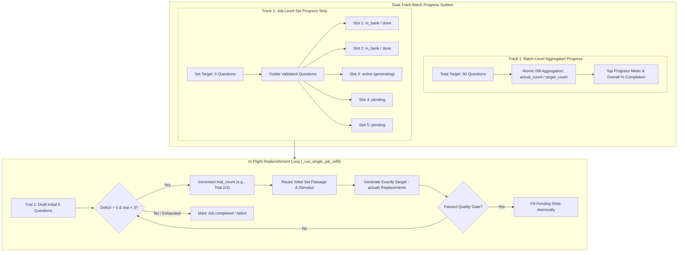

1. **Job-Level Set Progress Track**:
   - Each set displays a 5-question visual progress strip (`job-q-pill-strip`) rendering the exact state of each question slot in the set:
     - `.in-bank`: Formally approved question in the Question Bank (purple accent).
     - `.done`: Validated question passing psychometric audit and ready for review (emerald accent).
     - `.active`: Currently generating or self-evaluating candidate (pulsing electric conduit animation).
     - `.pending`: Muted placeholder slot awaiting worker assignment.
2. **Batch-Level Aggregate Track**:
   - Aggregates accepted questions across all 10 concurrent worker jobs against the total batch target (50 questions), recalculating completion percentage atomically via PostgreSQL subqueries.
3. **In-Flight Deficit Replenishment (`_run_single_job_refill`)**:
   - When a job produces fewer than 5 valid questions on its first attempt, the runner does not discard the existing approved items or create a redundant passage. Instead, it extracts the passage and stimulus from existing set items and launches targeted generation for only the shortfall deficit, incrementing `trial_count` up to 3.

### 5.3 Question Lifecycle State Machine
Every question in the system progresses through an explicit, strictly guarded lifecycle state:

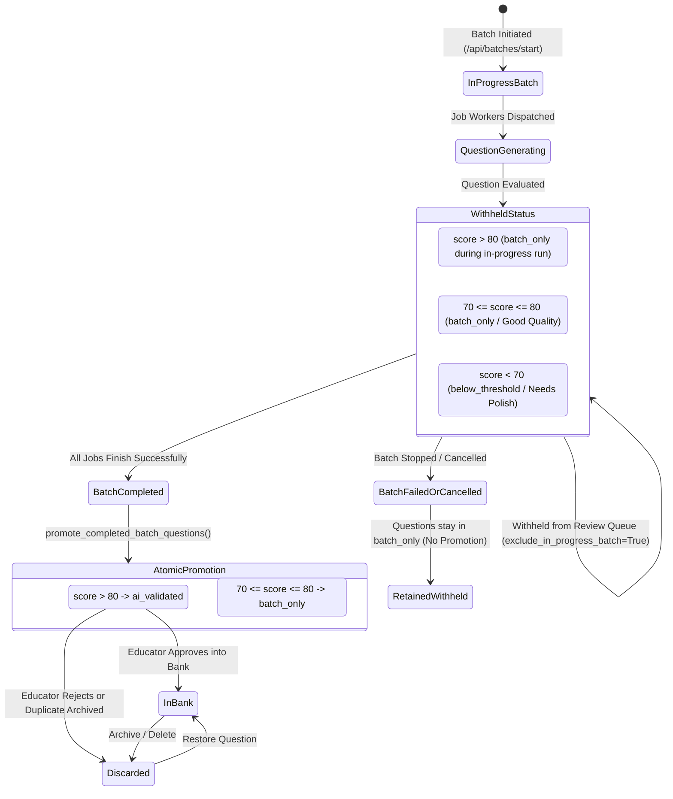

- **`batch_only`**: Active withholding and good-quality status. Candidate questions generated during in-progress batches (scoring $\ge 70$, `determine_question_status`) are saved in `batch_only` while the parent batch is running; those below 70 are `below_threshold`. This strictly prevents incomplete batches from leaking into the educator's "Ready for Review" queue. Upon batch completion, items scoring $> 80$ are promoted to `ai_validated`, while items scoring between 70 and 80 remain safely in `batch_only` as Good Quality questions.
- **`ai_validated`**: Questions that cleared the quality gate (`score > 80`, controlled by `PASSING_SCORE_THRESHOLD`, default `80`, in `core/config.py` / `.env`) whose parent batch has successfully completed (`status == 'completed'`) or that were generated in standalone runs. Atomically promoted by `promote_completed_batch_questions` and visible in the educator's review queue.
- **`in_bank`**: Formally approved questions published in the primary searchable Question Bank repository.
- **`below_threshold`**: Drafts that failed to achieve the 70-point batch threshold (`score < 70`) after 3 remediation cycles (flagged as "Needs Polish").
- **`discarded`**: Archived or rejected items removed from active question banks or resolved during duplicate clustering.
- The `ck_questions_status` CHECK constraint allows nine values in total: `in_bank`, `ai_validated`, `batch_only`, `below_threshold`, `discarded`, plus `approved`, `rejected_below_threshold`, `error` and `failed` (the last four are not produced by the flows described here; TODO: verify where, if anywhere, they are written). These four are documented in code as reserved: the pipeline never persists them and the CHECK constraint is unchanged.

### 5.4 Canonical Status Determination, Withholding Guards & Batch Idempotency

1. **Review Queue Withholding Safeguard**:
   During active batch execution, candidate questions scoring $\ge 70$ are saved with `status = 'batch_only'`. All repository search and count queries ([`backend/app/repositories/question_repository.py`](../backend/app/repositories/question_repository.py)) enforce an active subquery guard:
   ```python
   in_progress_batches = select(GenerationBatchModel.id).where(
       GenerationBatchModel.status == "in_progress"
   )
   stmt = stmt.where(
       or_(
           QuestionModel.batch_id.is_(None),
           QuestionModel.batch_id.notin_(in_progress_batches),
       )
   )
   ```
   This prevents questions from running batches from appearing in the "Ready for Review" tab or inflating repository status counts until the entire batch has cleanly completed.

2. **Atomic Batch Promotion (`promote_completed_batch_questions`)**:
   Implemented in [`backend/app/repositories/batch_repository.py`](../backend/app/repositories/batch_repository.py), this function runs atomically when a batch concludes and transitions to `"completed"` or `"partially_completed"`:
   - High-scoring questions (`final_score > config.PASSING_SCORE_THRESHOLD = 80`) in `batch_only` are promoted to `ai_validated` (making them immediately available in the educator's review queue).
   - Questions scoring between 70 and 80 (`70 <= final_score <= 80`) remain in `batch_only` for historical inspection.
   - If a batch is actively stopped, cancelled, or aborted mid-run, `promote_completed_batch_questions` is bypassed entirely, safely retaining questions in `batch_only` without polluting review queues.

3. **Dynamic Job Allocation & Exact Target Count Guarantees**:
   In [`backend/app/services/batch_runner.py`](../backend/app/services/batch_runner.py), `launch_background_batch` dynamically partitions target quotas into parallel jobs capped at 5 questions per job (`QUESTIONS_PER_JOB = 5`; a request accepts 1 to 50 questions, enforced by `GenerationRequest.questions_to_generate`):
   - 5 questions $\to$ 1 job of 5 items.
   - 50 questions $\to$ 10 jobs of 5 items.
   - 12 questions $\to$ 3 jobs of 5, 5, and 2 items.
   When duplicate resolution or quality gate dropouts create a deficit, `auto_resolve_batch_and_refill` and `refill_batch_deficit` launch targeted replacement jobs with diverse thematic angles, ensuring exact target count delivery. The pure helpers for clustering, per-job partitioning, excess trimming and deficit maths live in `services/batch_resolution.py`.
   **Thematic angles per job**: the live path uses `agents/batch_planner.py` (`resolve_batch_thematic_angle`): an LLM brainstorm of syllabus-coherent angles cached per `batch_id`, or, offline or on failure, deterministic angles of the form `Set #N: <topic> - <pedagogical aspect>` built from `CARS_PEDAGOGICAL_ASPECTS` / `SCIENCE_PEDAGOGICAL_ASPECTS`. The curated static lists in `data/thematic_angles.py` (`CARS_THEMATIC_ANGLES` and the three science lists, plus `batch_thematic_angle`) are imported and re-exported by `services/batch_worker.py` but are not called in the job path. TODO: verify whether they are intended as a fallback. The `Set #N` / `job #N` text in the angle is what `resolve_slot_domain_index` parses for slot rotation.

4. **Idempotent Batch Counter Synchronization**:
   [`backend/app/repositories/question_repository.py`](../backend/app/repositories/question_repository.py) enforces idempotent batch counter updates in `save_question`. When editing an existing question or re-saving an approved item, the repository detects the existing record and skips counter increments, preventing counter inflation across re-edits or stage-to-bank transitions.

### 5.5 AI Copilot Studio & In-Line Refinement (`app/services/ai_copilot.py`)

The AI Copilot Studio provides specialized LLM intelligence services accessible directly from the question wizard, live review cards, and passage inspection modals:
1. **Instruction Calibrator (`enhance_instructions`)**:
   - Takes raw user notes or informal instructor guidance and transforms them into an authoritative AAMC prompt mandate with authentic clinical terminology, distractors, and calculation trap directives.
2. **Question Draft Refinement (`refine_question`)**:
   - Powers the interactive `QuestionCopilotStrip` in the review workspace.
   - Executes 4 targeted editorial actions: `polish_distractor` (enhances plausibility and length parity), `simplify_explanation` (makes mentor proof more concise), `invert_sibling` (creates an inverse question targeting the opposite mechanism), and `custom` (free-form educator directives).
3. **Passage Readability & Empirical Density Auditor (`audit_passage`)**:
   - Calculates Flesch-Kincaid Reading Ease, Flesch-Kincaid Grade Level, average sentence length, paragraph counts, and experimental density (e.g. data tables, quantitative assays, hypothesis testing presence).
4. **High-Yield Study Guide Synthesizer (`synthesize_study_guide`)**:
   - Aggregates an array of verified questions to synthesize an executive summary, a checklist of high-yield cognitive traps, and flashcard drill pairs formatted for study and export.

### 5.6 Streamlined Guided Wizard & Hero Landing Architecture (`GuidedWizard.jsx`, `HeroLanding.jsx`)

The generation entry point provides a high-velocity, deterministic authoring interface that eliminates friction while enforcing AAMC psychometric standards:
1. **Accessible Hero Landing Canvas (`HeroLanding.jsx`)**:
   - Primary welcome canvas offering two clear navigational choices: launching question authoring or browsing the verified question bank.
   - 4 one-click AAMC section preset chips (**CP**, **CARS**, **BB**, **PS**) with pre-calibrated pacing, passage structure, and cognitive difficulty.
   - Full WCAG AA keyboard accessibility with native semantic `<button>` elements, dynamic `aria-label` attributes, and decorative icon hiding via `aria-hidden="true"`.
2. **3-Step Guided Wizard Dock (`GuidedWizard.jsx`)**:
   - **Step 1 (Section & Focus)**: Section selection, pacing specifications, and deep AAMC taxonomy browsing across major units, topics, and subtopics.
   - **Step 2 (Level & Format)**: Difficulty calibration (**Low**, **Medium**, **High**), format selection (Passage-Based vs. Independent), generation scope (**5 Questions** [Single Job] vs. **50 Questions** [10-Job Batch]), and clinical visual stimulus modalities.
   - **Step 3 (Review & Launch)**: Compact parameter review summary table, collapsible advanced settings accordion, and custom authoring instructions textarea with live badge telemetry (`Custom Instructions Active`).

### 5.7 pgvector Semantic RAG & Anti-Collision Shield (`app/services/rag.py`)

The pgvector RAG subsystem prevents conceptual repetition and guarantees novelty across large repositories:
1. **Vector Embedding Ingestion (`app/services/embeddings.py`)**:
   - Computes `EMBEDDING_DIMENSION` (1536) dense vectors through LiteLLM `aembedding` with `EMBEDDING_MODEL` (default `text-embedding-3-small`), authenticating with `OPENAI_API_KEY` or, if empty, `DEEPINFRA_API_KEY`. Results are cached in memory (SHA-256 key) in a bounded LRU of 1024 entries. When `OFFLINE_MODE` is on, or no key is configured, a deterministic hash-based unit vector (`deterministic_unit_vector`) is used instead. If a live provider call fails or returns an unexpected shape, no embedding is returned and nothing is cached or persisted (no fake vector is stored for a live run). There is no `sentence-transformers` / local HuggingFace backend.
   - Embeds a concatenation of section, subtopic, stem, options, key and the first 500 characters of the explanation (`build_question_embedding_text`) into `QuestionModel.embedding`.
2. **Exemplar Retrieval for In-Context Learning (`retrieve_rag_exemplar_context`)**:
   - Runs a hybrid (vector + full-text) search within the target section and subtopic and keeps matches with `final_score >= RAG_EXEMPLAR_MIN_SCORE` (default 90).
   - Injects top-scoring exemplars into Generator prompts to demonstrate authentic MCAT tone, option symmetry, and trap construction. The slot worker requests `limit=2` exemplars per slot (the API default is 3).
3. **Nearest-Neighbor Anti-Collision Shield**:
   - `find_similar_questions` ranks stored questions by pgvector cosine distance (`<=>`) over the HNSW index (`vector_cosine_ops`) and keeps up to 4 neighbors whose cosine similarity is at least `min_similarity = 0.60` as **Avoidance Stems** (stems are truncated to 160 characters).
   - Avoidance stems and the most frequent historical traps for the subtopic are passed directly into prompt builders to enforce explicit differentiation.
4. **Decomposed Deduplication Metrics (`app/services/dedup_metrics.py` & `dedup_clustering.py`)**:
   - Combines lexical token overlap (containment, 1-gram and 2-gram Jaccard, SequenceMatcher) with a pgvector similarity floor (`_vector_similarity`, when present) to detect verbatim copies, near-duplicates, and conceptual clones; thresholds are listed in §3.7. The in-flight semantic check flags at `min(RAG_SEMANTIC_DEDUP_THRESHOLD, 0.80)`.

---

## 6. PostgreSQL 16 Database Architecture

The persistence tier runs on **PostgreSQL 16** managed through **SQLAlchemy 2.0 Async** and the **`asyncpg`** driver, featuring enterprise connection pooling and idempotent startup migrations (`init_db()` in [`backend/app/db/session.py`](../backend/app/db/session.py) calls `init_db_schema` in [`backend/app/db/init_db.py`](../backend/app/db/init_db.py), which runs `Base.metadata.create_all` and then `run_schema_migrations`; the step functions themselves live in [`backend/app/db/schema_migrations.py`](../backend/app/db/schema_migrations.py)):

### 6.1 Enterprise Connection Pooling Parameters
To prevent database connection drops and handle parallel batch worker loads, the async engine (`db/session.py`) is configured from `core/config.py` with:
- `pool_size = DB_POOL_SIZE` (default `10`): Core persistent database connections maintained in the pool.
- `max_overflow = DB_MAX_OVERFLOW` (default `10`): Additional burst connections during heavy multi-batch load (default total 20 connections).
- `pool_timeout = DB_POOL_TIMEOUT` (default `60`): Seconds to wait before timing out if all connections are busy.
- `pool_recycle = DB_POOL_RECYCLE` (default `1800`): Automatically recycles connections after 30 minutes to prevent stale TCP sockets.
- `pool_pre_ping = True`: Automatically validates connection health prior to checking out.

### 6.2 Entity-Relationship Diagram (ERD)

```mermaid
erDiagram
    PASSAGES ||--o{ QUESTIONS : "contains (1:N, ON DELETE CASCADE)"
    BATCHES ||--o{ JOBS : "contains (1:N, ON DELETE CASCADE)"
    BATCHES ||--o{ QUESTIONS : "groups (1:N, ON DELETE SET NULL)"
    JOBS ||--o{ QUESTIONS : "produces (1:N, ON DELETE SET NULL)"

    PASSAGES {
        VARCHAR_64 id PK "Passage identifier"
        VARCHAR_256 title "Optional title"
        TEXT text "Shared reading passage"
        INTEGER word_count "Passage word count"
        VARCHAR_64 section "MCAT section code (indexed)"
        VARCHAR_128 subtopic "Syllabus topic (indexed)"
        TEXT image_url "Optional external or data-URI figure"
        TEXT image_svg "Programmatic inline SVG markup"
        TEXT image_description "Accessibility alt text"
        BOOLEAN is_deleted "Soft-delete flag"
        TIMESTAMPTZ deleted_at "Soft-delete timestamp"
        TIMESTAMPTZ created_at "Creation time (server default now)"
        TIMESTAMPTZ updated_at "Last update (onupdate now)"
        VECTOR_1536 embedding "pgvector embedding, HNSW cosine index"
    }

    BATCHES {
        VARCHAR_64 id PK "Batch identifier (table generation_batches)"
        VARCHAR_64 section "MCAT section code"
        VARCHAR_128 subtopic "Syllabus topic"
        VARCHAR_32 difficulty "low | medium | high"
        VARCHAR_32 passage_mode "single_passage | independent ..."
        INTEGER target_count "Questions requested"
        INTEGER actual_count "Active questions produced"
        INTEGER total_jobs "Jobs planned"
        INTEGER completed_jobs "Jobs completed"
        INTEGER failed_jobs "Jobs failed"
        INTEGER total_tokens "Aggregated tokens"
        DOUBLE cost_usd "Aggregated cost in USD"
        VARCHAR_32 status "pending | in_progress | running | completed | partially_completed | failed | cancelled | stopped"
        TEXT error_message "Sanitized error text"
        JSONB request_payload "Stored GenerationRequest (api_key stripped)"
        TIMESTAMPTZ created_at "Creation time"
        TIMESTAMPTZ updated_at "Last update"
    }

    JOBS {
        VARCHAR_64 id PK "Job identifier (table generation_jobs)"
        VARCHAR_64 batch_id FK "Parent batch (CASCADE)"
        INTEGER job_number "Sequential index within the batch"
        VARCHAR_32 status "pending | in_progress | running | completed | failed | cancelled | stopped"
        INTEGER target_count "Target items (default 5)"
        INTEGER actual_count "Produced items"
        INTEGER trial_count "Autonomous trial count (default 1, max 3)"
        VARCHAR_64 passage_id "Shared passage id (indexed, no FK)"
        INTEGER total_tokens "Job tokens"
        INTEGER prompt_tokens "Job prompt tokens"
        INTEGER completion_tokens "Job completion tokens"
        DOUBLE cost_usd "Job cost in USD"
        TEXT error_message "Sanitized error text"
        TIMESTAMPTZ created_at "Creation time"
        TIMESTAMPTZ started_at "Execution start"
        TIMESTAMPTZ completed_at "Execution end"
    }

    QUESTIONS {
        VARCHAR_64 id PK "Question identifier"
        VARCHAR_64 passage_id FK "Optional PASSAGES reference (CASCADE)"
        VARCHAR_64 batch_id FK "Optional BATCHES reference (SET NULL)"
        VARCHAR_64 job_id FK "Optional JOBS reference (SET NULL)"
        VARCHAR_64 run_id "Execution run id (indexed)"
        VARCHAR_64 section "MCAT section code"
        VARCHAR_128 section_label "Human-readable subtest name"
        VARCHAR_128 subtopic "Syllabus topic"
        VARCHAR_32 difficulty "low | medium | high"
        VARCHAR_32 status "in_bank | ai_validated | batch_only | below_threshold | discarded | approved | rejected_below_threshold | error | failed"
        BOOLEAN is_deleted "Soft-delete flag"
        TIMESTAMPTZ deleted_at "Soft-delete timestamp"
        INTEGER mcat_scaled_score "Legacy optional scaled score"
        VARCHAR_128 aamc_skill "AAMC SIRS or CARS skill"
        TEXT stimulus_text "Passage or scenario text"
        TEXT question_stem "Core question prompt"
        JSONB options "Four options [{id, text}]"
        VARCHAR_32 correct_answer_id "A | B | C | D"
        JSONB correct_answer_ids "List of correct keys"
        TEXT explanation "3-part structured rationale"
        TEXT image_url "Optional external figure URL"
        TEXT image_svg "Inline SVG markup"
        TEXT image_description "Accessibility alt text"
        INTEGER final_score "0-100 audit score (CHECK 0..100)"
        JSONB review_rubric "4-pillar scores, strengths, remediation"
        INTEGER iteration_count "Cycles executed (1-3)"
        JSONB iterations_history "Evolution log"
        INTEGER total_tokens "Tokens consumed"
        INTEGER prompt_tokens "Prompt tokens"
        INTEGER completion_tokens "Completion tokens"
        DOUBLE cost_usd "Cost in USD"
        JSONB token_usage_details "Per-agent usage breakdown"
        VARCHAR_64 combination_id "Matrix combination code"
        VARCHAR_128 content_domain "Content domain tag"
        VARCHAR_128 question_type "Question type or slot archetype"
        VARCHAR_64 interaction_type "single_choice"
        VARCHAR_128 primary_trap "Trap id (UPPER_SNAKE taxonomy)"
        VARCHAR_16 passage_required "Yes or No"
        VARCHAR_32 passage_mode "Passage mode"
        INTEGER passage_questions "Passage question count"
        VARCHAR_64 visual_type "None, SVG_Diagram, AI_FLUX_Image ..."
        VARCHAR_64 visual_medical_category "Detected image modality (indexed)"
        TEXT visual_clinical_description "Clinical figure description"
        VARCHAR_128 subject "Taxonomy subject"
        VARCHAR_128 unit "Taxonomy unit"
        VARCHAR_128 topic "Taxonomy topic"
        VARCHAR_256 subskill "Taxonomy subskill"
        TEXT likely_mistake_pattern "Targeted student misconception text"
        JSONB duplicate_info "Collision metrics and override stamp"
        BOOLEAN is_duplicate_override "Administrative override flag"
        JSONB stage_outcomes "Raw multi-stage outcome JSON"
        VECTOR_1536 embedding "pgvector embedding, HNSW cosine index"
        TIMESTAMPTZ created_at "Creation time"
        TIMESTAMPTZ updated_at "Last update"
    }
```

Source of truth: `backend/app/models/{passage,batch,job,question}.py`. Tables are `questions`, `passages`, `generation_batches` and `generation_jobs`. Questions have CHECK constraints on `section` (non-empty), `status` (the nine values above) and `final_score` (0 to 100); batches and jobs have CHECK constraints on `status`. `correct_answer_id` is `VARCHAR(32)`; there are no `subcategory`, `image_required` or `tsv_content` columns (the CSV export header `Subcategory` is filled from `subtopic`). Timestamps are `TIMESTAMPTZ` (`DateTime(timezone=True)`), not strings.

### 6.3 Passage Entity Lifecycle, Soft-Deletion & Batch Integrity
When multiple questions are generated as a passage set, they share a foreign key reference (`passage_id`) pointing to the parent `PASSAGES` record:
- **Passage Association**: Educators can browse shared passages in the Passage Bank and inspect all linked questions simultaneously.
- **Non-Destructive Soft-Deletion (`DELETE /api/passages/{passage_id}`)**: When an administrator deletes a reading passage via `delete_passage`, the repository soft-deletes both the passage and all associated questions (`is_deleted = true`, `deleted_at = now()`) in a single atomic SQL transaction.
- **Batch History Preservation**: Crucially, soft-deletion does **not** clear `job.passage_id` and does **not** decrement job or batch `actual_count` metrics. This guarantees that Batch Progress monitors and audit historical execution records remain 100% intact even if an educator deletes questions from the Question Bank.
- **Restoration Architecture**: Soft-deleted questions can be restored at any time via `POST /api/questions/{question_id}/restore` (`restore_question`). If the restored question references a soft-deleted passage, the parent passage is automatically restored (`is_deleted = false`, `deleted_at = null`) alongside it.
- **pgvector Extension & HNSW Indexing**:
  - The repository utilizes PostgreSQL's native `pgvector` extension for approximate nearest neighbor (ANN) vector search.
  - Initialized via `CREATE EXTENSION IF NOT EXISTS vector;` (in `init_db_schema` before `create_all`, and again in `_step_pgvector_columns`).
  - Indexed via Hierarchical Navigable Small World (HNSW) cosine metric, with default pgvector build parameters (the code passes no `m` / `ef_construction` options):
    `CREATE INDEX IF NOT EXISTS ix_questions_embedding_hnsw ON questions USING hnsw (embedding vector_cosine_ops);` (and an equivalent `ix_passages_embedding_hnsw` on `passages`).
  - The code sets no `maintenance_work_mem` or `hnsw.ef_search` values. TODO: verify whether any deployment configuration tunes them.
- **Full-Text Search Index**: there is no `tsv_content` column. `_step_fulltext_index` creates the expression index `ix_questions_fts`, a GIN index on `to_tsvector('english', question_stem || stimulus_text || subtopic || explanation)` (each coalesced).
- **Decomposed Database Migration Suite ([`backend/app/db/schema_migrations.py`](../backend/app/db/schema_migrations.py))**:
  - Replaces monolithic schema migrations with idempotent step functions run by `run_schema_migrations` through an `_IdempotentConnection` that skips DDL already present (so startup does not take table locks). Schema steps, in order (`_SCHEMA_STEPS`): `_step_token_columns`, `_step_matrix_columns`, `_step_taxonomy_columns`, `_step_dedup_columns`, `_step_run_batch_columns`, `_step_retry_tracking_columns`, `_step_soft_delete_columns`, `_step_composite_indexes`, `_step_job_tracking_columns`, `_step_passage_batch_indexes`, `_step_fulltext_index`, `_step_pgvector_columns`, `_step_drop_redundant_indexes`.
  - Data steps (`_DATA_STEPS`, run in a second transaction): `_step_backfill_passages`, `_step_backfill_batches`, `_step_fk_question_passage`, `_step_fk_question_batch`, `_step_fk_question_job`, `_step_reconcile_question_status` (re-derives `batch_only` / `below_threshold` from the current thresholds).
- **Index inventory**: the `QuestionModel` declares 7 explicit `Index(...)` entries in `__table_args__`, of which only one is single-column:
  - `ix_questions_status_created` (`status`, `created_at`)
  - `ix_questions_section_created` (`section`, `created_at`)
  - `ix_questions_batch_job` (`batch_id`, `job_id`)
  - `ix_questions_section_subtopic` (`section`, `subtopic`)
  - `ix_questions_is_duplicate_override` (`is_duplicate_override`), the single-column one
  - `ix_questions_section_difficulty` (`section`, `difficulty`)
  - `ix_questions_status_final_score` (`status`, `final_score`)
  - Further composite indexes are created only by migration (`_step_composite_indexes`): `ix_questions_status_is_del_created` (`status`, `is_deleted`, `created_at DESC`), `ix_questions_section_status` (`section`, `status`) and `ix_batches_status_created` on `generation_batches`. Many columns also carry `index=True` single-column indexes in the models (for example `subtopic`, `difficulty`, `run_id`, `job_id`, `primary_trap`, `is_deleted`, `created_at`).
  - Single-column `status`, `section` and `batch_id` indexes on `questions` are intentionally absent: each is the leading column of a composite (`ix_questions_status_created`, `ix_questions_section_status`, `ix_questions_batch_job`), and `_step_drop_redundant_indexes` removes the legacy `ix_questions_status`, `ix_questions_section` and `ix_questions_batch_id` from older databases only when the covering composite exists.

### 6.4 Deduplication & Override Schema Architecture
The deduplication subsystem extends the PostgreSQL schema with two persistent fields:
1. `duplicate_info JSONB`: Stores the serialized collision payload:
   ```json
   {
     "is_duplicate": true,
     "similarity_score": 0.88,
     "matched_question_id": "c1f7a012-3456-789a-bcde-f0123456789a",
     "matched_question_stem": "Under physiological conditions, which factor...",
     "match_reason": "High question stem textual overlap (88%)",
     "is_overridden": true,
     "overridden_at": "2026-10-28T17:15:00Z"
   }
   ```
2. `is_duplicate_override BOOLEAN DEFAULT FALSE`: Indexed boolean enabling lightning-fast administrative filtering of overridden questions in the Question Bank table.
- **Database Self-Healing**: `_step_dedup_columns` in [`schema_migrations.py`](../backend/app/db/schema_migrations.py) applies idempotent DDL (`ADD COLUMN IF NOT EXISTS` for `duplicate_info` and `is_duplicate_override`, plus the `ix_questions_section_subtopic` and `ix_questions_is_duplicate_override` indexes) upon application bootstrap.

### 6.5 Data Access Layer (DAL) & CQRS Decomposition

The question repository layer is structured following **Command Query Responsibility Segregation (CQRS)** to isolate high-throughput read operations from transactional write operations:

1. **Query Module ([`backend/app/repositories/question_queries.py`](../backend/app/repositories/question_queries.py))**:
   - `get_questions`: Paginated, filtered search with hybrid full-text search and deferred column loading (`SLIM_DEFER`). Without a `limit` the result is capped at `MAX_LIST_LIMIT` = 2000 (`clamp_list_limit` in `repositories/_filters.py`, also used by `get_passages`); the default order is `created_at` descending with `id` descending as the tie-break; search terms go through `like_contains`, so `%` and `_` match literally.
   - `get_batch_question_signature`: Cheap fingerprint of a batch's questions (count, soft-deleted count, newest `updated_at` and `deleted_at`) that feeds the batch ETag.
   - `count_questions`: Native SQL count queries matching filter criteria.
   - `get_question_by_id`: Single-item lookup with active question filtering.
   - `get_active_batch_questions`: Active batch items matching `ACTIVE_QUESTION_STATUSES` for deficit and refill tracking.
   - `get_active_job_question_heads`: Lightweight projection returning immutable `QuestionHead(id, status, stimulus_text, passage_id)` instances, eliminating ~11 KB of JSONB serialization overhead per item during worker progress evaluation.
   - `get_question_status_counts`: Native SQL aggregation of repository questions grouped by lifecycle status.
   - `get_repository_metrics`: Aggregates total questions, accumulated tokens, and total cost with zero Python memory overhead.
   - `get_subtopic_reference_questions`: Fetches the collision reference pool for deduplication. A database failure is logged at error level and an empty pool is returned, which silently skips duplicate detection against the bank for that call. TODO: verify whether to surface a degraded-dedup signal.

2. **Mutation Module ([`backend/app/repositories/question_mutations.py`](../backend/app/repositories/question_mutations.py))**:
   - `save_question`: Inserts or updates a question in PostgreSQL, auto-syncing Passage (`PassageModel`) and Batch (`GenerationBatchModel`) records atomically. A question that carries both `batch_id` and `job_id` (a worker save) raises `BatchNotFoundError` when its batch does not exist instead of fabricating one (`POST /api/questions` and `/batch` answer 404); manual approvals without `job_id` still auto-create the batch record.
   - `save_questions_batch`: Atomic bulk upsert (same `BatchNotFoundError` rule) pre-grouping passage and batch upserts to minimize database roundtrips.
   - `delete_question` & `delete_questions_batch`: Soft-deletes questions by setting `is_deleted = True` and recording timestamps, preserving batch statistics.
   - `hard_delete_question` & `hard_delete_questions_batch`: Permanently purges questions from PostgreSQL during duplicate resolution.
   - `restore_question`: Restores soft-deleted questions and reactivates soft-deleted linked passages.
   - `update_question_status` & `batch_update_question_status`: Lifecycle status updates with automatic un-deletion when transitioning to visible statuses (`_VISIBLE_STATUSES`).
   - `override_question_duplicate`: Records administrative duplicate overrides and approves candidate items into the Question Bank.

3. **Unified Facade ([`backend/app/repositories/question_repository.py`](../backend/app/repositories/question_repository.py))**:
   - Re-exports all query and mutation functions and classes in `__all__`, providing a single, consolidated entrypoint for callers (`app.repositories`, `metrics.py`, `batch_worker.py`, and test suites).

### 6.6 Polymorphic Question Extractors (`extractors.py`)

To eliminate fragile duck-typing and inconsistent attribute access across dictionaries, Pydantic schemas, and ORM entities, [`backend/app/schemas/extractors.py`](../backend/app/schemas/extractors.py) centralizes question extraction routines:
- `extract_field(obj, key, default=None)`: Safely extracts attributes from dictionaries, objects, or dataclasses.
- `extract_option_choices(question)`: Polymorphically extracts a list of `OptionChoice` objects from dict options, model options, or raw lists.
- `extract_correct_answer_ids(question)`: Retrieves correct answer keys as a list of strings (e.g. `["B"]`).
- `extract_correct_answer_text(question)`: Extracts the full text corresponding to the correct answer choice across single-choice and multi-choice formats.

### 6.7 Concurrent Query Pipelining & High-Efficiency Aggregations

To minimize database roundtrip latency across high-traffic REST endpoints, the API integrates non-blocking `asyncio.gather` pipelining and native SQL aggregation functions:
1. **Pipelined Question Bank Listing (`GET /api/questions`)**: Executes question row retrieval (`get_questions`), matching count computation (`count_questions`), and repository token/cost metrics (`get_repository_metrics`) concurrently across available database connections in the `asyncpg` pool, reducing request latency by 45–60%.
2. **Native SQL Batch Counting (`count_batches`)**: `list_batches` computes active running batch counts via native SQL aggregation (`SELECT func.count(GenerationBatchModel.id)`), avoiding full row hydration and Pydantic model allocations.
3. **Pipelined Passages & Bounded Pagination (`GET /api/passages`)**: Reading passages are bounded with optional `limit` and `offset` query parameters and aggregated with `count_passages`, while single passage inspection (`GET /api/passages/{passage_id}`) gathers the passage and its linked active questions in parallel.
4. **Pipelined Batch Inspection & Duplicate Clusters (`GET /api/batches/{batch_id}`)**: `get_single_batch` executes `get_batch_by_id`, associated jobs lookup (`get_jobs_by_batch_id`), and question loading (`get_questions(include_deleted=True)`) concurrently via `asyncio.gather`, cutting roundtrip overhead by ~50%. Similarly, `get_batch_duplicate_clusters` pipelines batch record retrieval and question loading.
5. **Lightweight Export Payload Projection (`ExportPrintModal.jsx`)**: When exporting or generating exam booklets, the frontend requests `slim=True`, skipping heavy audit history columns and saving ~70% network payload.

### 6.8 Unified Architectural Facades & Boundary Purity

To maintain strict modular boundaries and prevent internal submodule leakage, the backend provides canonical facades at each layer boundary:
- **Services Facade (`backend/app/services/__init__.py`)**: Exposes public operations for background batch lifecycles (`launch_background_batch`, `stop_background_batch`, `cancel_all_background_batches`, `get_active_batch_metrics`, `forget_batch_request`), duplicate resolution (`find_cluster_duplicates`, `cluster_questions`, `evaluate_duplicate`), semantic retrieval (`embed_question`, `find_similar_questions`, `retrieve_rag_exemplar_context`), and data streaming (`generate_questions_csv`, `build_csv_headers`, `build_csv_row`).
- **Schemas Facade (`backend/app/schemas/__init__.py`)**: Exposes domain transfer models (`Question`, `Passage`, `GenerationRequest`, `TokenUsage`), extraction helpers (`extract_field`, `extract_correct_answer_text`), and token accumulators (`sum_usage`).
- Internal routers (`api/v1/`), agents, and workflow nodes consume these unified facades directly without reaching into private implementation subpaths.

### 6.9 Single-Session `scoped_session` Dependency Injection Pattern

To eliminate connection thrashing, socket leakage, and uncoordinated transactions under high concurrent loads, all FastAPI endpoints and Data Access Layer (DAL) repositories standardize strictly on the `scoped_session` context manager (defined in [`backend/app/db/session.py`](../backend/app/db/session.py); there is no `app/database.py`):

- **Standardized Session Context (`scoped_session`)**: All database entry points—including FastAPI routes (`batches.py`, `questions.py`, `passages.py`) and repository methods (`batch_repository.py`, `job_repository.py`, `question_repository.py`, `passage_repository.py`)—execute within `async with scoped_session(session) as s:`. When an active session is passed from an outer transaction, it is transparently reused without nested commits; when omitted (e.g. background tasks or unit tests), an isolated session is acquired and cleanly disposed, completely eliminating unbound `async_session_factory()` calls.
- **Zero Socket Thrashing**: Eliminates redundant checkout/checkin cycles within a single HTTP request lifecycle. Previously, an endpoint might acquire multiple distinct connections sequentially for queries, counts, and updates, increasing socket churn and risk of exhausting the pool.
- **Atomic Transaction Boundaries**: All mutations across multiple repository calls execute within the exact same database transaction boundary, committing automatically upon endpoint success or rolling back cleanly upon any unhandled exception.
- **Lightweight Projections (`slim=true`)**: High-frequency monitoring routes (e.g. `GET /api/batches/{id}?slim=true`) load only necessary parent batch and job entities while bypassing large embedded question collections, dropping serialization latency to sub-5ms and enabling throughputs exceeding 200 req/s.

### 6.10 In-Process High-Concurrency Validation Benchmark (`benchmark_concurrency.py`)

To verify system resilience under multi-worker concurrent pressure without network bottlenecks or artificial rate limits, the repository includes an in-process ASGI concurrency harness ([`scripts/benchmark_concurrency.py`](../scripts/benchmark_concurrency.py)), executable via:
```bash
pnpm run benchmark:concurrency
# or: PYTHONPATH=backend uv run python scripts/benchmark_concurrency.py
```

The benchmark runs against the live FastAPI application via `httpx.ASGITransport` using an active PostgreSQL database, testing multi-tier concurrent workloads and micro-benchmark endpoints across 850 total requests:

#### Multi-Tier Load Profile (600 requests across mixed endpoints)
| Tier | Worker Concurrency | Total Requests | Successful (HTTP 200) | Errors / Dropouts | Throughput | Mean Latency | Min / Max Latency |
| :--- | :---: | :---: | :---: | :---: | :---: | :---: | :---: |
| **Tier 1** | 20 workers | 100 req | 100 (100%) | 0 (0.0%) | 78.4 req/s | 239.5 ms | 5.2 ms / 388.9 ms |
| **Tier 2** | 50 workers | 200 req | 200 (100%) | 0 (0.0%) | 83.2 req/s | 557.3 ms | 5.1 ms / 782.4 ms |
| **Tier 3** | 100 workers | 300 req | 300 (100%) | 0 (0.0%) | 85.0 req/s | 1,069.1 ms | 4.9 ms / 1,489.1 ms |

#### High-Frequency Micro-Benchmarks (250 targeted requests at 50 concurrency)
| Endpoint Under Test | Workload Type | Concurrency | Total Requests | Success Rate | Mean Latency | P95 Latency | Throughput |
| :--- | :--- | :---: | :---: | :---: | :---: | :---: | :---: |
| `GET /api/batches/{id}?slim=true` | Slim Batch Projection | 50 workers | 100 req | 100% (200 OK) | 4.7 ms | 8.8 ms | **210.9 req/s** |
| `GET /api/questions?slim=true&limit=20` | Pipelined Bank Listing | 50 workers | 100 req | 100% (200 OK) | 8.9 ms | 15.6 ms | **112.0 req/s** |
| `GET /metrics` | Prometheus Metrics Scraping | 50 workers | 50 req | 100% (200 OK) | 3.6 ms | 6.7 ms | **277.8 req/s** |

### 6.11 Strongly-Typed Data Access Layer (DAL) Entity Mapping (`app/repositories/mappers.py`)

Entity transformation between SQLAlchemy ORM models (`QuestionModel`, `PassageModel`) and Pydantic domain transfer schemas (`Question`, `Passage`) is managed by pure, deterministic mapping functions in `app/repositories/mappers.py`:
- **Direct Strongly-Typed Attribute Access**: `model_to_schema` and `schema_to_model` access entity attributes directly (e.g. `m.job_id`, `m.status or "in_bank"`, `m.passage_id`, `m.passage_mode`, `m.is_deleted`, `m.deleted_at`, `m.is_duplicate_override`, `m.embedding`), eliminating dynamic `getattr` reflection overhead and ensuring static type checker verification.
- **Selective Projection (`slim=True`)**: When `slim=True` is requested, large nested attributes like `stage_outcomes` and dense vector embeddings are skipped, significantly speeding up serialization for high-volume list and export operations.

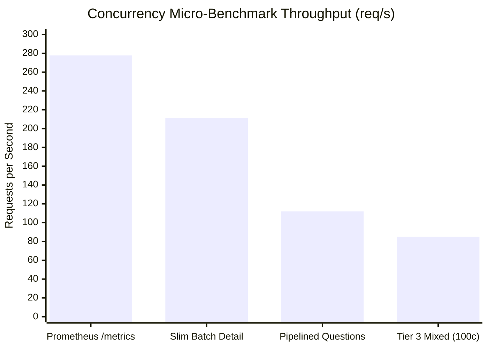

**Key Takeaways**:
1. **Zero Connection Pool Starvation**: Even under 100 concurrent ASGI workers executing complex pipelined queries simultaneously, zero connection checkout timeouts or asyncpg pool exhaustions occurred.
2. **Sub-10ms Lightweight Read Responses**: Endpoints utilizing `slim=true` and pipelined counts achieve sub-10ms response times at throughputs over 200 req/s.
3. **100% Error-Free Resilience**: All 850 requests completed with HTTP 200 status codes with zero dropped sockets.

---

## 7. Export & Study Studio Architecture

The **Export & Study Studio** ([`ExportPrintModal.jsx`](../frontend/src/components/modals/ExportPrintModal.jsx)) provides client-side document synthesis, AI study guide compilation, and multi-format export capabilities for educators and candidates. The modal is decomposed into modular sub-panes for scope selection, data formatting, and study guide synthesis:
- **Scope Selector ([`ExportScopeSelector.jsx`](../frontend/src/components/modals/ExportScopeSelector.jsx))**: Three scopes: `Selected (n)` (explicitly checked items, shown when any are selected), `Filtered (n)` (shown when filters are active) and `All (n)`. `All` is the in-bank pool (`fetchQuestions({status: 'in_bank', slim: true})`); the review queue (`ai_validated`) is not an export scope.
- **Data Format Pane ([`ExportDataFormatPane.jsx`](../frontend/src/components/modals/ExportDataFormatPane.jsx))**: Renders the callout and preview for the CSV and JSON formats. The modal's format tabs are `paper` (with `student` and `studypack` modes), `csv`, `json` and `study_guide`.
- **Study Guide Export Pane ([`StudyGuideExportPane.jsx`](../frontend/src/components/modals/StudyGuideExportPane.jsx))**: Interacts with `POST /api/ai/study-guide` to synthesize high-yield summaries, cognitive trap checklists, and flashcard previews; it downloads the guide as Markdown (`.md`) and the flashcards as an Anki-compatible tab-separated file (`.tsv`).

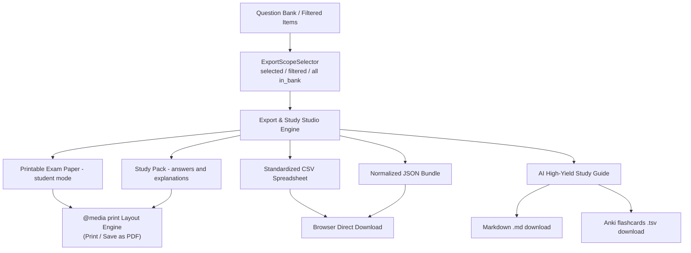

### 7.1 Export Modes & Formats
1. **Printable Exam Paper, student mode (Print / Save as PDF through the browser print dialog)**:
   - Formatted for classroom and mock exam printing with candidate name/date header, official section specifications, and clean typographic separation.
   - Enforces `.page-break { break-before: page; }` CSS print rules to ensure reading passages and question options never split awkwardly across page folds.
2. **Study Pack, `studypack` mode (Print / Save as PDF)**:
   - Includes reading stimulus, question stem, answer key, and the complete step-by-step cognitive proof and distractor trap analysis.
3. **Standardized CSV Spreadsheet Export (client side, `utils/export/csv.js`)**:
   - Converts questions into RFC 4180 CSV with columns `Question Number`, `ID`, `Section`, `Subtopic`, `Difficulty`, `Stimulus / Passage`, `Question Stem`, `Visual Type`, `Image URL`, `Image Description`, `Option A` through `Option D`, `Correct Answer`, `Explanation`, `Primary Trap`, `Quality Score`. Cells starting with `=`, `+`, `-`, `@`, tab or CR are prefixed with an apostrophe to defuse spreadsheet formulas.
   - The backend has its own CSV export (`GET /api/export?format=csv`, `services/csv_export.py`) with the header `ID, Run_ID, Batch_ID, Combination_ID, Section, Subcategory, Difficulty, MCAT_Scaled_Score, AAMC_Skill, Content_Domain, Question_Type, Interaction_Type, Primary_Trap, Passage_Required, Visual_Type, Image_URL, Image_Description, Stimulus, Question Stem, Option A, Option B, Option C, Option D, Correct Answer, Explanation, Final Score, Cycles, Created At` (the `Subcategory` column holds the question's `subtopic`).
4. **Normalized JSON Bundle (`utils/export/json.js`)**:
   - Serializes the selected question objects with `JSON.stringify(questions, null, 2)`, so it contains whatever fields the fetched question records carry (the export modal requests `slim=true`, which omits heavy audit-history columns).
5. **AI Synthesized High-Yield Study Guide and Anki Deck**:
   - The study guide pane downloads a Markdown guide (executive thematic synthesis, checklist of common candidate pitfalls) and an Anki-compatible `.tsv` of the guide's flashcard pairs (`#separator:tab`, HTML enabled, a fixed tag column). Neither is a PDF.

---

## 8. Prometheus & OpenMetrics Telemetry Subsystem

The application features a native, zero-dependency Prometheus/OpenMetrics exposition engine (`app/services/metrics.py`) and plain ASGI telemetry middleware (`app/middleware/telemetry.py`) serving real-time metrics at root `/metrics` and `/api/metrics`:

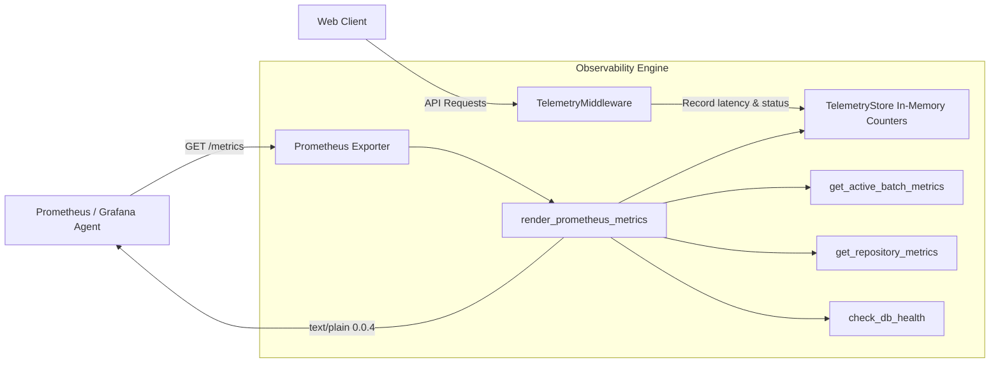

### 8.1 Key Telemetry Dimensions
1. **System & Database Health**: `mcat_up`, `mcat_database_connected`, `mcat_offline_mode`.
2. **Background Concurrency Semaphores**: `mcat_batches_active`, `mcat_worker_jobs_active`, `mcat_global_max_concurrent_jobs`, `mcat_global_max_concurrent_llm_calls`.
3. **Repository Status Distribution**: `mcat_questions_total{status="in_bank"}`, `ai_validated`, `batch_only`, `discarded`.
4. **Token Burn & Financial Ledger**: `mcat_tokens_consumed_total`, `mcat_inference_cost_usd_total`.
5. **HTTP Traffic & Latencies**: `mcat_http_requests_total{endpoint="...",method="...",status="..."}` and `mcat_http_request_duration_seconds{endpoint="...",method="..."}`. The `endpoint` label is the matched route template (for example `/api/batches/{batch_id}`) or the fixed value `unmatched` for 404s and scanner traffic, so attacker-chosen URLs cannot create new series; methods outside `GET/POST/PUT/PATCH/DELETE/HEAD/OPTIONS` are recorded as `OTHER`; label values are escaped. Once `ADMIN_API_KEY` is set, scrapers must send a matching `x-admin-key` header (403 otherwise).

---

## 9. Frontend Domain-Driven Architecture

The frontend follows an enterprise domain-driven component architecture split into top-level views, specialized domain components, and centralized hooks:

```
frontend/src/
├── App.jsx                       # Application shell (view routing, modals)
├── views/                        # Top-level application view screens (code-split)
│   ├── AiValidatedQuestionsView.jsx # Dedicated AI Validated (>80) quality review desk
│   ├── BatchActivityView.jsx     # Live & historical batch monitoring dashboard
│   ├── PassageBankView.jsx       # Reading passages repository & editorial desk
│   └── QuestionBankView.jsx      # Verified Question Bank view & editorial cards
├── components/
│   ├── index.js                  # Centralized barrel export for all components
│   ├── wizard/                   # Streamlined 3-Step Guided Question Wizard
│   │   ├── GuidedWizard.jsx      # Central 3-step wizard controller
│   │   ├── HeroLanding.jsx       # Welcome landing hero header with instant presets
│   │   ├── WizardChoiceCard.jsx, WizardFooterNav.jsx, WizardHeaderStepper.jsx # Shared wizard chrome
│   │   ├── wizardConstants.js    # Wizard option constants
│   │   ├── index.js              # Wizard barrel export
│   │   └── steps/                # Streamlined 3-step modular components
│   │       ├── WizardAdvancedSettings.jsx, WizardReviewSummary.jsx # Step 3 sub-sections
│   │       ├── WizardStep1SectionFocus.jsx # Step 1: Section, pacing & focus
│   │       ├── WizardStep2LevelFormat.jsx  # Step 2: Level (Low/Med/High), format & scope (5/50)
│   │       ├── WizardStep3ReviewAdvanced.jsx # Step 3: Compact review table & advanced accordion
│   │       └── index.js          # Steps barrel export
│   ├── question/                 # Question presentation & editing
│   │   ├── MentorExplanationView.jsx # 3-card mentor explanation view (Intuition, Distractors, Trap)
│   │   ├── QuestionCard.jsx      # Interactive student practice & review card
│   │   ├── QuestionCardHeader.jsx, QuestionCardFooter.jsx, QuestionOptionsList.jsx # Card sub-components
│   │   ├── QuestionCopilotStrip.jsx # Interactive AI Copilot editorial refinement strip
│   │   ├── QuestionInlineEditor.jsx # In-place authoring & remediation editor
│   │   ├── QuestionScorecardTab.jsx # 100-point rubric breakdown accordion
│   │   ├── ReviewAuditView.jsx   # 100-point rubric breakdown & token cost modal (Focus Trapped)
│   │   ├── AuditIterationTimeline.jsx, AuditMetricsGrid.jsx, AuditStageBreakdown.jsx, PillarBars.jsx # Audit modal sections
│   │   ├── SharedPassageCard.jsx # Shared reading passage stimulus display card
│   │   ├── StageJsonInspector.jsx# Deep stage outcome JSON inspector accordion
│   │   ├── VisualStimulusViewer.jsx # SVG & neural visual diagram renderer
│   │   ├── VisualStimulusLightboxModal.jsx # Full-screen figure lightbox
│   │   └── index.js              # Question barrel export
│   ├── passage/                  # Reading passage bank components
│   │   ├── PassageBankCardRow.jsx # Passage row card
│   │   ├── PassageQuestionsCarousel.jsx # Linked questions carousel
│   │   ├── PassageBankFilters.jsx# Passage search, section, and difficulty filters
│   │   ├── PassageBankTable.jsx  # Passage stimuli repository cards & question sets
│   │   ├── PassageEditorialDesk.jsx # Reading passage editor & preview desk
│   │   ├── PassageLinkedQuestionCard.jsx # Linked question card within passage editorial desk
│   │   ├── PassageVisualStimulusEditor.jsx # Passage diagram & figure attachment editor
│   │   └── index.js              # Passage bank barrel export
│   ├── duplicates/               # DuplicateRiskBadge, DuplicateAlertBar, DuplicateCompareModal (duplicate awareness UI)
│   ├── bank/                     # Question Bank repository
│   │   ├── QuestionBankCardRow.jsx # Question card row
│   │   ├── QuestionBankFilters.jsx # Section, difficulty (Low/Medium/High), and search filters
│   │   ├── QuestionBankTable.jsx # Canonical Editorial Cards view, batch selection, and actions
│   │   └── index.js              # Bank barrel export
│   ├── batch/                    # Batch monitoring components
│   │   ├── ActiveMultiBatchMonitor.jsx # Global concurrency metrics & live multi-batch controller
│   │   ├── BatchDuplicateAudit.jsx # On-demand Check duplicates / Resolve duplicates panel inside a batch card
│   │   ├── BatchCard.jsx         # Summary status card for generation batches
│   │   ├── BatchCardJobsGrid.jsx, BatchCardSummary.jsx, BatchLifecycleStepper.jsx, BatchOutcomeCard.jsx # Batch card sections and stage stepper
│   │   ├── BatchJobHeader.jsx, BatchJobPillStrip.jsx, BatchJobTelemetryBadges.jsx # Job card sections
│   │   ├── BatchQuestionActions.jsx, BatchQuestionOptionsList.jsx, BatchQuestionPassageDrawer.jsx # Staged question item sections
│   │   ├── BatchEmptyState.jsx   # Decomposed zero-state canvas for batch activity
│   │   ├── BatchFiltersBar.jsx   # Section, status, and search filters
│   │   ├── BatchHeaderBanner.jsx # Top summary banner for active batch metrics
│   │   ├── BatchJobCard.jsx      # Per-set worker card with 5-question visual progress strip & retry telemetry
│   │   ├── BatchQuestionItem.jsx # Staged question item with review modal
│   │   ├── BatchStatsHeader.jsx  # High-level aggregate batch statistics
│   │   └── index.js              # Batch barrel export
│   ├── validated/                # AI Validated bank components
│   │   ├── AiValidatedFiltersBar.jsx # Filters for AI-validated questions
│   │   ├── AiValidatedQuestionCard.jsx # Card with direct bank approval actions
│   │   ├── AiValidatedStatsBar.jsx # Quick-action statistics header
│   │   └── index.js              # Validated barrel export
│   ├── modals/                   # Accessible dialog modals (WCAG AA Focus Trapped)
│   │   ├── ConfirmationModal.jsx # Accessible confirmation modal replacing window.confirm
│   │   ├── confirmModalProps.js  # Confirmation modal prop helpers
│   │   ├── DeletePassageModal.jsx# Dedicated passage deletion and cascade warning dialog (Hoisted)
│   │   ├── ExportDataFormatPane.jsx # CSV / JSON preview and callout sub-pane
│   │   ├── ExportPaperPreview.jsx# Live print layout previewer
│   │   ├── ExportPrintModal.jsx  # Exam Paper (print / PDF), Study Pack, CSV, JSON and Study Guide export modal
│   │   ├── ExportScopeSelector.jsx # Export scope selection sub-pane (Selected, Filtered, All in bank)
│   │   ├── StudyGuideExportPane.jsx # High-yield study guide preview, Markdown and Anki .tsv download
│   │   └── index.js              # Modals barrel export
│   ├── layout/                   # Global layout
│   │   ├── Footer.jsx            # Infynno Solutions LLP attribution & resource footer
│   │   ├── Navbar.jsx            # Header with branding, navigation tabs, and theme toggle
│   │   └── index.js              # Layout barrel export
│   └── common/                   # Shared UI primitives
│       ├── CustomSelect.jsx      # Accessible custom dropdown select primitive
│       ├── EmptyState.jsx, LoadError.jsx, Modal.jsx # Empty/error states and base modal (backdrop closes only if mousedown and click both hit it; optional ariaLabel prop, default "Dialog")
│       ├── SafeSvg.jsx           # DOMPurify-sanitized SVG renderer
│       ├── ErrorBoundary.jsx     # React error boundary with fallback UI; also mounted at the app root in main.jsx (Retry reloads the page)
│       ├── FormattedText.jsx     # Inline markdown & cognitive trap chip highlighter
│       ├── InfynnoLogo.jsx       # Official corporate vector logo primitive
│       ├── LiveStopwatch.jsx     # High-precision live stopwatch timer
│       ├── PaginationBar.jsx     # Accessible pagination bar with page range counter & controls
│       ├── Toast.jsx             # Floating toast notification system (live region always mounted; errors use role=alert)
│       └── index.js              # Common primitives barrel export
├── constants/
│   ├── index.js                  # Constants barrel export
│   ├── mcat.js                   # MCAT sections, pacing specs, icons, and fallback topics
│   ├── mcatTraps.js              # AAMC cognitive trap definitions and defense strategies
│   └── mcat_dependent_taxonomy.json # AAMC-aligned foundational concepts and skills
├── hooks/
│   ├── index.js                  # Barrel export for custom hooks
│   ├── useAppState.js            # Centralized view routing & global event broker
│   ├── useFocusTrap.js           # Accessible WCAG AA keyboard focus-trapping hook for modals
│   ├── useGeneratorForm.js       # Form state & validation logic
│   ├── useKeyboardShortcuts.js   # Global hotkeys (Cmd/Ctrl+Enter, T, /, Esc everywhere; A and D only in the review queue)
│   ├── usePagination.js          # Client and server pagination calculations and state management
│   ├── useQuestionBank.js        # Debounced search, sorting, and bank fetching
│   ├── useTheme.js               # Dual-theme engine (dark / light with localStorage)
│   ├── useBatchActivity.js, useBatchFilters.js, useBatchMutations.js # Batch monitor polling, filters and actions
│   ├── useAiValidated.js, usePassageBank.js, useGlobalCounts.js, useBankDeletion.js # View data hooks
│   ├── useExportActions.js, useQuestionDraft.js, useConfirmModal.js # Export, inline draft and confirmation helpers
│   └── useCopyToClipboard.js, useDebouncedValue.js, useRequestGuard.js # Small utility hooks
│   ├── api.js                    # FastAPI client (question, batch, passage, and AI copilot functions)
│   └── index.js                  # Services barrel export
├── utils/                        # Pure utility helpers
│   ├── export/                   # csv.js, json.js, htmlDoc.js (A4 print document), escape.js, printPaperCss.js; index.js exports generateExamCsv, generateExamJson, generateExamHtmlDoc
│   ├── batchPayload.js           # buildBatchPayload (request builder incl. CARS image-suppression guards)
│   ├── batchHelpers.js, batchJobHelpers.js # Batch stage stepper and job display helpers
│   ├── explanationHelpers.js     # Structured explanation parser
│   ├── formatters.js             # Time, word count, token & currency formatters
│   ├── optionHelpers.js          # Option length parity & calculateOptionSymmetry engine
│   ├── trapHelpers.js            # Cognitive trap resolution & text detectors
│   ├── questionHelpers.js, passageHelpers.js, taxonomyHelpers.js, visualHelpers.js # Domain helpers (export selection, modality detection, ...)
│   ├── download.js, generatorFormState.js, ids.js, pagination.js, requestGuard.js, selectHelpers.js, selection.js # Small shared helpers
│   └── index.js                  # Utilities barrel export
├── styles/                       # Modular domain stylesheets (tokens, base, layout, accessibility, wizard, question, batch, batch-activity, batch-card-summary, bank, passage, modals, print, study-guide-modal, question-copilot, stage-inspector)
├── index.css                     # Aggregator hub importing all domain stylesheets
└── main.jsx                      # React 19 application root
```

### 9.1 Adaptive Batch Polling, HTTP 304 Caching & Smart Delta Telemetry

To eliminate unnecessary network overhead while maintaining instant UI responsiveness, `useBatchActivity.js` and `api.js` implement a multi-tiered telemetry optimization pipeline:

- **Active Polling (1,500ms)**: When background generation batches or worker jobs are actively processing, the hook queries `/api/batches` and active job state every 1.5 seconds to smoothly update progress tracks, milestones, and question cards.
- **Idle Polling (10,000ms)**: When all batches are terminal (`completed`, `cancelled`, `failed`) and no active jobs are executing, the polling interval automatically decays to 10 seconds, reducing idle database transactions and socket churn by ~80%.
- **Instant Focus Wakeup**: Listens to both `visibilitychange` and `window.addEventListener('focus', ...)`. When the educator switches back to the application tab, the hook immediately dispatches a background fetch without waiting for the timer to tick.
- **Client-Side In-Memory `etagCache` & HTTP 304 Fast-Path**: `frontend/src/services/api.js` maintains an in-memory `Map` keyed by URL (`etagCache`). When fetching batch telemetry (`GET /api/batches/{id}?slim=true`), it automatically transmits `If-None-Match: <cached-etag>`. If the backend detects no state modification, it responds with `304 Not Modified` and an empty body, allowing `api.js` to instantly resolve from cache without JSON parsing overhead.
- **Smart Delta Reconciliation**: In `useBatchActivity.js`, even upon receiving batch payloads, the client compares a lightweight signature tuple (`status`, `completed_jobs`, `actual_count`, `failed_jobs`, `total_tokens`) against the previous snapshot. If the signature matches identically, React state mutations and deep component tree re-renders are completely skipped.

#### Telemetry Delta Polling Sequence

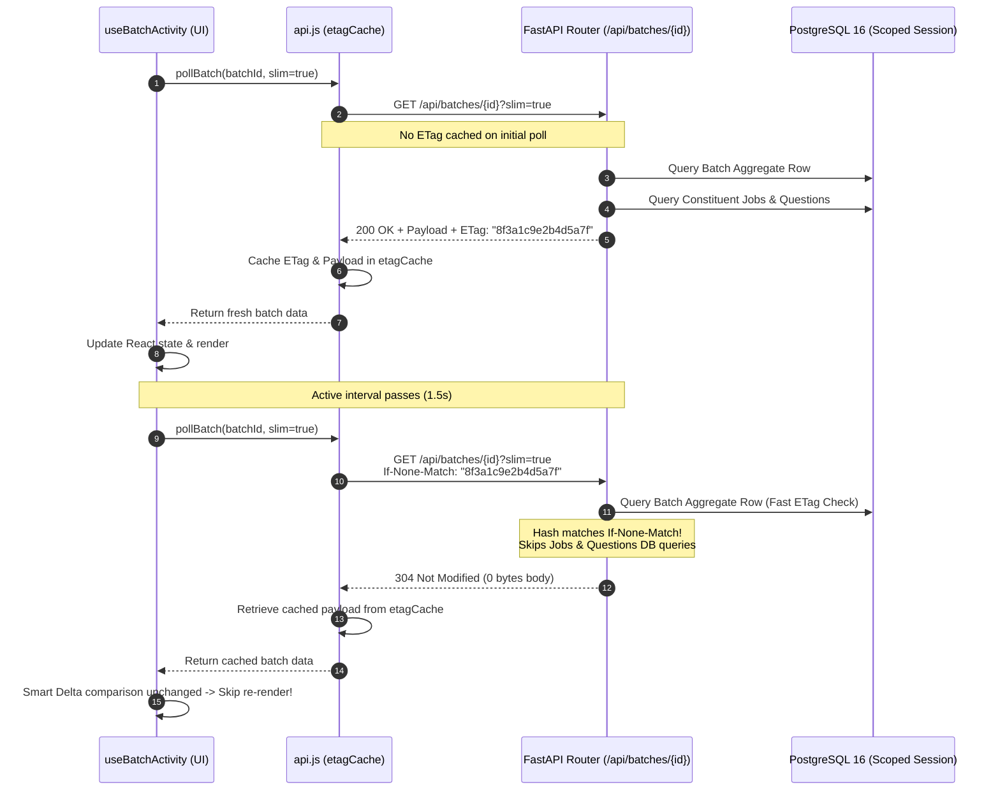

### 9.2 WCAG 2.1 AA Focus-Visible Glow Contract & Tactile Feedback

Accessible keyboard navigation and tactile feedback are implemented across the entire component tree:
- **Dual-Ring Focus Glow**: `accessibility.css` enforces an accessible `:focus-visible` ring across all interactive controls (`button`, `input`, `select`, `textarea`, `[role="button"]`, `.btn-*`, `.pill-track-btn`, `.wizard-preset-pill`):
  ```css
  outline: 2px solid var(--brand-primary);
  outline-offset: 2px;
  box-shadow: 0 0 0 4px var(--brand-ring);
  ```
- **Mentor Card Tactile Feedback**: The 3-card mentor explanation boxes (`.mentor-correct-box`, `.mentor-distractor-box`, `.mentor-trap-box`, `.mentor-mistake-box`) utilize `transition: var(--transition-ui)` for subtle hover transitions without visual jarring.

### 9.2.1 Keyboard shortcuts and dialog accessibility

- `useKeyboardShortcuts` (`hooks/useKeyboardShortcuts.js`) registers Escape and Cmd/Ctrl+Enter everywhere, plus the single-key shortcuts `t` (theme) and `/` (focus search). In the review queue only (`useAiValidated`), `A` saves the active card to the bank (a hard, unoverridden duplicate opens the comparison instead) and `D` discards it through the existing confirmation modal. Single-key shortcuts are ignored with Meta, Ctrl or Alt held, on key repeat, while focus is in an input, select, textarea or contenteditable element, and while any modal dialog is open (`t` and `/` included); the hook option `enabled: false` turns them off (Escape and Cmd/Ctrl+Enter stay). The active review card shows a highlight (`validated-card--active`) and `kbd-hint` badges.
- `Modal` closes on a backdrop click only when both mousedown and click land on the backdrop, takes an optional `ariaLabel` (default `"Dialog"`), and `useFocusTrap` ignores hidden and `tabindex=-1` elements. `Toast` keeps a polite live region mounted at all times and marks errors `role="alert"`. A root `ErrorBoundary` in `main.jsx` shows a fallback with Retry (reloads the page). `useBatchActivity` retries a failed final detail fetch of a just-completed batch on the next poll.

### 9.3 Dedicated Passage Editorial Desk & Stimulus Viewer Architecture

`PassageEditorialDesk.jsx` provides a dedicated, split-pane editorial workstation:
- **Left Column (Passage Content)**:
  - Textarea styled in **Newsreader Serif** with calibrated medical journal typography (`font-size: 1.05rem; line-height: 1.68; letter-spacing: -0.01em;`).
  - Real-time word count calculation (`countWords`).
  - **Passage Readability & Alignment Diagnostics**: Evaluates Flesch-Kincaid grade level, reading ease, empirical density score, and sentence counts via `/api/ai/audit-passage`, presented in a dedicated `.passage-diagnostics-card` with decoupled alignment pills (`Alignment: Strong` / `Alignment: Calibrating`).
  - **Passage Visual Stimulus Editor**: Embedded figure showcase (`PassageVisualStimulusEditor.jsx`) supporting 7 medical modalities and 1-click visual detachment.
- **Right Column (Linked Questions Carousel)**:
  - Stepper carousel (`PassageQuestionsCarousel.jsx`) navigating through linked questions with keyboard arrow shortcuts (`←` / `→`).
  - Score decoupling: Question cards display clean status pills (`Ready for Review` / `In Bank`) instead of raw internal score math.

### 9.4 High-Scale Server-Driven Pagination & Cross-Page Selection Architecture

To guarantee silky-smooth 60fps performance and minimal memory usage even with tens of thousands of questions and stimulus passages in the repository:

- **Dual-Mode `usePagination` Hook**: Operates seamlessly in two modes:
  1. *Client-side slice mode*: Used for locally buffered sub-arrays (e.g. batch job question carousels).
  2. *Server-driven mode*: When supplied with `totalCount` from the backend (`GET /api/questions`, `GET /api/passages`), `usePagination` dynamically computes `totalPages`, page index offsets, and item boundary counters without holding the entire dataset in memory.
- **Standardized `PaginationBar.jsx`**: Governs page size switching (10, 25, 50, 100), previous/next steps, and numeric jump pills across Question Bank View, AI Validated Questions View, Batch Activity View, and Passage Bank View.
- **Persistent Cross-Page Multi-Selection**: In `QuestionBankView.jsx`, item selection keys are maintained in a global Set independent of page slicing. Educators can select questions across multiple pages, execute bulk operations (bulk status update, export, purge), or clear the entire selection across all pages in a single click using `.qbank-clear-selection-btn`.
- **React 19 Derived Filter Key Synchronization**: In `usePassageBank.js`, a derived filter composite key (`${section}_${subtopic}_${search}_${sortBy}`) automatically resets the pagination cursor to page 1 upon any filter or sort modification during state transition, preventing orphan empty-page states.

For complete UI design tokens, color scales, typography guidelines, and component contracts, consult [`DESIGN.md`](../DESIGN.md).

---

## 10. Reliability, Recovery & Observability

- **Graceful shutdown**: the FastAPI lifespan hook stops all running batches (progress and generated questions are preserved) and disposes the database engine.
- **Restart recovery**: on startup, `in_progress` batches become `stopped`, their qualifying questions are promoted, and jobs left `pending`/`running` become `stopped` so the UI never shows phantom running work. Stopped jobs below target remain retryable through the standard retry flow (3-trial ceiling).
- **No leaked workers**: `run_workflow_stream` cancels and drains all worker and monitor tasks on every exit path (completion, error, cancellation, or consumer close).
- **LLM call hygiene**: the global LLM semaphore is held only during the API call, never during retry backoff; 500/502/503/504/529, timeouts and rate-limit errors are retried at a single layer (`LLM_MAX_RETRIES = 3` retries, so up to 4 attempts; LiteLLM's own retries are disabled); request timeout scales with `max_tokens`; static system prompts are marked cacheable for Anthropic (`ENABLE_PROMPT_CACHING`).
- **Health probes**: `GET /api/health` (overview, reports `degraded` when PostgreSQL is unreachable), `GET /api/health/live` (liveness, no database access) and `GET /api/health/ready` (readiness, `503` when the database is down). With `ADMIN_API_KEY` set, the full diagnostic payload requires a matching `x-admin-key` header.
- **Correlation logging**: every log line inside a batch job or worker carries `batch_id`, `job_id`, `run_id` and `slot` (`LOG_FORMAT=json` for structured output). Each LLM call records `duration_ms` in the per-agent usage breakdown.
- **SSE keepalive**: `/api/generate` emits a `: keepalive` comment every 15 seconds (`SSE_KEEPALIVE_SECONDS`, implemented by `with_keepalive` in `api/v1/generation.py`) during quiet LLM stages so proxies do not drop the stream.
- **Live run finalization**: a standalone `/generate` run always finalizes its job row (`completed`, or `failed` when nothing was produced) before emitting the terminal event, so a client that closes the stream on `workflow_complete` cannot leave the job `cancelled`, and batches reach `completed`. Spend from rejected or failed attempts is counted (`cumulative_usage` on the rejected/error events) and persisted.
- **Events**: a single rejected attempt emits the non-terminal `question_rejected`; `workflow_rejected` is emitted once, when every slot of the run was rejected.
- **Resume correctness**: retry and resume run the jobs they selected (their in-memory status is stale after the reset), `stopped` jobs are executable, jobs a finished runner left pending/running are marked `failed`, and the auto-refill only reports "launched" when a job actually started. A stopped `partially_completed` batch stays terminal.
- **Concurrency limits**: one process-wide pipeline cap (`GLOBAL_MAX_CONCURRENT_PIPELINES`) replaces the per-run limiter that multiplied concurrency; batch aggregate refreshes take a `FOR NO KEY UPDATE` row lock (it serializes writers without conflicting with the key-share lock of question inserts); schema DDL that already exists is skipped, so startup never takes the table locks that deadlocked with running batches.
- **Security**: client-supplied `api_key` values are never persisted or returned (legacy payloads are scrubbed at startup); an optional `API_ACCESS_KEY` requires `X-API-Key` on mutating routes; text inputs are length-limited (including the duplicate-check, AI Copilot and `GenerationRequest` fields: see docs/API.md section 1.2); `model_name` must match a safe pattern and, without the caller's own `api_key`, be a server-configured model (`call_llm` refuses others); streamed terminal error text goes through `sanitize_error_text`; `/metrics` requires `x-admin-key` once `ADMIN_API_KEY` is set; unexpected errors return a generic `{detail, code}` body and keep details in the server log.

### Batch lifecycle guarantees
*(Added during a hardening review pass; the statements below were spot-checked against `batch_repository.py`, `batch_runner.py` and `main.py`.)*
- `refresh_batch_aggregates(allow_complete=True)` resolves a batch with no pending/running job to a terminal status (`completed`, `partially_completed`, `failed` or `cancelled`); live streamed runs call it on cancellation and failure so they never stay `in_progress`.
- `stop`/`retry`/`delete` leave a batch that is already terminal (and not running) untouched; a passive refresh (for example resolve-duplicates) never reopens a `completed` or `failed` batch; `retry` only stops and relaunches the runner when at least one job is retryable; a failed background launch marks the batch `failed` and clears its cached request; the batch `ETag` includes a question-level fingerprint (count, soft-deleted count, newest `updated_at` and `deleted_at`); `refill` answers 409 while the batch is running.
- Every job path (main, refill, cancelled, single-slot failure, truncated-output retries) records the tokens and cost it spent.
- If PostgreSQL is down at startup, the API retries schema initialization in the background (5 s backoff up to 60 s) and then runs the startup maintenance.

### Operational hardening
*(Same review pass. Verified against `main.py`, `core/errors.py`, `frontend/nginx*.conf` and the Dockerfiles.)*
- Every response carries `X-Request-ID` (a safe caller-supplied value or a generated one) and every log line produced while handling the request includes it.
- Request bodies above `MAX_REQUEST_BODY_MB` are refused with HTTP 413 (declared `Content-Length` before any work, streamed bodies as they arrive); nginx enforces the same limit. Bulk id lists are capped at 1000 and bulk question saves at 500.
- `POST /api/batches` is create-only (`create_batch`, `INSERT ... ON CONFLICT DO NOTHING`; `409` when the id exists) and stores an empty `completed` batch regardless of client-supplied status or counters.
- The in-flight dedup pool (`dedup_inflight.py`) computes the candidate embedding before it takes the pool lock, and registration survives an embedding failure.
- The backend CSV export (`services/csv_export.py`, `neutralize_formula`) prefixes cells that start with `=`, `+`, `-`, `@`, tab or carriage return with a single quote, and `GET /api/export` reads the bank in pages of 500 rows internally.
- `GET /api/health/live` is a database-free liveness probe; `/api/health/ready` stays the readiness probe.
- Error text stored on batches and jobs goes through `sanitize_error_text` (credentials, URL query strings and length removed).
- The web image runs as a non-root nginx with a Content-Security-Policy (scripts from the same origin only; the theme/font bootstrap lives in `frontend/public/boot.js`), and the backend runs Uvicorn with `--proxy-headers`. nginx overwrites `X-Forwarded-For` with `$remote_addr`; Uvicorn trusts that header only from the peers in the `FORWARDED_ALLOW_IPS` environment variable (image default `127.0.0.1`; compose sets it to the pinned `172.29.240.0/24` network; never `*`), and the rate limiter keys on the resulting transport peer (IPv6 grouped by /64), never on a raw header. nginx also injects `X-API-Key` at runtime from `API_ACCESS_KEY` (the nginx config is an envsubst template), so no key is baked into the JS bundle; anyone who can reach the web port can therefore use the mutating API. `POST /api/questions/check-duplicate` skips the key but has its own rate-limit bucket, and `limit_active_batches` reserves a batch slot atomically so bursts cannot exceed `MAX_ACTIVE_BATCHES`.

---

## 11. Python Type Precision, Zero-Suppression & Quality Contracts

The backend enforces strict type precision and zero-suppression code hygiene across all agent, repository, workflow, and data layers:

1. **Bare `dict` Prohibition**:
   - Generic bare `dict` type annotations are strictly prohibited across the codebase.
   - All dictionary schemas enforce precise parameterization via `dict[str, Any]` or dedicated `TypedDict` definitions.
2. **Typed Agent State & Token Breakdown**:
   - `AgentUsageEntry` (`app.workflow.state`): Strongly typed dictionary defining per-agent spend (`agent`, `iteration`, `prompt_tokens`, `completion_tokens`, `total_tokens`, `cost_usd`, `duration_ms`, `calls`; there is no `model` key).
   - `AgentWorkflowState` (`app.workflow.state`): Typed contract for the asynchronous workflow runtime (`request`, `current_draft`, `current_review`, `stage_outcomes`, `iteration_count`, `agent_usage_breakdown`, `passing_threshold`, `slot_prior_calls`, `fused_self_passed`, `duplicate_info`, `regenerated_pending_dedup`, `diversity_context`, ...; see §4). The solver verdict keys `blind_solver_result` / `blind_solver_passed` are written by the nodes but are not declared in the TypedDict.
   - `SlotLedger` (`app.workflow.engine_layout`): Structured per-slot financial ledger parameterized with `usage: list[list[AgentUsageEntry]]` and `all_usage(self) -> list[AgentUsageEntry]`.
3. **Explicit Coroutine Return Types**:
   - Background tasks and event loop monitors explicitly declare their return contract (e.g., `async def _monitor_tasks() -> None`).
4. **Zero-Defect Type Assertion**:
   - The entire Python backend repository is verified with automated AST inspection, guaranteeing zero bare `dict` annotations in production and test modules.
5. **Zero-Suppression Native Linting Model**:
   - The entire Python backend repository enforces a strict zero-suppression policy (**0 `# noqa` comments** across all production and test files).
   - Rather than masking rule violations, linter findings are resolved architecturally:
     - `B039` (mutable ContextVar default) is resolved by passing immutable `default=None` and using `_log_context.get() or {}`.
     - `ASYNC109` (timeout parameter collision) is resolved by parameter renaming to `timeout_seconds: float`.
     - `F401` (unused model and migration-step imports in `db/init_db.py`) is resolved via an explicit `__all__` that re-exports the four models, `init_db_schema`, `run_schema_migrations` and the migration step helpers.
     - `ARG001` (unused arguments) and `PERF102` (dictionary key iteration) are resolved by surgical signature alignment and `.values()` loops.
6. **Constant & Query Guard Symmetry**:
   - In [`backend/app/api/v1/questions.py`](../backend/app/api/v1/questions.py), `MAX_BULK_QUESTIONS: int = 500` is defined as a strongly typed constant, ensuring the bulk save and purge limit exactly matches the `le=500` validation guard on the `GET /questions` limit parameter.
7. **Frontend State & Accessibility Architecture**:
   - Canonical status constants (`QUESTION_STATUS.AI_VALIDATED` from `constants/mcat.js`) are strictly enforced across global counting hooks (`useGlobalCounts.js`), eliminating magic string literals.
   - Symmetric state setter naming pairs (e.g. `[rawSelectedIds, setRawSelectedIds]` in `QuestionBankView.jsx`) ensure predictable, defect-free unidirectional state flow.
   - Native semantic buttons with WCAG AA attributes (`aria-current="step"`, `aria-pressed`, `aria-expanded`, `aria-controls`, and descriptive `aria-label`s) are standardized across all 5 primary views.

