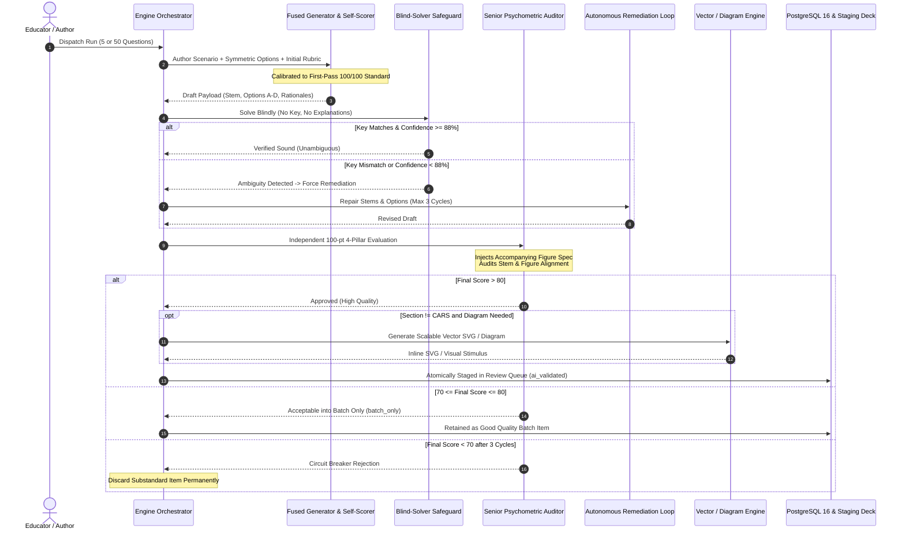
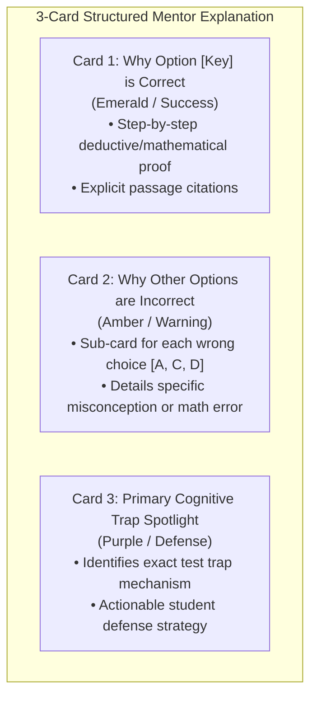
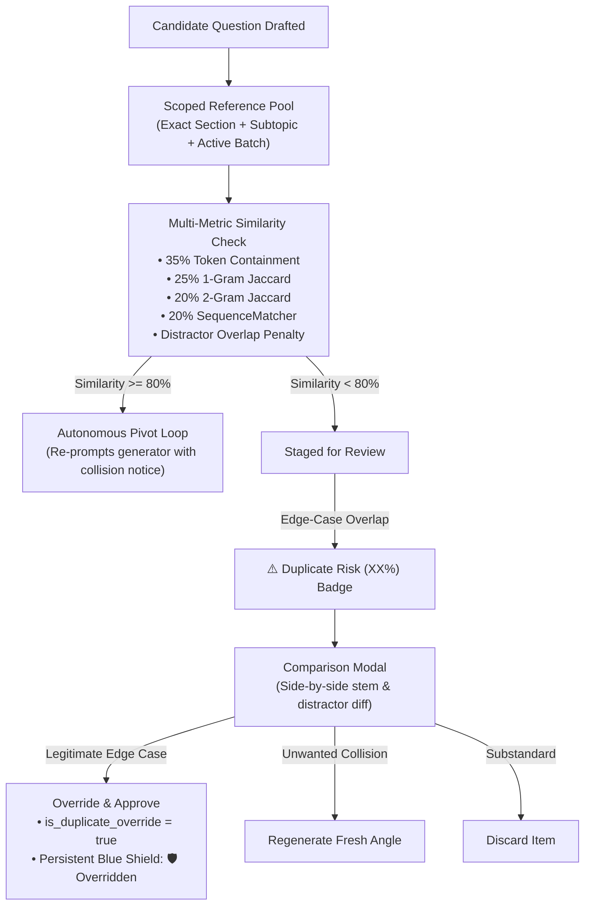
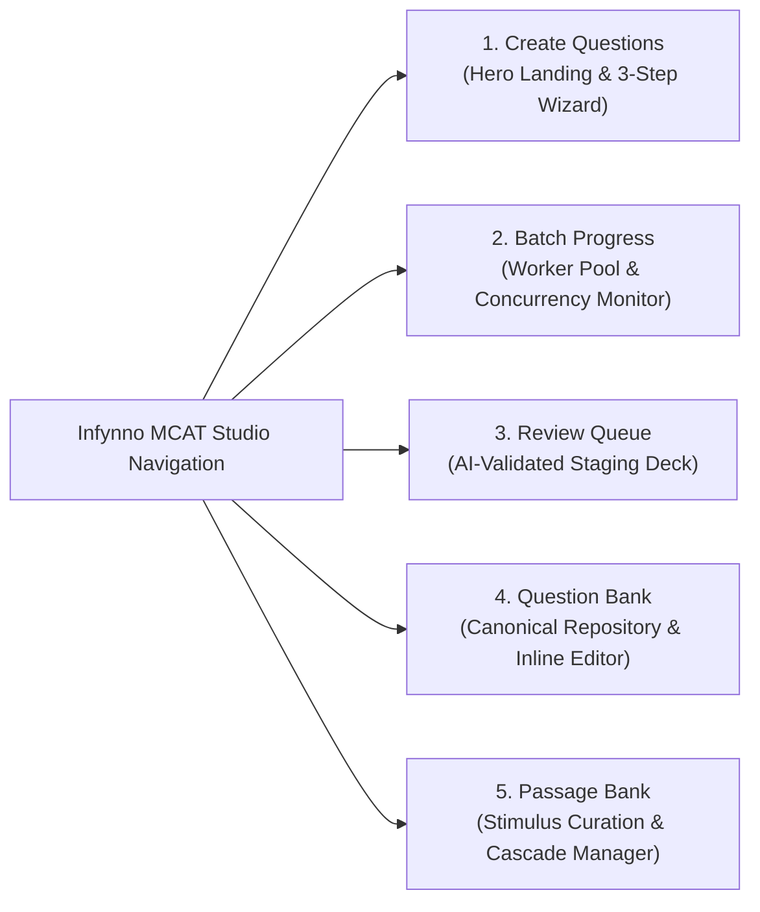
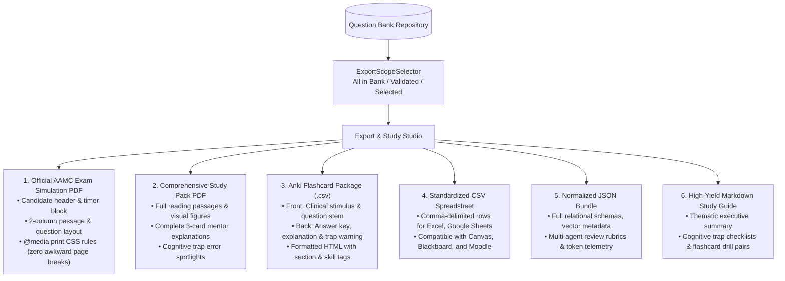

# Infynno MCAT Question Bank Generator v2.0
## System Architecture, End-to-End Workflows & Client Master Guide

> **Prepared by**: Infynno Solutions LLP • Infinite Innovations • [infynno.com](https://infynno.com/)  
> **Product**: Infynno MCAT Question Bank Generator v2.0  
> **Target Audience**: Client Leadership, Product Stakeholders, Medical Admissions Educators, Pre-Med Faculty, and Test-Prep Authors  
> **System Status**: Fully Implemented, Tested (508 Deterministic Backend Tests across 75 Modules, 518 Total Backend Tests + 142 Frontend Tests across 16 Test Files), and Production-Ready  

---

## Table of Contents
1. [Executive Summary & Value Proposition](#1-executive-summary--value-proposition)
2. [Official AAMC MCAT Foundations & Pacing Rules](#2-official-aamc-mcat-foundations--pacing-rules)
3. [Autonomous Multi-Agent AI Pipeline](#3-autonomous-multi-agent-ai-pipeline)
4. [Pedagogical Quality, Anti-Guessability & Distractor Traps](#4-pedagogical-quality-anti-guessability--distractor-traps)
5. [Anti-Collision, Deduplication & pgvector Semantic RAG](#5-anti-collision-deduplication--pgvector-semantic-rag)
   - 5.1 [Multi-Metric Similarity Algorithm](#51-multi-metric-similarity-algorithm)
   - 5.2 [Intra-Batch Clustering & Autonomous Replenishment](#52-intra-batch-clustering--autonomous-replenishment)
   - 5.3 [pgvector Semantic RAG & Anti-Collision Shield](#53-pgvector-semantic-rag--anti-collision-shield)
   - 5.4 [Protected Audit Trail (🛡️ Overridden)](#54-protected-audit-trail--overridden)
6. [The 5 Top-Level Workstation Views](#6-the-5-top-level-workstation-views)
   - 6.1 [Create Questions: Question Studio & 3-Step Wizard](#61-create-questions-question-studio--3-step-wizard)
   - 6.2 [Batch Progress: Concurrency Monitor & Resilient Processing](#62-batch-progress-concurrency-monitor--resilient-processing)
   - 6.3 [Review Queue: AI-Validated Triage & Editorial Staging](#63-review-queue-ai-validated-triage--editorial-staging)
   - 6.4 [Question Bank: Canonical Repository & Inline Editorial Desk](#64-question-bank-canonical-repository--inline-editorial-desk)
   - 6.5 [Passage Bank: Stimulus Curation & Cascading Management](#65-passage-bank-stimulus-curation--cascading-management)
   - 6.6 [AI Copilot Studio & In-Line Refinement](#66-ai-copilot-studio--in-line-refinement)
   - 6.7 [Hero Landing & Quick-Start Presets Desk](#67-hero-landing--quick-start-presets-desk)
7. [Export & Study Studio (Anki, Exam Simulation PDF, Study Guide)](#7-export--study-studio)
8. [Financial Telemetry & Micro-Dollar Cost Accounting](#8-financial-telemetry--micro-dollar-cost-accounting)
9. [UI Design System, Ergonomics & Accessibility](#9-ui-design-system-ergonomics--accessibility)
10. [Technical Architecture, Security & Production Readiness](#10-technical-architecture-security--production-readiness)

---

## 1. Executive Summary & Value Proposition

Preparing medical school candidates for the **AAMC MCAT (Medical College Admission Test)** requires simulating the exact cognitive rigor, multi-disciplinary depth, and strict timing of North American medical admissions testing. Unlike standard memorization tests, the MCAT evaluates deep critical reasoning across physical sciences, biochemistry, humanities, and behavioral dynamics under extreme time pressure (**~96 to ~101 seconds per question**).

### The Critical Flaws of Generic AI in Medical Test Prep
Standard generative AI setups fail when applied to official MCAT question authoring:
1. **The "Longest Option" Give-Away**: Language models naturally over-explain the correct answer, creating a giveaway choice that test-savvy students exploit without reading the passage.
2. **Superficial & Unrealistic Distractors**: Off-the-shelf AI creates distractors that are obviously wrong or absurd. Official MCAT questions use distractors that reflect authentic student misconceptions, inverted math ratios, or out-of-scope extrapolations.
3. **Disjointed Trivia vs. Experimental Passages**: Real MCAT sections require dense, publication-grade research passages featuring experimental controls, Lineweaver-Burk kinetics, gel electrophoresis, or complex humanities rhetoric. Naive prompts generate isolated trivia.
4. **AI Style Tell-Tales**: Generic AI outputs frequently use unnatural em-dashes (`—`) and repetitive robotic phrasing (`"It is important to remember that..."`) that destroy test authenticity.

### The Infynno Engineered Solution
The **Infynno MCAT Question Bank Generator v2.0** eliminates these failures through an enterprise-grade multi-agent platform:
- **Mathematical Option Symmetry**: Option lengths are locked within 3 words or $\pm 15-20\%$ of each other with parallel grammatical structure.
- **Blind-Solver Dual Validation**: An independent AI agent solves the question without the answer key. If it disagrees or confidence is $< 88\%$, the question is automatically rejected or remediated.
- **100-Point Psychometric Audit**: Every draft is graded across 4 pillars of 25 points each. Only items scoring $> 80$ reach the review queue.
- **Autonomous Deduplication**: Multi-metric mathematical similarity guarantees zero question repetition across mock sets.
- **Human-Centric Editorial Control**: Pre-med instructors retain full editorial power with 1-click in-place editing, override shields, and publication-ready multi-format exports (PDF, CSV, JSON).

---

## 2. Official AAMC MCAT Foundations & Pacing Rules

The entire application is strictly aligned with the four official AAMC MCAT sections:

| Section Code | Official AAMC Section Name | Questions | Time Limit | Target Pacing | Formatting Mandates |
| :--- | :--- | :---: | :---: | :---: | :--- |
| **`chem_phys`** | **Chemical and Physical Foundations of Biological Systems** | 59 | 95 mins | **~96s / question** | General chemistry, organic chemistry, physics, thermodynamics, kinetics. Supports Passage Sets or Discretes. |
| **`cars`** | **Critical Analysis and Reasoning Skills** | 53 | 90 mins | **~101s / question** | Humanities, ethics, philosophy, social sciences. **Strictly 100% Passage-Based (Discretes forbidden). Zero diagrams.** |
| **`bio_biochem`** | **Biological and Biochemical Foundations of Living Systems** | 59 | 95 mins | **~96s / question** | Molecular genetics, metabolic pathways, microbiology, organ physiology. Supports Passage Sets or Discretes. |
| **`psych_soc`** | **Psychological, Social, and Biological Foundations of Behavior** | 59 | 95 mins | **~96s / question** | Cognitive psychology, healthcare sociology, sensory perception, research ethics. Supports Passage Sets or Discretes. |

### AAMC Scientific Inquiry & Reasoning Skills (SIRS)
The platform explicitly targets and categorizes questions by the official AAMC reasoning framework:
- **Skill 1: Knowledge of Scientific Concepts and Principles** — Identifying scientific definitions, models, and fundamental relationships.
- **Skill 2: Scientific Reasoning and Problem-Solving** — Analyzing scientific theories, evaluating hypotheses, and synthesizing concepts.
- **Skill 3: Reasoning About the Design and Execution of Research** — Evaluating experimental variables, positive/negative controls, validity, and ethics.
- **Skill 4: Data-Based and Statistical Reasoning** — Reading reaction graphs, scatter plots, Lineweaver-Burk plots, p-values, and confidence intervals.

---

## 3. Autonomous Multi-Agent AI Pipeline

The core intelligence consists of five specialized autonomous agents orchestrated by a deterministic state engine:

### 3.1 Fused Draft-and-Critique Cognitive Engine (`generator.py`)
- **First-Pass 100/100 Excellence Directive**: Explicitly instructed to author perfect items on the initial attempt, maximizing authenticity, distractor sharpness, and explanation rigor in a single unified round-trip.
- **Anti-AI Formatting Standard**: Strictly forbids unspaced em-dashes (`—`), en-dashes (`–`), or double hyphens (`--`). Uses clean spaced single hyphens (`-`).
- **Option Length Symmetry**: Automatically adjusts character and word counts so no single option can be identified as an outlier.

### 3.2 Blind-Solver Dual-Validation Safeguard (`blind_solver.py`)
- **Simulated Test Candidate**: Solves the candidate question purely from the passage and question stem, without access to the author's answer key or explanation.
- **Strict Verification Gate**: Requires both **exact key agreement** and **$\ge 88\%$ algorithmic confidence**. If the solver chooses a different key or flags ambiguous language, the question is routed into remediation.

### 3.3 Senior Psychometric Auditor (`reviewer.py`)
Evaluates items across four equal 25-point pillars (100 points total):
1. **Pillar 1: Authenticity & Scientific Rigor (25 pts)** — Alignment with AAMC syllabus, clinical or laboratory depth, and professional tone.
2. **Pillar 2: Clarity & Scientific Logic (25 pts)** — Syntactic precision, unambiguous phrasing, and absence of linguistic traps.
3. **Pillar 3: Distractor Traps & Option Symmetry (25 pts)** — Plausibility of wrong choices, length symmetry ($\pm 15\%$), and cognitive trap alignment.
4. **Pillar 4: Explanation & Proof Rigor (25 pts)** — Incontrovertible mathematical or deductive proof citing explicit passage evidence.

- **Accompanying Visual Stimulus & Empirical Data Audit Boundary**:
  When an educator or candidate question requires empirical findings (such as Lineweaver-Burk enzyme kinetics, 12-lead ECG traces, chest CT scans, or renal biopsy histology slides), the Senior Psychometric Auditor receives the complete Accompanying Visual Stimulus Specification. The Auditor is strictly instructed **never to penalize references to "Figure 1", "the plot", or "the radiograph below"** in standalone stems, verifying instead that the question stem, answer choices, and scientific proof logically align with the described empirical figure.

### 3.4 Autonomous Remediation Loop (`regenerator.py`)
- Automatically repairs borderline drafts scoring $\le 80$.
- Ingests specific auditor critique notes, adjusts distractors, equalizes option word counts, and sharpens step-by-step proofs.
- **Visual Stimulus Preservation Guarantee**: Mandates that items requiring medical imaging or scientific diagrams retain `image_needed: True` and preserve references to "Figure 1". The regenerator remediates pedagogical traps and explanation depth without flattening empirical visual findings into plain text numbers.
- Maximum 3 cycles; if an item cannot reach 70 points, the circuit breaker permanently discards it.

### 3.5 Visual Stimulus & Medical Imaging Engine (`image_generator.py` & `medical_imaging.py`)
- **Unrestricted Medical & Scientific Visual Generation**: Synthesizes publication-grade scientific figures, anatomical illustrations, and clinical diagnostic stimuli across both discrete questions and passage-linked item sets whenever required (`draft.image_needed: true` or `req.require_image: true`).
- **Autonomous AI Discretion for Standalone Questions**: In standalone question generation with "Include Images When Needed" enabled, visual creation is 100% dependent on autonomous AI pedagogical discretion (without pre-defined artificial modulo or forced question indices).
  - *Frontend Decoupling*: The toggle sets `allow_ai_images: true` while defaulting `require_image: false`, permitting figures when necessary without forcing generation across every item.
  - *Multi-Question Batch Isolation (`is_standalone_batch`)*: In independent batches (`total_qty > 1` and `passage_mode == 'independent'`), worker items strictly evaluate under AI discretion (`allow_ai_images: True`, `require_image: False`) ensuring parent batch flags never mandate images across independent questions.
  - *Unrestricted AI Pedagogical Discretion*: The generator has complete freedom to incorporate visuals across all supported modalities whenever an accompanying figure, clinical photograph, or diagram enriches the question. If the model chooses a pure text-based question, it sets `image_needed: false`, rendering cleanly with zero empty placeholders or wasted image generation compute.
  - *Full-Spectrum Modality Diversity*: The system is calibrated across all sections so that the AI autonomously explores the full range of medical and scientific modalities—preventing generative clustering on standard 2D line plots and actively incorporating authentic diagnostic radiology, histology biopsies, gross anatomical dissections, electron microscopy, and physiological traces even without custom prompt specifications.
- **The 7 Supported Medical & Scientific Modalities**:
  1. **Radiology**: Axial, coronal, and sagittal CT scans, MRI (T1, T2, FLAIR sequences), chest radiographs, ultrasound sonograms, and fluoroscopic views.
  2. **Histopathology**: Light micrographs featuring hematoxylin and eosin (H&E) staining, specialized tissue biopsies, and cytological smears (e.g., Reed-Sternberg cells, renal glomerular crescents).
  3. **Gross Anatomy**: Anatomical atlas-style dissections, organ systems, neurovascular pathways, and visceral cross-sections with automated safety sanitization for academic purity.
  4. **Cellular Electron Microscopy**: High-magnification TEM and SEM micrographs highlighting organellar ultrastructure (mitochondria, rough ER, Golgi, ciliated axonemes).
  5. **Physiological & ECG Traces**: Standard 12-lead ECG rhythm strips, myocardial action potential curves, cardiac pressure-volume (PV) loops, and pulmonary spirometric flow-volume loops.
  6. **Clinical Pathology**: Clinical photographic presentations, dermatological lesions (melanoma margins, erythema migrans), and ophthalmic fundoscopic examinations.
  7. **Scientific Diagrams & Reaction Pathways**: Clean, scalable vector graphics (**programmatic SVGs**) directly rendered with DOMPurify sanitization (metabolic pathways, Lineweaver-Burk plots, optical ray tracings, chromatography apparatus).
- **Educator Customization via Step 3 Instructions**:
  Educators can direct specific modalities, projections, and clinical findings using the **Additional Authoring Instructions** textarea in Step 3 of the Guided Wizard:
  - *"Include an axial contrast-enhanced CT showing acute appendicitis with an appendicolith."*
  - *"Provide an H&E histological section of cardiac muscle showing contraction band necrosis."*
  - *"Generate a Lead II rhythm strip demonstrating second-degree Mobitz Type I AV block."*
- **Interactive Full-Screen Lightbox & Zoom Inspection**:
  Candidate cards and review desks integrate the interactive `VisualStimulusLightboxModal`:
  - **Full-Screen Canvas**: Accessible dialog with focus trapping (`useFocusTrap`) and Escape key dismissal.
  - **Zoom & Pan Controls**: Scalable zoom from $0.5\times$ to $3.0\times$ with 1-click reset (`RotateCcw`).
  - **Copy SVG Source**: Direct clipboard export of raw vector XML.
- **High-Contrast Dark Container Presentation**:
  To protect clinical visual fidelity, figures classified under **Radiology** or **Electron Microscopy** automatically render inside a dedicated high-contrast dark container (`isDarkContainer: true`) even in Alabaster Light mode, preventing washed-out whites and preserving diagnostic micro-details.
- **CARS Safeguard**: In strict accordance with official AAMC test regulations, diagram generation is permanently disabled for Critical Analysis and Reasoning Skills (CARS).

---

## 4. Pedagogical Quality, Anti-Guessability & Distractor Traps

### 4.1 3-Card Structured Mentor Explanations
Every item generated presents a comprehensive 3-card pedagogical breakdown designed to train medical reasoning:

### 4.2 The 11-Trap Cognitive Taxonomy
The system incorporates an exhaustive taxonomy of official MCAT cognitive traps:

| Trap Name | Error Mechanism | Student Defense Strategy |
| :--- | :--- | :--- |
| **Calculation / Formula Trap** | Uses inverted ratios, forgotten square roots, or wrong constants. | Verify unit cancellations and dimensional analysis before calculating. |
| **Extreme Language** | Uses absolute qualifiers (*always*, *never*, *completely*, *solely*). | Eliminate choices containing absolutes unless explicitly supported by data. |
| **Outside Knowledge in CARS** | Brings in real-world historical or scientific facts not in the passage. | Base CARS answers strictly on author arguments, ignoring outside knowledge. |
| **Correlation vs. Causation** | Assumes an observed correlation proves direct physical causation. | Check if experiments controlled for confounding variables. |
| **Distortion / Opposite** | Inverts an enzymatic relationship or reverses an author's claim. | Trace the direction of regulation (*upregulation* vs. *inhibition*). |
| **Out of Scope** | Introduces plausible concepts never addressed in the passage narrative. | Reject choices that discuss unmentioned physiological systems. |
| **Half-Right / False Premise** | Combines a true scientific fact with an invalid concluding inference. | Evaluate both clauses independently; if half is wrong, the option is wrong. |
| **Scope Shift** | Answers a related question rather than the exact question asked in the stem. | Re-read the stem's final clause to confirm the exact parameter being requested. |
| **Faulty Comparison** | Compares two entities not compared or calibrated in the experiment. | Check table rows and control groups for true direct comparisons. |
| **Unwarranted Extrapolation** | Extrapolates in vitro cell culture findings to whole in vivo organisms. | Confine conclusions strictly to the experimental model tested. |
| **Vague Generalization** | Offers a true but overly vague biological platitude without answering the stem. | Favor specific mechanisms over broad, non-committal generalizations. |

> **Smart AI Automatic Selection**: In addition to manual trap targeting in the wizard, the generator features an `Automatic` mode where the AI analyzes the scenario to select and inject the most pedagogically appropriate trap, badging it on the question header.

---

## 5. Anti-Collision, Deduplication & pgvector Semantic RAG

In high-stakes MCAT preparation, duplicate questions damage student outcomes by creating artificially inflated scores and wasting timed practice stamina.

### 5.1 Multi-Metric Similarity Algorithm
The anti-collision engine calculates a composite mathematical similarity score:
$$\text{Similarity} = 0.35(\text{Token Containment}) + 0.25(\text{1-Gram Jaccard}) + 0.20(\text{2-Gram Jaccard}) + 0.20(\text{SequenceMatcher})$$
If distractor choices match an existing item by $\ge 75\%$, a severe options-overlap penalty is added to guarantee distractor diversity.

### 5.2 Intra-Batch Clustering & Autonomous Replenishment
In background multi-job batches (e.g. 50 questions), the system performs autonomous pairwise clustering (>75% similarity). Duplicate items within the same batch are permanently purged (`action="delete"`) and automatically replenished with fresh drafts, guaranteeing delivery of the exact target quota without passage drift.

### 5.3 pgvector Semantic RAG & Anti-Collision Shield
Beyond lexical string overlap, the system integrates **native PostgreSQL 16 `pgvector`** semantic indexing:
- **1536-Dimensional Vector Embeddings**: Every candidate and published question stem, options set, and mentor proof is translated into a 1536-dimensional vector embedding (`vector(1536)`).
- **In-Context Exemplar Retrieval**: Queries historical bank questions scoring $\ge 90$ points within the identical section and subtopic. Injects these top-performing items into generator prompts as concrete stylistic and cognitive benchmarks.
- **Negative Avoidance Shielding**: Searches the HNSW cosine vector index (`vector_cosine_ops`) for nearest neighbors. Questions within a cosine distance $\le 0.12$ ($> 88\%$ conceptual similarity) are supplied to the LLM generator as explicit **Avoidance Stems**, commanding the model to explore distinct clinical angles, unaddressed enzymatic conditions, or novel sociological theories.

### 5.4 Protected Audit Trail (`🛡️ Overridden`)
When an educator determines that two questions examine distinct principles (e.g., competitive vs. uncompetitive enzyme inhibition using the same substrate), clicking **"Override & Approve"** stamps the database with an audit timestamp and marks the question with a protected royal blue badge: `🛡️ Overridden`.

---

## 6. The 5 Top-Level Workstation Views

---

### 6.1 Create Questions: Question Studio & 3-Step Wizard
The primary authoring portal switches between a minimalist welcome canvas (`HeroLanding.jsx`) and the streamlined 3-step authoring wizard (`GuidedWizard.jsx`):

1. **Step 1: Section & Focus (`WizardStep1SectionFocus.jsx`)**:
   - Official AAMC section selection (`CP`, `CARS`, `BB`, `PS`).
   - Granular syllabus navigation: major units and concept subtopics.
2. **Step 2: Level, Format & Scope (`WizardStep2LevelFormat.jsx`)**:
   - **Generation Scope**:
     - **5 Questions (1 Single Job)**: Rapid background worker drafting on a shared passage or discrete set (~35-50s) with live telemetry.
     - **50 Questions (10 Jobs)**: Enterprise background multi-job batch across 10 concurrent worker jobs.
   - **Challenge Level**: Low, Medium, High difficulty calibration.
   - **Binary Format**: Passage-Based Set vs. Independent Discretes.
3. **Step 3: Review & Launch (`WizardStep3ReviewAdvanced.jsx`)**:
   - **Parameter Summary Card**: Compact tabular review of section, topics, difficulty, and question count (`.wizard-review-card`, 12px radius).
   - **Scientific Diagrams Toggle Card**: 1-click toggle card for natural science sections (`.wizard-diagram-card`, 12px radius).
   - **Additional Authoring Instructions**: High-priority textarea allowing educators to specify custom clinical scenarios or derivations (triggers animated `+ Custom Prompt Active` badge).
   - **Advanced Settings Drawer**: Fine-grained selection of specific cognitive traps, SIRS reasoning skills, and targeted mistake patterns.
4. **Spatial Ergonomics & Radius Scale**:
   - The outer Guided Wizard dock (`.wizard-card`) is styled with `border-radius: var(--radius-lg)` (`16px`), matching top-level workspace panels and modal dialogs.
   - Nested decision containers—such as difficulty choice cards (`.wizard-tier-card`), review parameter summaries (`.wizard-review-card`), and the diagram toggle card (`.wizard-diagram-card`)—consistently enforce `border-radius: var(--radius-md)` (`12px`), providing a harmonious, fatigue-free authoring environment that eliminates visual sibling drift.

---

### 6.2 Batch Progress: Concurrency Monitor & Resilient Processing
A real-time monitor (`BatchActivityView.jsx`, `ActiveMultiBatchMonitor.jsx`) tracking multi-job background batches:

- **Global Worker Pool Concurrency Gauge**: Displays live worker slot occupancy against server semaphores (`4 active worker slots`, `10 LLM calls`).
- **Dual-Track Progress Indication**:
  - **Uncapped Mathematical Progress Bar**: Accurately reflects `actual_count / target_count * 100%`.
  - **5-Question Progress Strips**: Visual micro-pills (`Q1`–`Q5`) showing exact slot lifecycle:
    - `✓ Q1` (Emerald): Completed and ready for review.
    - `✓ Q1` (Purple): Completed and approved into Question Bank.
    - `● Q2` (Pulsing Cyan): Actively generating or self-evaluating candidate.
    - `Q3` (Dashed Muted): Pending placeholder awaiting worker slot.
- **Autonomous In-Flight 3-Trials Retry Policy**: If questions fail quality benchmarks, background jobs automatically execute up to 3 replenishment trials, displaying `AUTO-RETRYING (X/3)` or `3/3 TRIALS EXHAUSTED`.
- **Review Queue Withholding Guarantee**: Items generated in background batches remain in `batch_only` status while the batch is running. Only when the batch cleanly finishes are items with score $> 80$ promoted to the Review Queue, ensuring educators never review incomplete sets.
- **1-Click Batch Stop & Controlled Resume**: Educators can stop a running batch safely. Paused batches with remaining trials display a **"Resume Sets"** action to resume execution.

---

### 6.3 Review Queue: AI-Validated Triage & Editorial Staging
A dedicated triage desk (`AiValidatedQuestionsView.jsx`) for items that scored $> 80$ in batch runs:

- **Fast Editorial Scanning**: Displays section badges, difficulty chips (`badge-emerald`, `badge-amber`, `badge-rose`), score badges (`<Award size={11} /> Score/100`), subtopic, and primary trap tag.
- **Passage Inspection with `SharedPassageCard`**: Expandable reading passages formatted in `Newsreader` serif typography with word-count badges, font scaling controls (A-, 100%, A+), and embedded diagrams.
- **1-Click Editorial Actions**:
  - **Save to Question Bank**: Moves the question to the permanent bank.
  - **Discard**: Permanently removes the question.
  - **Quality Review**: Opens the comprehensive 4-pillar psychometric breakdown modal.
- **Bulk Actions**: Select individual or all questions to "Save Selected to Question Bank" or "Discard Selected".

---

### 6.4 Question Bank: Canonical Repository & Inline Editorial Desk
The primary searchable and filterable repository (`QuestionBankView.jsx`), strictly consolidated on the canonical **Editorial Cards** view:

- **Multi-Factor Filtering & Search**: Instant keyword search (focused via `/` keyboard shortcut), section dropdown, difficulty filter, and sorting.
- **Inline Question Editor (`QuestionInlineEditor.jsx`)**: In-place editing of question stem, options, and explanations without navigating away, powered by live **Option Length Symmetry** calculations.
- **Card Drawer Expansion**: Inline preview showing the full reading passage via `SharedPassageCard`, 2x2 option grid with correct key highlight, and full 3-card mentor explanations.
- **Full Question Inspector Modal**: Accessible dialog with 3 inspection tabs:
  - **Preview Tab**: Student practice mode with interactive selection and mentor explanations.
  - **Scorecard Tab**: Itemized 100-point rubric with reviewer critique.
  - **Details Tab**: Deep stage outcome JSON inspector showing raw multi-agent payloads.
- **Bulk Management**: Multi-select questions for batch deletion (with accessible confirmation dialog) or export.

---

### 6.5 Passage Bank: Stimulus Curation & Cascading Management
A specialized repository (`PassageBankView.jsx`) dedicated to reading passages and research narratives:

- **Passage Editorial Desk (`PassageEditorialDesk.jsx`)**: Split-pane editorial canvas featuring:
  - Live in-place text editor for the passage narrative.
  - Real-time word counter with MCAT pacing metrics.
  - Figure showcase and discard tool (`PassageVisualStimulusEditor.jsx`).
  - Linked questions drawer inspecting all questions currently associated with the passage.
- **Safe Cascade Deletion Modal (`DeletePassageModal.jsx`)**: Accessible dialog that audits and displays the exact number of linked questions across all lifecycle statuses (`in_bank`, `ai_validated`, `batch_only`) that will be soft-deleted, while cleanly preserving historical batch execution progress.

---

### 6.6 AI Copilot Studio & In-Line Refinement
The platform integrates an interactive AI Copilot Studio embedded directly into editorial review and generation workflows:

1. **Question Copilot Strip (`QuestionCopilotStrip.jsx`)**:
   - Rendered directly inside candidate question cards in the Review Queue and Question Bank.
   - Provides 1-click intelligent refinement actions:
     - **Polish Distractors**: Enhances plausibility, eliminates giveaway length differences, and tightens distractor trap subtlety.
     - **Simplify Explanation**: Sharpens mentor explanations into concise step-by-step proofs without sacrificing scientific rigor.
     - **Invert Sibling**: Synthesizes a reverse question testing the opposing physiological mechanism or inverted mathematical ratio.
     - **Custom Instruction Drawer**: An expandable drawer allowing educators to enter custom editorial commands (e.g., *"Shift focus to Lineweaver-Burk y-intercept changes under competitive inhibition"*).
   - Generates an in-place preview with side-by-side diffing before the educator commits changes.

2. **Authoring Prompt Enhancement (`/api/ai/enhance-instructions`)**:
   - **Enhance Instructions**: Enhances informal instructor notes into an authoritative AAMC prompt mandate with authentic clinical terminology, distractor constraints, and calculation trap directives directly inside the Guided Wizard Step 3.

---

### 6.7 Hero Landing & Quick-Start Presets Desk
The entry landing surface (`HeroLanding.jsx`) welcomes educators with an uncluttered command canvas, providing two clear primary pathways and instant 1-click AAMC section presets:

- **Dual Primary Actions**:
  - **Create Questions**: Launches the streamlined 3-step Guided Wizard to configure custom sections, pacing, and focus.
  - **Question Bank**: Navigates directly to the canonical repository of verified, high-scoring questions.
- **Instant Section Quick-Start Presets**: 4 pre-calibrated preset chips allowing educators to bypass repetitive configuration:
  - **Chemical and Physical Foundations (CP)**: Pacing 95s, Passage-Based, High difficulty.
  - **Critical Analysis and Reasoning Skills (CARS)**: Pacing 100s, Passage-Based, High difficulty.
  - **Biological and Biochemical Foundations (BB)**: Pacing 95s, Passage-Based, High difficulty.
  - **Psychological, Social, and Biological Foundations (PS)**: Pacing 95s, Passage-Based, Medium difficulty.
- **Enterprise Accessibility (WCAG AA)**: Built with native semantic `<button>` elements, explicit `aria-label`s on brand link and preset chips, and hidden decorative Lucide icons (`aria-hidden="true"`).

---

## 7. Export & Study Studio

The platform includes a comprehensive, accessible export studio (`ExportPrintModal.jsx`) decomposed into specialized sub-panes for scope selection, data formatting, and study guide compilation:

- **Scope Selector (`ExportScopeSelector.jsx`)**: Allows educators to export all approved bank items (`in_bank`), the staging review queue (`ai_validated`), or a custom selection of checked items.
- **Data Format Pane (`ExportDataFormatPane.jsx`)**: Formats questions for classroom mock exams, digital flashcards, or LMS ingestion.
- **Study Guide Export Pane (`StudyGuideExportPane.jsx`)**: Interfaces with `POST /api/ai/study-guide` to synthesize executive summaries, trap checklists, and interactive flashcards.

---

## 8. Financial Telemetry & Micro-Dollar Cost Accounting

Every inference request calculates exact sub-micro-cent USD expenditure using real-time token tracking:

$$\text{Cost (USD)} = \left(\frac{\text{Prompt Tokens}}{1,000,000} \times R_{\text{in}}\right) + \left(\frac{\text{Completion Tokens}}{1,000,000} \times R_{\text{out}}\right) + \text{Cache Costs}$$

### Supported Inference Providers & Standard Rate Cards
- **DeepInfra (DeepSeek V4.1 Flash Reasoning Engine)**:
  - Input: **$0.20 / 1M tokens**
  - Output: **$0.60 / 1M tokens**
  - FLUX-2 Neural Visual Stimulus: **$0.014 / image**
- **Anthropic Claude (Haiku 5.5, Sonnet 3.5, Opus 3)**:
  - Claude Haiku 5.5: **$0.10 input / $0.50 output per 1M tokens** with native prompt caching discounts.
- **OpenAI (`gpt-4o-mini`)**: Supported via provider toggle.

### Operational Cost Benchmarks
- A complete, quality-audited **5-question set** typically costs between **$0.006 and $0.012 USD** under DeepInfra.
- An enterprise **50-question mock section (10 jobs)** costs between **$0.06 and $0.12 USD**.
- Accumulated repository tokens, execution durations, and total dollar investments are displayed live in the Question Bank header.

---

## 9. UI Design System, Ergonomics & Accessibility

- **Linear/Vercel-Inspired Minimalist Aesthetic**: Quiet surfaces, hairline dividers (`1px solid var(--border-light)`), subtle box shadows, and zero card clutter.
- **Dual-Theme Ergonomics**: First-class Alabaster Light (`#f8fafc`) default and Dark Obsidian (`#080c14`) theme with zero-flicker toggle via navbar switch or keyboard shortcut (`T`).
- **Editorial Typography Hierarchy**:
  - `Plus Jakarta Sans`: Clean, geometric sans-serif for UI controls, buttons, wizards, and tables.
  - `Newsreader Serif`: Clinical reading passages and stimuli rendered in high-legibility serif (`1.05rem`, `line-height: 1.68`) to eliminate reading fatigue.
  - `JetBrains Mono`: Monospace typography for token counts, stopwatch timers, cost calculations, and keyboard shortcuts.
- **WCAG AA Accessibility Standards**:
  - Minimum contrast ratio of 4.5:1 for body copy and 3:1 for large text/badges across both themes.
  - Strict keyboard focus trapping (`useFocusTrap`) across all modals (`Modal`, `ConfirmationModal`, `DeletePassageModal`, `ExportPrintModal`), restoring focus to origin controls upon `Escape` or dismissal.
- **Global Keyboard Accelerators**:
  - `⌘ + Enter` / `Ctrl + Enter`: Trigger question or batch generation.
  - `T`: Instant toggle between Dark and Light themes.
  - `/`: Immediately focus the Question Bank search input.
  - `A`: Approve active staged question into the bank.
  - `D`: Discard active staged question.
  - `Escape`: Dismiss open dialogs and drawers.
- **Everyday Human Language Standard**: Replaces robotic AI jargon with classroom-authentic terms (*Reading passage*, *Independent question*, *Quality Review*, *Create Questions*, *Common Traps*).

---

## 10. Technical Architecture, Security & Production Readiness

### Full-Stack Architecture Specifications
- **Frontend**: React 19, Vite 8, Lucide Icons, pure token-driven CSS (no bulky utility frameworks), oxlint, Vitest (142 unit tests across 16 test files).
- **Backend**: FastAPI (Python 3.11), SQLAlchemy Async 2.0, asyncpg connection pooling, Pydantic v2 schemas, pytest (508 deterministic test suite across 75 modules; 518 total tests).
- **Database**: PostgreSQL 16 with native JSONB columns for multi-stage payloads, rubrics, and token tracking; UUID4 primary keys; automated schema migrations on startup.
- **Observability**: Prometheus `/metrics` endpoint exposing real-time worker pool occupancy, batch lifecycle states, and token expenditures.
- **Security & Hygiene**:
  - Input sanitization via DOMPurify SVG profile (`SafeSvg`) preventing XSS in diagrams.
  - Strict CORS validation and API key redaction in logging contexts.
  - Pre-development port hygiene scripts ensuring clean local boot.

---

## Summary Deliverable Overview

| Dimension | Infynno MCAT Generator v2.0 Capability |
| :--- | :--- |
| **Exam Alignment** | 100% compliant with official AAMC syllabus, SIRS skills, and CARS pure-passage rules. |
| **Pedagogical Integrity** | Mathematical option symmetry ($\pm 15\%$), 3-card mentor explanations, 11-trap taxonomy. |
| **Verification & Safeguards** | Algorithmic Blind-Solver test candidate ($\ge 88\%$ confidence), 100-pt 4-pillar auditor. |
| **Duplicate Prevention** | Multi-metric semantic anti-collision loop ($>80\%$), intra-batch clustering, protected override shields (`🛡️`). |
| **Batch Capabilities** | Dual-track progress monitor, 4-stage stepper, 3-trials autonomous retries, withholding queue guarantee. |
| **Editorial Workflows** | Canonical Editorial Cards bank, inline question editor, passage editorial desk, cascade delete safety. |
| **Export Formats** | Exam Booklets (PDF/Print with page-break protection), Study Packs, CSV, Normalized JSON. |
| **Economics & Telemetry** | Micro-dollar precision tracking ($0.006–$0.012 per 5-question set) across DeepInfra / Anthropic Claude. |
| **Design & Accessibility** | Alabaster Light / Dark Obsidian, Newsreader serif typography, WCAG AA focus trapping, keyboard shortcuts. |

---
*Infynno Solutions LLP • Infinite Innovations • Confidential & Proprietary Client Deliverable*
