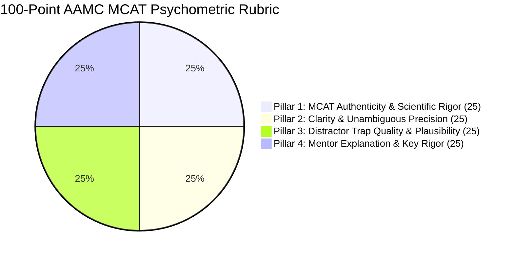

# AAMC MCAT 100-Point Psychometric Rubric & Question Authoring Standards

Engineered by **[Infynno Solutions LLP](https://infynno.com/)** (*"Infinite Innovations"*).

This document specifies the psychometric standards, 100-point quality rubric, cognitive distractor trap engineering principles, AAMC reasoning skills, calibrated scaled score mapping, and pacing guidelines governing the **Infynno MCAT Question Bank Generator v2.0**.

---

## 1. The Official AAMC MCAT Examination Overview

The **Medical College Admission Test (MCAT)**, administered by the Association of American Medical Colleges (AAMC), is the computer-based standardized examination required for admission to medical schools across the United States and Canada.

The MCAT evaluates problem-solving, critical thinking, and knowledge of natural, behavioral, and social science concepts and principles prerequisite to the study of medicine.

### 1.1 The 4 Official Sections & Pacing Standards

| Section Code | Official Section Name | Total Qs | Time Limit | Target Pacing | Core Scientific & Cognitive Domain |
| :---: | :--- | :---: | :---: | :---: | :--- |
| **chem_phys** | **Chemical and Physical Foundations of Biological Systems** | 59 | 95 mins | **~96s / question** | General chemistry, organic chemistry, physics, biochemistry, cellular thermodynamics, and laboratory kinetics. |
| **cars** | **Critical Analysis and Reasoning Skills** | 53 | 90 mins | **~101s / question** | Humanities and social sciences rhetoric, authorial tone, thesis extraction, inference, and philosophical argument critique (100% passage-based, strictly 0 discretes). |
| **bio_biochem** | **Biological and Biochemical Foundations of Living Systems** | 59 | 95 mins | **~96s / question** | Molecular genetics, metabolic pathways, microbiology, organ system physiology, enzymatic regulation, and gel/Western blot analysis. |
| **psych_soc** | **Psychological, Social, and Biological Foundations of Behavior** | 59 | 95 mins | **~96s / question** | Cognitive psychology, neurobiology, sociology of healthcare, demographic disparity, sensory perception, and experimental design. |

---

## 2. AAMC Scientific Inquiry & Reasoning Skills (SIRS)

All generated questions explicitly test one of the official four AAMC Scientific Inquiry and Reasoning Skills (or CARS reasoning skills):

### Natural, Behavioral & Social Sciences (SIRS)
1. **Skill 1: Knowledge of Scientific Concepts and Principles** — Recognizing, recalling, and defining scientific phenomena, models, and relationships.
2. **Skill 2: Scientific Reasoning and Problem Solving** — Formulating hypotheses, applying conceptual models to novel clinical scenarios, and evaluating scientific solutions.
3. **Skill 3: Reasoning About the Design and Execution of Research** — Evaluating experimental variables, positive/negative controls, ethical standards, and instrumentation validity.
4. **Skill 4: Data-Based and Statistical Reasoning** — Reading tables, dose-response curves, gel electrophoresis assays, bar charts, and evaluating statistical significance ($p < 0.05$).

### Critical Analysis and Reasoning Skills (CARS)
1. **Foundations of Comprehension** — Understanding the literal meaning and main ideas of complex philosophical and social science passages.
2. **Reasoning Within the Text** — Identifying assumptions, evaluating evidence, and understanding rhetorical tone and logical connections within the passage.
3. **Reasoning Beyond the Text** — Applying passage arguments to novel external scenarios and assessing the impact of new information on the author's thesis.

---

## 3. The 100-Point Psychometric Rubric

Every candidate question drafted by the autonomous pipeline is audited against a standardized **100-point rubric** divided into 4 equal 25-point pillars:



---

### Pillar 1: MCAT Authenticity & Scientific Rigor (0 - 25 Points)
Evaluates whether the stimulus passage or clinical stem matches the exact intellectual register, terminology, units of measurement (SI units), biochemical nomenclature, and experimental structure of official AAMC exam passages.

| Score Range | Descriptor | Criteria |
| :---: | :--- | :--- |
| **23 - 25** | *Flawless Authenticity* | Indistinguishable from official AAMC Section Bank items. Precise biochemical terminology, accurate thermodynamic and kinetic framing, authentic experimental research passage or philosophical argument. |
| **19 - 22** | *Strong Authenticity* | Minor stylistic variance, but scientifically watertight and stylistically consistent with authentic MCAT standards. |
| **14 - 18** | *Borderline* | Simplistic language, colloquial terminology, or scenario slightly uncharacteristic of medical admissions testing. |
| **0 - 13** | *Unacceptable* | Factual error in science, cartoonish or trivia-level prompt, completely unrepresentative of MCAT rigor. |

---

### Pillar 2: Clarity & Unambiguous Precision (0 - 25 Points)
Ensures the question stem contains all necessary conditions and variables, is free of grammatical ambiguity, and leaves zero doubt as to what is being asked.

| Score Range | Descriptor | Criteria |
| :---: | :--- | :--- |
| **23 - 25** | *Axiomatic Precision* | Absolute clarity. The question stem guides the candidate unequivocally to the exact variable or reasoning required. |
| **19 - 22** | *Sound & Clear* | Premise is logically valid with minimal extraneous fluff; stem is straightforward. |
| **14 - 18** | *Ambiguous* | Borderline double-negative phrasing or subtle omission in the passage causing legitimate contention. |
| **0 - 13** | *Confusing* | Self-contradictory stem or flawed premise that makes selecting an objectively correct answer impossible. |

---

### Pillar 3: Distractor Trap Quality & Plausibility (0 - 25 Points)
Official MCAT distractors are **never trivial or obviously wrong**; they are deliberate psychological traps reflecting real student misconceptions, inverse relationships, arithmetic sign inversions, or out-of-scope over-extrapolations.

| Score Range | Descriptor | Criteria |
| :---: | :--- | :--- |
| **23 - 25** | *Exceptional Traps* | All 3 distractors are highly plausible, scientifically coherent, and target distinct cognitive traps. Options exhibit symmetric length (word-count spread within `max(3, ceil(0.20 x mean))` words, see `agents/standards.py`) and grammatical parallelism. |
| **19 - 22** | *Strong Distractors* | Options represent genuine misconceptions with strong plausibility; minor length variance. |
| **14 - 18** | *Mediocre Distractors* | One distractor is easily eliminated by basic common sense; trap mechanisms are weak. |
| **0 - 13** | *Defective Options* | Distractors are silly, obviously absurd, or mathematically incoherent. |

---

### Pillar 4: Mentor Explanation & Key Rigor (0 - 25 Points)
The correct answer must be incontrovertible. Before any model-based scoring, free deterministic validators check structure (four unique options, a valid single key, no em/en dashes, no all/none of the above) and repair forbidden punctuation automatically. Scoring is evidence-based: each pillar starts at 25 and loses points for every concrete flaw the reviewer can name, and an independent reviewer audits every draft even if the generator's own self-critique passed. Beyond editorial evaluation, the system enforces algorithmic verification via the **Blind-Solver Dual Validation Agent**, which solves the question without access to the key. To earn full credit, the key must be incontrovertibly deduced from passage evidence, and the explanation must provide deep pedagogical value structured into:
1. Proof of why the key is correct (Core intuition + step-by-step mathematical or deductive proof).
2. Step-by-step refutation of each incorrect distractor ($A, B, C, D$).
3. Cognitive trap spotlight detailing psychological error mechanisms and actionable student defense strategies.

| Score Range | Descriptor | Criteria |
| :---: | :--- | :--- |
| **23 - 25** | *Gold-Standard Pedagogy* | Incontrovertible key verified by Blind-Solver ($\ge 88\%$ confidence), elegant step-by-step scientific proof, rigorous distractor breakdown for all choices, and tactical defense guidance. |
| **19 - 22** | *Thorough Explanation* | Valid proof and refutations, but lacks nuanced cognitive trap defense notes. |
| **14 - 18** | *Superficial Explanation* | Explains only why the key is right without explaining why distractors are wrong. |
| **0 - 13** | *Defective / Circular* | Simply restates the question key ("B is correct because B is the right answer") with no proof, or key is disputed by Blind-Solver. |

---

## 4. The Cognitive Trap Taxonomy for Distractors

The engine's trap taxonomy is data, not hard-coded prose: `backend/app/data/mcat_dependent_taxonomy.json` (`generation_options.primary_trap`), loaded as `PRIMARY_TRAPS` in `backend/app/schemas/mcat.py`. It contains **25** ids in UPPER_SNAKE case (the file notes these are internal generation taxonomies, not official AAMC labels, and that one primary trap is used per question). The earlier "11 official trap types" list (`Scope_Shift`, `Keyword_Trap`, ...) does not exist in the code.

| # | Trap id | UI label (`mcatTraps.js`) | Error mechanism / student advice (`mcatTraps.js`) |
| :---: | :--- | :--- | :--- |
| 1 | `CONCEPT_CONFUSION` | Concept Confusion | Conflates two closely related scientific concepts, models, or physiological mechanisms. |
| 2 | `WRONG_BASE` | Wrong Base or Reference Value | Uses the incorrect initial quantity, baseline value, or denominator when computing changes. |
| 3 | `UNIT_CONVERSION` | Unit Conversion Error | Forgets or mishandles dimensional unit conversions (e.g., nm to m, mL to L, or kJ to J). |
| 4 | `FORMULA_MISAPPLICATION` | Formula Misapplication | Selects a formula whose underlying assumptions or physical boundary conditions are violated. |
| 5 | `SIGN_CONVENTION` | Sign or Direction Convention | Reverses a vector direction, thermodynamic sign convention (+/- Delta G/H), or electrochemical potential. |
| 6 | `PROPORTIONALITY_ERROR` | Proportionality Error | Mistakes an inverse relationship for direct proportionality, or overlooks a squared/square-root exponent. |
| 7 | `ASSUMPTION_MISSED` | Missed Assumption or Condition | Fails to check essential boundary conditions (e.g. STP, ideal gas, steady-state enzyme kinetics). |
| 8 | `CAUSE_EFFECT_CONFUSION` | Cause-Effect Confusion | Reverses the direction of causality between two biological, biochemical, or social phenomena. |
| 9 | `CORRELATION_CAUSATION` | Correlation vs. Causation | Mistakes an observed statistical association for proof of a direct mechanistic cause-and-effect relationship. |
| 10 | `CONTROL_GROUP_CONFUSION` | Control-Group Confusion | Confuses the negative/vehicle control with experimental manipulation groups or baseline states. |
| 11 | `VARIABLE_CONFUSION` | Independent/Dependent Variable Confusion | Swaps the variable manipulated by researchers with the outcome variable being measured. |
| 12 | `SAMPLE_SIZE_BIAS` | Sampling or Sample-Size Bias | Draws broad clinical or population generalizations from an underpowered or non-representative sample. |
| 13 | `STATISTICAL_SIGNIFICANCE` | Statistical Significance Misconception | Equates failure to reject the null hypothesis with proof of no effect, or confuses p-values with effect magnitude. |
| 14 | `GRAPH_AXIS_MISREADING` | Graph or Axis Misreading | Misreads axes, logarithmic scales, inverted coordinates, or compares mismatched experimental series. |
| 15 | `TABLE_COMPARISON_ERROR` | Table Comparison Error | Misaligns rows and columns or compares treatment groups without normalizing to baseline controls. |
| 16 | `TREND_EXTRAPOLATION` | Unsupported Trend Extrapolation | Extrapolates a linear or monotonic trend beyond the empirical range tested in the study. |
| 17 | `MECHANISM_CONFUSION` | Mechanism Confusion | Proposes an unverified reaction pathway, enzymatic intermediate, or physiological cascade. |
| 18 | `EXCEPTION_OVERLOOKED` | Exception or Qualifier Overlooked | Ignores crucial qualifying conditions in the stem such as "under aerobic conditions only" or "at physiological pH". |
| 19 | `NEGATION_MISREAD` | Negation or NOT/EXCEPT Misread | Overlooks negative phrasing (e.g., "LEAST likely", "EXCEPT", "NOT supported") and picks a true statement. |
| 20 | `SCOPE_SHIFT` | Scope Shift | Generalizes a finding observed in cell culture or animal models directly to whole-organism human physiology. |
| 21 | `UNSUPPORTED_INFERENCE` | Unsupported Inference | Selects an answer that sounds scientifically plausible but lacks empirical proof in the supplied passage. |
| 22 | `PASSAGE_CONTRADICTION` | Passage Contradiction | States a claim that directly contradicts experimental data, figures, or author arguments in the passage. |
| 23 | `OVERGENERALIZATION` | Overgeneralization | Uses unhedged absolutes ("always", "never", "invariably") where only a conditional effect was shown. |
| 24 | `DISTRACTOR_OVERINTERPRETATION` | Distractor Overinterpretation | Reads complex unstated motives or unwarranted biochemical consequences into simple factual data. |
| 25 | `ANSWER_CHOICE_CONFLATION` | Answer-Choice Conflation | Merges elements of two distinct answer choices to form a seemingly comprehensive but erroneous hybrid. |

The backend taxonomy file (`generation_options.primary_trap`) stores only the id and a short `value` label per trap; the richer label and advice text above come from the frontend constant `frontend/src/constants/mcatTraps.js` (`MCAT_TRAP_DEFINITIONS`, keyed by the same 25 ids).

- **Automatic mode**: the default request value `"Automatic"` lets the generator pick the best-fit id; `normalize_primary_trap` then maps whatever the model returns onto this list (case, space and hyphen tolerant, with a label-text fallback), and `detect_primary_trap` (`agents/draft_parser.py`) falls back to regex matching of the explanation when no trap is returned.
- **Trap rotation**: on a slot replenishment attempt (attempt $> 0$) the engine's diversity context (`_build_diversity_context` in `workflow/engine_layout.py`) tells the generator to use `ALT_TRAP_ROTATION[(idx + attempt) % 8]` (`schemas/mcat.py`): `CONCEPT_CONFUSION`, `FORMULA_MISAPPLICATION`, `SIGN_CONVENTION`, `PROPORTIONALITY_ERROR`, `VARIABLE_CONFUSION`, `CAUSE_EFFECT_CONFUSION`, `TREND_EXTRAPOLATION`, `ASSUMPTION_MISSED`. On the first attempt it instead lists the traps already used by sibling slots and asks for a complementary one.

---

## 5. Calibrated Difficulty Calibration Tiers (Low, Medium, High)

The generator calibrates questions into 3 difficulty tiers across the authoring wizard, question cards, and repository filters:

| Difficulty Tier | Cognitive Complexity | Typical AAMC Reasoning Skill | Characteristics & Trap Sophistication |
| :---: | :--- | :--- | :--- |
| **Low** | Direct recall & single-step deduction | Skill 1 (Knowledge of Concepts) / CARS Skill 1 | Direct application of core definitions, single-variable calculations, direct passage fact extraction; clear distractors targeting basic misconceptions. |
| **Medium** | Multi-step reasoning & graphical data | Skill 2 (Scientific Problem Solving) / CARS Skill 2 | Multi-step deduction, two-variable data analysis (e.g., standard Michaelis-Menten curve or Lineweaver-Burk interpretation), standard distractor traps (e.g. calculation formula traps, sign inversions). |
| **High** | Multi-component synthesis & research design | Skill 3 (Research Design) & Skill 4 (Data/Stats) / CARS Skill 3 | Novel experimental setups, subtle rhetorical tone shifts, conflicting hypotheses, multi-step stoichiometry or kinetics, highly sophisticated distractors (e.g., subtle half-truths, unwarranted assumptions). |

---

## 6. 100-Point 4-Pillar Psychometric Audit Calibration & First-Pass 100/100 Directive

Every question candidate is evaluated against a 100-point psychometric audit structured across four equal 25-point pillars:

| Pillar | Focus & Standards | Max Points |
| :--- | :--- | :---: |
| **1. Authenticity & Tone** | Medical school curriculum alignment, authentic clinical/research vignettes, scientific precision, and AAMC tone authenticity. | **25** |
| **2. Clarity & Scientific Logic** | Unambiguous question stem, sound deductive logic, rigorous chemical/biological mechanisms, and avoidance of AI artifacts. | **25** |
| **3. Distractor Traps & Symmetry** | Strictly 4 options, length parity (word-count spread of at most `max(3, ceil(0.20 x mean option length))`), parallel grammar, and authentic AAMC cognitive distractor traps. | **25** |
| **4. Explanation Rigor** | 3-part pedagogical rationale (why correct key is incontrovertible, itemized flaws for each of the 3 distractors, and cognitive trap defense advice). | **25** |

### 6.1 First-Pass 100/100 Excellence Directive
- **Generator Mandate**: The question generator agent (`generator.py` and `prompt_builder.py`) is explicitly instructed to author items aiming for a perfect score of **100 out of 100** on the initial pass (25/25 across all four pillars).
- **Reviewer Calibration**: The independent reviewer agent (`reviewer.py`) awards full points (25 in each pillar) whenever an item meets all requirements with zero concrete flaws, removing artificial score dampening. Candidate items that achieve flawless science, length parity, and exhaustive explanations receive their earned top scores on the first pass itself without unnecessary refinement cycles.

---

## 7. Quality Threshold Model & Quality Gates

The system enforces a strict psychometric quality evaluation framework governed by a single canonical threshold, `PASSING_SCORE_THRESHOLD` (default `80`, `backend/app/core/config.py`, overridable through `.env`):

### 7.1 Dynamic Three-Tier Threshold Model
1. **High Quality (`score > 80`)**:
   - Items scoring $> 80$ on the 100-point rubric (`config.passes_quality_gate`, strictly greater) qualify for the **AI Validated Questions** workspace (`status = 'ai_validated'`, after their batch completes) and, once an educator approves them, admission into the **Question Bank** (`status = 'in_bank'`).
2. **Good Quality (`70 <= score <= 80`)**:
   - Automatically derived via `config.BATCH_PASSING_SCORE_THRESHOLD = PASSING_SCORE_THRESHOLD - 10 = 70`.
   - Items scoring between 70 and 80 remain safely in `batch_only` status within active or completed batches as solid, high-yield practice items (`determine_question_status` treats 70 as inclusive; the unused helper `config.passes_batch_quality_gate` is strictly `> 70`, a minor code inconsistency).
3. **Needs Polish (`score < 70`)**:
   - A persisted score below 70 maps to `below_threshold`. In the live pipeline a draft below 70 is remediated while iterations remain, and at iteration 3 it is rejected (`reject`), not saved.

### 7.2 3-Iteration Quality Optimization Workflow (`workflow/routes.py`, `review_loop.py`)
- **Iterations 1 & 2**: When a candidate scores $\le 80$ (or the review is marked failed, for example by the blind solver), the workflow routes the draft to the **Regenerator** agent to repair specific distractor flaws or deepen rationale proofs, actively striving to exceed 80. Deterministic validator failures (structure, a hard duplicate after a rewrite) are also sent to the Regenerator before any LLM review is paid for.
- **Iteration 3 (Final Cycle)**: If the item scores $\ge 70$ it is accepted into the batch as Good Quality and continues to image generation or finalize (`"image_generator"` / `"finalize"`), provided the blind solver verifies the key; a blind-solver failure at iteration 3 is always a rejection. Items below 70 at iteration 3 are halted and rejected (`"reject"`).
- **Blind-solver interaction**: a failed solver verdict caps the review's `total_score` at 75 and sets `passed = False`; the solver samples use `BLIND_SOLVER_MAX_TOKENS = 2048` and the second sample runs at `BLIND_SOLVER_TEMPERATURE + 0.2`.
- **Structural-failure score**: a draft that fails the free deterministic checks is represented to the Regenerator by a synthetic review (all four pillars 15, `total_score` 60), not by an LLM score.
- **Job-level trials**: separately from these in-slot iterations, a batch job may replenish shortfalls over up to `MAX_JOB_TRIALS = 3` trials (see `ARCHITECTURE.md` §5).

---

## 8. Smart AI Choice & Targeted Misconception Calibration (`likely_mistake_pattern`)

Beyond standard cognitive traps, the engine operationalizes pedagogical misconception diagnosis:
1. **Automatic (Smart AI Choice)**: The generator agent analyzes the scientific research study, equations, and question stem to autonomously diagnose the most authentic student calculation or conceptual error for the tested concept. The curated taxonomy (`generation_options.likely_mistake_pattern` in `mcat_dependent_taxonomy.json`, exposed as `LIKELY_MISTAKE_PATTERNS`) has 23 ids, among them `USES_WRONG_REFERENCE_VALUE`, `CONFUSES_ABSOLUTE_RELATIVE_CHANGE`, `CONFUSES_KM_VMAX`, `ASSUMES_BOTH_ENZYME_PARAMETERS_CHANGE`, `IGNORES_UNITS`, `USES_WRONG_EQUATION`, `DROPS_NEGATIVE_SIGN`, `CONFUSES_RATE_WITH_AMOUNT`, `CONFUSES_MOLARITY_MOLES`, `MISREADS_GRAPH_AXES`, `ASSUMES_CORRELATION_CAUSATION`, `MISIDENTIFIES_VARIABLES`, `MISUNDERSTANDS_CONTROL`, `IGNORES_CONFOUND`, `OVERREADS_STATISTICAL_SIGNIFICANCE`, `FAILURE_TO_REJECT_AS_PROOF`, `EXTRAPOLATES_BEYOND_DATA`, `USES_OUTSIDE_KNOWLEDGE_OVER_PASSAGE`, `CONFUSES_AUTHOR_VIEW_WITH_REPORTED_VIEW`, `SELECTS_PARTLY_TRUE_OPTION`, `MISSES_QUALIFIER`, `CONFUSES_SIMILAR_TERMS`, `ASSUMES_UNSTATED_CAUSE`, `OVERGENERALIZES_RESULT`. A custom free-text pattern is also accepted.
2. **Explicit Distractor Targeting**: At least one distractor option is engineered specifically to attract students committing that exact misconception, and the complete error mechanism is detailed in the 3-card mentor explanation.
3. **Audit Trail Persistence**: The diagnosed pattern is saved to PostgreSQL in `likely_mistake_pattern` (a `TEXT` column; `normalize_mistake_pattern` stores the taxonomy's human-readable `value` text for a recognized id) and shown in the question and audit views.

---

## 9. Cognitive Slot Blueprints & Replenishment Rotation for Passage Sets

When generating 5-question passage sets, the multi-agent pipeline enforces structured pedagogical archetypes defined in [`backend/app/workflow/passage_blueprints.py`](../backend/app/workflow/passage_blueprints.py) (`CARS_PASSAGE_SET_BLUEPRINTS`, `SCIENCE_PASSAGE_SET_BLUEPRINTS`; the slot is the question index modulo 5). This prevents the common LLM failure mode of drafting 5 questions that test identical passage recall facts. The archetype strings below are the exact `archetype` values in code; the `skill` column is the blueprint's `skill` code.

### 9.1 Slot Blueprints Specification

#### Critical Analysis and Reasoning Skills (CARS)
| Slot Index | Archetype (exact code string) | Skill code | Core Pedagogical Mandate (from the slot directive) |
| :---: | :--- | :---: | :--- |
| **Slot 1** | **Central Claim / Main Thesis** | `CARS1` | The author's overarching thesis, central argument or primary communicative purpose across the whole passage. |
| **Slot 2** | **Local Detail & Passage Evidence** | `CARS1` | Direct textual comprehension of a specific concept, term or relationship in the early paragraphs; not the overall thesis. |
| **Slot 3** | **Rhetorical Function / Author's Stance** | `CARS2` | The logical or rhetorical function of a phrase, metaphor or cited example in the middle of the passage. |
| **Slot 4** | **Reasoning Beyond the Text: Novel Scenario Application** | `CARS3` | Extrapolate the author's reasoning to a new hypothetical scenario not in the text; the scenario domain is drawn from `CARS_SLOT4_APPLICATION_DOMAINS` (see 9.2). |
| **Slot 5** | **Reasoning Beyond the Text: Challenge / Weaken Assumptions** | `CARS3` | Which new finding or counter-example would most directly challenge a boundary condition or assumption in the concluding paragraphs; must not repeat slots 1 to 4. |

#### Natural, Behavioral & Social Sciences (Chem/Phys, Bio/Biochem, Psych/Soc)
| Slot Index | Archetype (exact code string) | Skill code | Core Pedagogical Mandate (from the slot directive) |
| :---: | :--- | :---: | :--- |
| **Slot 1** | **Scientific Concept & Principle Foundation** | `Skill_1` | Foundational concepts, definition, nomenclature or fundamental law referenced in the introductory paragraph. |
| **Slot 2** | **Data, Figure & Graph Interpretation** | `Skill_4` | Data-based and statistical reasoning on a quantitative trend, table, figure or assay baseline described in the passage. |
| **Slot 3** | **Experimental Design & Methodological Rationale** | `Skill_3` | Why a control was chosen, how a variable was isolated, or the rationale for an assay or reagent. |
| **Slot 4** | **Scientific Reasoning & Problem Solving / Downstream Mechanism** | `Skill_2` | Multi-step mechanistic deduction combining a middle or late passage observation with outside knowledge. |
| **Slot 5** | **Novel Experimental Condition / Hypothesis Testing** | `Skill_2` | Predict the outcome of a follow-up experiment under a perturbation drawn from `SCIENCE_SLOT5_EXPERIMENTAL_CONDITIONS` (see 9.2). |

In live mode, `extract_passage_slot_blueprints` additionally asks the LLM for a passage-grounded target per slot and appends it to the static directive; offline or on failure it builds deterministic paragraph-anchored directives instead.

---

### 9.2 Replenishment Rotation Pools & Modulo Arithmetic

When a question slot is re-attempted (`WORKFLOW_MAX_WORKER_RETRIES = 2`, so up to 3 attempts per slot), `slot_worker.py` rotates the slot's application domain or experimental condition so a retry does not repeat the same one:

```python
domain_idx = resolve_slot_domain_index(request, attempt=attempt)
# job/set #N in thematic_angle -> (N - 1 + attempt) % 10
# otherwise a seed (passage_id, batch_id, thematic_angle or run_id) -> (abs(hash(seed)) + attempt) % 10
# no seed -> attempt % 10
```

Both pools have **10** entries, so the modulus is 10. The rotation is applied to question indexes `idx % 5 == 3` for CARS (the Slot 4 position, domain pool) and `idx % 5 == 4` for science sections (the Slot 5 position, condition pool). The hash-based branch uses Python's built-in `hash`, which is randomized per process unless `PYTHONHASHSEED` is set.

#### CARS Slot 4 Application Domains (`CARS_SLOT4_APPLICATION_DOMAINS`)
| Index | Application Domain | Focus (examples in the code string) |
| :---: | :--- | :--- |
| `0` | **Clinical Medical Ethics & Patient Autonomy** | triage protocols, informed consent disputes, surrogate decision-making |
| `1` | **Environmental Policy & Conservation Governance** | water rights allocation, biodiversity treaties, ecological remediation |
| `2` | **Historical Jurisprudence & Constitutional Law** | statutory interpretation, judicial precedent, executive wartime powers |
| `3` | **Art Curation & Architectural Preservation** | museum restitution claims, urban monument removal, adaptive reuse ethics |
| `4` | **Behavioral Economics & Consumer Welfare** | regulatory nudges, anti-monopoly enforcement, public utility rate-setting |
| `5` | **Artificial Intelligence & Algorithmic Governance** | automated recidivism risk scoring, facial recognition limits, transparency mandates |
| `6` | **Higher Education & Standardized Evaluation Policy** | affirmative action, holistic admissions, vocational tracking |
| `7` | **Civic Infrastructure & Urban Planning** | transit equity, eminent domain, disaster mitigation zoning |
| `8` | **Academic Publishing & Scientific Integrity** | peer review confidentiality, replication mandates, patenting academic discoveries |
| `9` | **International Diplomacy & Treaty Compliance** | arms inspection protocols, cross-border carbon border adjustments, diplomatic immunity |

#### Science Slot 5 Experimental Conditions (`SCIENCE_SLOT5_EXPERIMENTAL_CONDITIONS`)
| Index | Experimental Condition | Example perturbation (from the code string) |
| :---: | :--- | :--- |
| `0` | **Targeted Small-Molecule Enzyme Inhibition** | novel competitive vs allosteric inhibitor added to assay |
| `1` | **Genetic Knockdown / CRISPR Disruption** | siRNA silencing of target kinase or transporter |
| `2` | **Physiological Stress / Environmental Perturbation** | altered extracellular pH, hyperosmotic shock, hypothermic incubation |
| `3` | **Isotopic Tracer / Radioligand Competition** | deuterated substrate substitution or pulse-chase labeling |
| `4` | **Site-Directed Mutagenesis** | conservative vs non-conservative active-site residue substitution |
| `5` | **Receptor Antagonism / Channel Blockade** | selective receptor blocker or ionophore titration |
| `6` | **Metabolic Intermediate Depletion** | nutrient starvation, glycolytic inhibitor, or uncoupling agent |
| `7` | **Co-culture / Multi-Tissue Interaction** | conditioned media transfer or paracrine signaling assay |
| `8` | **Altered Kinetic Substrate Range** | varying substrate concentrations across Vmax / Km regimes |
| `9` | **In Vivo Animal Model Validation** | knockout mouse phenotype vs in vitro cell culture findings |
