# Infynno MCAT Question Bank Generator v2.0 - Documentation Suite

Welcome to the official documentation portal for the **Infynno MCAT Question Bank Generator v2.0**, engineered by **[Infynno Solutions LLP](https://infynno.com/)** (*"Infinite Innovations"*).

This centralized hub provides an architectural overview, role-based navigation guides, and direct links to every technical specification and operational manual across the repository.

---

## 🗺️ Documentation Directory & Architecture Map

```mermaid
graph TD
    Root[Infynno MCAT Question Bank Generator Docs]
    
    subgraph "Core Operational Guides"
        Root --> ClientGuide[Client System & Workflow Guide<br>docs/CLIENT_SYSTEM_AND_WORKFLOW_GUIDE.md]
        Root --> Rubric[AAMC MCAT Psychometric Rubric<br>docs/MCAT_RUBRIC.md]
        Root --> Setup[Installation & Deployment<br>docs/SETUP_AND_CONFIG.md]
    end

    subgraph "Technical & Engineering Specs"
        Root --> Arch[System Architecture & Multi-Agent Flow<br>docs/ARCHITECTURE.md]
        Root --> API[REST & SSE API Reference<br>docs/API.md]
        Root --> Tokens[Token Usage & Cost Tracking<br>docs/TOKEN_TRACKING.md]
        Root --> QA[Testing & Quality Assurance Guide<br>docs/TESTING_AND_QA.md]
        Root --> Design[UI/UX Design System Guide<br>DESIGN.md]
    end

    subgraph "Subsystem Engineering Guides"
        Root --> BackendGuide[Backend Developer Guide<br>backend/README.md]
        Root --> FrontendGuide[Frontend Workstation Guide<br>frontend/README.md]
        Root --> Contrib[Contributing & Code Standards<br>CONTRIBUTING.md]
    end
```

---

## 📚 Complete Guides Index

| Document | Primary Audience | Core Focus & Description |
| :--- | :--- | :--- |
| **[Client System & Workflow Guide](CLIENT_SYSTEM_AND_WORKFLOW_GUIDE.md)** | Product Stakeholders, Medical Admissions Educators | End-to-end operational walkthrough: 3-step Guided Wizard, 2 calibrated generation scopes (Practice Set [5 Qs] and Full Exam [50 Qs]), Low/Medium/High challenge levels, Blind-Solver safeguard, AAMC Split-Pane reading mode, canonical Editorial Cards Question Bank, 3-card mentor explanations, and financial transparency. |
| **[System Architecture & Workflow](ARCHITECTURE.md)** | System Architects, AI Engineers | Multi-agent LangGraph StateGraph, Fused Draft-and-Critique engine, Blind-Solver Dual Validation agent, Autonomous Remediation loop, Strict Quality Gate, Two-Tier quality threshold model, Global Concurrency Semaphores, PostgreSQL 16 ERD, and batch execution pipeline. |
| **[REST & SSE API Reference](API.md)** | Full-Stack & API Developers | Comprehensive reference of all 38 Z endpoint paths, duplicate check, cluster inspection, auto-resolve & refill endpoints, soft-deletion restoration (`/restore`), permanent purges (`/permanent`, `/purge-batch`), request/response models, batch controls (`/start`, `/stop`, `/retry`, `/cancel-all`), lifecycle transitions, and cURL examples. |
| **[Testing & Quality Assurance Guide](TESTING_AND_QA.md)** | QA Engineers, DevOps, Full-Stack Developers | Full technical specification of the 197 passing deterministic unit/integration tests across 37 modules (207 total backend tests), 15 TestSprite Playwright E2E browser tests (100% pass rate), Ruff & Oxlint zero-defect policies, and CI pipeline workflows. |
| **[Token Usage & Cost Tracking](TOKEN_TRACKING.md)** | Finance, DevOps, Developers | Dual first-class inference pricing: DeepInfra rate card ($0.098 input / $0.294 output per 1M tokens), Anthropic Claude rates ($0.10/$0.50 per 1M with prompt cache write/read rates), FLUX image pricing ($0.014/unit), exact sub-micro-cent mathematical formulas, Blind-Solver token tracking, and UI observability. |
| **[Installation, Setup & Deployment](SETUP_AND_CONFIG.md)** | DevOps, QA Engineers, Developers | Complete environment provisioning: Docker PostgreSQL 16 setup, virtual environment, all 53 configuration parameters, automated verification (55 offline / 97 DB / 207 total tests), database duplicate cleanup utility (`pnpm run db:clean-duplicates`), predev port cleanup, production servers, and FAQs. |
| **[AAMC Psychometric Rubric & Standards](MCAT_RUBRIC.md)** | Content Authors, Psychometricians | Official 4 AAMC section standards (~96s to ~101s pacing), 100-point 4-pillar quality audit rubric, Low/Medium/High difficulty rubrics, Blind-Solver algorithmic verification, AAMC SIRS reasoning skills, scaled score calibration (118-132), and 11 cognitive distractor traps. |
| **[UI/UX Design System (DESIGN.md)](../DESIGN.md)** | Frontend Designers, UI Engineers | Authoritative design tokens (dark obsidian / alabaster light), streamlined 3-step wizard specs with decomposed summary/advanced drawers, QuestionCard subcomponents, Duplicate Comparison Modal, AAMC Dual Split-Pane reading mode, accessible modal focus-trapping contracts (`Modal`, `ConfirmationModal`, `DeletePassageModal`), live batch retry telemetry (`AUTO-RETRYING X/3`), Active Multi-Batch Concurrency monitor, typography stacks, and micro-animations. |
| **[Backend Developer Guide](../backend/README.md)** | Python & Backend Engineers | Modular layer separation (`api/`, `workflow/`, `agents/`, `repositories/`, `models/`, `schemas/`), dual LLM providers (DeepInfra + Anthropic), Blind-Solver agent, Deduplication service, soft-deletion DAL, async database sessions, global worker semaphores, 3-trial batch retry engine, and 97-test automated suite execution. |
| **[Frontend Workstation Guide](../frontend/README.md)** | React & Frontend Engineers | React 19 architecture, Vite 8 build pipeline, top-level views (`views/`), decomposed feature components (`wizard/`, `passage/`, `question/`, `bank/`, `batch/`, `validated/`, `modals/`, `common/`), accessible modal focus-trapping, predev port cleaner, and custom hooks. |
| **[Contributing Guidelines](../CONTRIBUTING.md)** | Contributors & Developers | Zero-defect testing policy (197 deterministic tests across 37 modules required + TestSprite E2E validation), Oxlint & Ruff formatting, MCAT 4-choice purity standards, anti-AI hyphenation, and Git PR conventions. |

---

## 👥 Role-Based Reading Paths

Find the most relevant starting point based on your objective:

### 1. Medical Admissions Educator & Content Director
- Start with **[CLIENT_SYSTEM_AND_WORKFLOW_GUIDE.md](CLIENT_SYSTEM_AND_WORKFLOW_GUIDE.md)** for a high-level operational overview, AAMC Split-Pane reading mode, and Blind-Solver safeguards.
- Consult **[MCAT_RUBRIC.md](MCAT_RUBRIC.md)** to understand how candidate items are scored and calibrated against AAMC percentiles.
- Review **[DESIGN.md](../DESIGN.md)** Section 4.5 for details on printing classroom Exam Papers and Study Packs.

### 2. Full-Stack / Backend Engineer
- Start with **[ARCHITECTURE.md](ARCHITECTURE.md)** to understand the LangGraph state machine, dual LLM providers (DeepInfra + Anthropic Claude), Blind-Solver validation, Deduplication & Anti-Collision subsystem, and global concurrency semaphores.
- Consult **[API.md](API.md)** for exact specifications of all 38 Z endpoint paths.
- Refer to **[backend/README.md](../backend/README.md)** for local development, repositories, and testing.

### 3. Frontend & UI Engineer
- Read **[DESIGN.md](../DESIGN.md)** for CSS custom properties, dual-theme tokens, AAMC Split-Pane reading mode grid, Duplicate Comparison modal, accessible modal focus-trapping (`ConfirmationModal`, `DeletePassageModal`), and everyday human language rules.
- Consult **[frontend/README.md](../frontend/README.md)** for view routing (`views/`), component prop contracts, and state hooks.
- Cross-reference with **[API.md](API.md)** Section 3.1 for handling real-time Server-Sent Events.

### 4. DevOps & QA Engineer
- Follow **[SETUP_AND_CONFIG.md](SETUP_AND_CONFIG.md)** to configure PostgreSQL 16 via Docker, set `.env` secrets, database duplicate cleanup utility (`pnpm run db:clean-duplicates`), predev port cleaners, and deploy Gunicorn/Uvicorn.
- Consult **[TESTING_AND_QA.md](TESTING_AND_QA.md)** for detailed coverage of the 197 deterministic pytest cases across 37 modules (plus 10 live tests) and the Playwright E2E scenarios in `e2e/`.
- Review **[TOKEN_TRACKING.md](TOKEN_TRACKING.md)** for multi-provider inference rate cards and budget monitoring.
- Execute automated quality checks as detailed in **[CONTRIBUTING.md](../CONTRIBUTING.md)** (the deterministic pytest suite + Oxlint on all frontend sources + Ruff).

---

## ⚡ Core Technical Stack Summary

| Layer | Technologies | Key Responsibilities |
| :--- | :--- | :--- |
| **Backend Framework** | **Python 3.11+**, **FastAPI 0.115+**, **Uvicorn** | Asynchronous REST endpoints (38 Z paths), SSE event streaming, security headers. |
| **Workflow Engine** | **LangGraph 0.2+**, **LiteLLM 1.50+** | Multi-agent state graph, fused draft & self-critique, Blind-Solver dual-validation, autonomous remediation loop. |
| **Persistence Tier** | **PostgreSQL 16**, **SQLAlchemy 2.0 (Async)**, **asyncpg** | Normalized 4-entity model (Passages, Batches, Jobs, Questions), connection pooling (`pool_size=20`), JSONB storage, hybrid FTS. |
| **Frontend Framework**| **React 19**, **Vite 8** | Modern reactive workstation, single-canvas studio, AAMC Split-Pane reading mode, real-time live telemetry. |
| **Styling & Theme** | **Vanilla CSS Tokens**, **Lucide Icons** | Linear/Vercel obsidian & alabaster design system, electric conduit animations, accessible focus trapping. |
| **AI Inference** | **DeepSeek V4.1 Flash** (DeepInfra), **Claude Haiku 5.5 / Sonnet / Opus** (Anthropic), **FLUX-2-klein-4b** | Dual first-class high-throughput reasoning (~110-140 tok/s), $0.098/$0.294 (DeepInfra) or $0.10/$0.50 (Anthropic) per 1M tokens, prompt cache pricing, neural visual stimuli. |

---

## 🛡️ Key Architectural Guarantees

1. **MCAT 4-Choice Purity**: Strictly 4 options (A, B, C, D) per question, length-balanced (within 3 words, or 20% for longer options) to eliminate guessing cues. Zero multi-choice or legacy 5-choice artifacts.
2. **Deterministic Quality Gate (>90 Points)**: Every question is audited against an uncompromising 100-point rubric. Unrepaired questions that fail after 3 cycles are discarded immediately.
3. **Blind-Solver Dual Validation**: Every candidate is solved blindly without answer key access. Any key discrepancy or confidence $< 88\%$ triggers automatic remediation.
4. **Soft-Deletion & Batch Integrity**: Non-destructive deletion on questions and reading passages preserves background batch execution progress metrics intact while excluding items from active catalog views, with full restoration support (`POST /api/questions/{id}/restore`).
5. **Question Deduplication & Anti-Collision Safeguard**: Hybrid multi-metric similarity detection ($\ge 0.80$) scoped by Section and Subtopic prevents duplicate question stems, with an autonomous pivot loop, cluster management, hard-delete duplicate purging, and educator side-by-side override audit trail (`is_duplicate_override`).
6. **Review Queue Withholding Guarantee**: Staged questions from running batches stay in `batch_only` status and are strictly withheld from reviewer queues until the batch cleanly completes, at which point questions with scores $> 90$ are atomically promoted to `ai_validated`.
7. **Custom Authoring Instructions Enforcement**: Educator directives (`additional_instructions`) in Guided Wizard Step 3 are injected into prompt builders with high-priority mandate across all generation and critique cycles.
8. **Sub-Micro-Cent Cost Precision & Anti-AI Formatting**: Every token is mathematically accounted for, rounded to 7 decimal places, and persisted alongside question records in PostgreSQL. Strictly forbids em dashes (`—`) or en dashes (`–`).
9. **Autonomous 3-Trials Retry Policy**: Background batch sets automatically execute in-flight replenishment retries up to 3 trials with live telemetry badges (`AUTO-RETRYING X/3`, `3/3 TRIALS EXHAUSTED`), while manual retry options are restricted strictly to "Resume Sets" for manually paused runs under 3 trials (rejecting exhausted sets with HTTP 400).
10. **Zero-Defect Code Hygiene**: Full test suite with 197 passing deterministic unit and integration tests across 37 modules (207 total backend tests), 15 TestSprite Playwright E2E tests (100% pass rate), 0 Ruff errors, and 0 Oxlint warnings.
