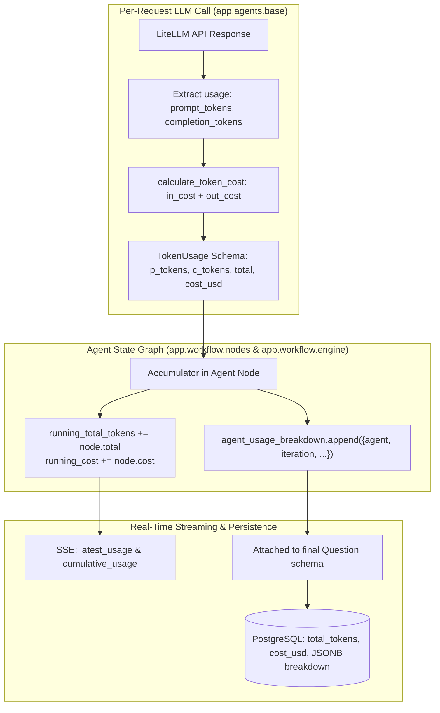

# Per-Request Token Usage & Cost Tracking Specification

Engineered by **[Infynno Solutions LLP](https://infynno.com/)** (*"Infinite Innovations"*).

This document details the token accounting engine, high-throughput pricing rate card, accumulation architecture, database persistence, and frontend observability features built into the **Infynno MCAT Question Bank Generator v2.0**.

---

## 1. Inference Engines & Pricing Rate Cards

The system supports several providers, switchable via `ACTIVE_LLM_PROVIDER=anthropic|openai|deepinfra` in `.env`. **Costs follow the model's own provider**, not the active one: a request-time model from another provider is billed at that provider's rates, and a runtime rate override only re-prices the active provider's models. The single place that records where each built-in price comes from (page and verification date) is `PRICE_SOURCES` in [`backend/app/core/pricing.py`](../backend/app/core/pricing.py); re-check those pages whenever a rate changes. Prices below were verified on **2026-11-05**.

### Anthropic: Claude Haiku 5.5 (`claude-haiku-5-5`)
Source: [Anthropic pricing](https://platform.claude.com/docs/en/about-claude/pricing). USD per million tokens:

| | Prompt up to 100K tokens | Prompt over 100K tokens |
| :--- | :---: | :---: |
| Input | $0.10 | $0.50 |
| Output | $0.50 | $2.50 |
| Cache read | $0.01 | $0.05 |
| Cache write, 5 minute (used by the app) | $0.125 | $0.625 |
| Cache write, 1 hour (not requested by the app) | $0.20 | $1.00 |

The prompt length that selects the tier counts every input token, including cache reads and writes (LiteLLM folds them into `prompt_tokens`, which is what the app tiers on). Any spelling (`claude-haiku-5-5`, `claude-haiku-5.5`, `anthropic/...`) is recognised. Other Claude models come from LiteLLM's registry, then family fallbacks (Sonnet $3/$15, Opus $15/$75, Haiku $0.80/$4), with cache read at 10% and 5-minute write at 125% of the input rate.

### OpenAI: `gpt-4o-mini` (default OpenAI text model)
Source: [OpenAI pricing](https://developers.openai.com/api/docs/pricing). $0.15 in, **$0.075 cached in**, $0.60 out per 1M tokens. Cached input (`prompt_tokens_details.cached_tokens`) is costed at 50% of the input rate. Other OpenAI models (`gpt-4o`, `o3-mini`, `o1`, ...) come from LiteLLM's registry, then family fallbacks.

### DeepInfra: DeepSeek-V4.1-Flash-1017 (`deepinfra/deepseek-ai/DeepSeek-V4.1-Flash-1017`)
Source: [DeepInfra model page](https://deepinfra.com/deepseek-ai/DeepSeek-V4.1-Flash-1017).
- **Standard (the default here): $0.20 in, $0.60 out, $0.006 cached in** per 1M tokens. Cached input is costed at 3% of the input rate.
- DeepInfra currently also shows a **51% promotional price: $0.098 in / $0.294 out / $0.003 cached**, with no end date on the page. To cost at the promo set `DEEPINFRA_COST_PER_MILLION_INPUT_TOKENS=0.098` and `DEEPINFRA_COST_PER_MILLION_OUTPUT_TOKENS=0.294`, and switch back when it ends.
- Priority (1.5x) and Flex (0.8x) service tiers exist; the app uses Standard.
- DeepSeek-R1 (`deepseek-r1`): $0.55 in / $2.19 out (built-in fallback).

---

## 2. Mathematical Cost Computation Engine

The calculation is implemented in [`backend/app/agents/base.py`](../backend/app/agents/base.py) via `calculate_token_cost`; rates come from `Settings.get_default_pricing_rates` ([`core/config.py`](../backend/app/core/config.py)) and the tables in [`core/pricing.py`](../backend/app/core/pricing.py).

For **DeepInfra** and **OpenAI** (cached prompt tokens at a discount, no cache writes):
$$\text{Cost}_{\text{USD}} = \frac{P - K}{10^6} R_{\text{in}} + \frac{K}{10^6} R_{\text{in}} f_{\text{cached}} + \frac{C}{10^6} R_{\text{out}}$$
with $P$ prompt tokens, $K$ cached tokens, $C$ completion tokens, $f_{\text{cached}} = 0.03$ (DeepInfra) or $0.50$ (OpenAI).

For **Anthropic** (with prompt caching; for Haiku 5.5 the four rates come from the tier table above):
$$\text{Cost}_{\text{USD}} = \frac{\text{Base In}}{10^6} R_{\text{in}} + \frac{C}{10^6} R_{\text{out}} + \frac{\text{Cache Read}}{10^6} R_{\text{read}} + \frac{\text{Cache Create}}{10^6} R_{\text{write}}$$

Results are rounded to **7 decimal places** (sub-micro-cent precision). A model that matches no known provider or table is costed with the DeepInfra rates and logged once as `No price known for model ...`.

### Calculation Examples (DeepInfra standard price, $0.20 in / $0.60 out)

| Scenario | Prompt Tokens | Completion Tokens | Input Cost | Output Cost | Total Cost (USD) |
| :--- | :---: | :---: | :---: | :---: | :---: |
| Micro benchmark (1k / 1k) | 1,000 | 1,000 | $0.000200 | $0.000600 | **$0.000800** |
| Fused draft + self-critique | 720 | 480 | $0.000144 | $0.000288 | **$0.000432** |
| Blind-solver pass | 650 | 180 | $0.000130 | $0.000108 | **$0.000238** |
| Independent reviewer pass | 380 | 210 | $0.000076 | $0.000126 | **$0.000202** |
| Re-generator remediation | 510 | 390 | $0.000102 | $0.000234 | **$0.000336** |
| Full mock section (50 questions, approx.) | 40,000 | 28,000 | $0.008000 | $0.016800 | **$0.024800** |
| 1 million input tokens | 1,000,000 | 0 | $0.200000 | $0.000000 | **$0.200000** |
| 1 million output tokens | 0 | 1,000,000 | $0.000000 | $0.600000 | **$0.600000** |

The same micro benchmark on Claude Haiku 5.5 is $0.000600 ($0.10 in + $0.50 out) and on `gpt-4o-mini` $0.000750.

---

## 3. Dedicated AI Image Generation Pricing

Images use **OpenAI** (`ACTIVE_IMAGE_PROVIDER=openai`) or **DeepInfra** (`ACTIVE_IMAGE_PROVIDER=deepinfra`).

### 3.1 OpenAI: `gpt-image-2.5-flare` (default)
Source: [OpenAI model page](https://developers.openai.com/api/docs/models/gpt-image-2.5-flare). It is **billed per token, not per image**: text input $5, image input $8 (cached $1.25 / $2), **image output $30** per 1M tokens (Batch is half). OpenAI publishes no per-image table; the number of output tokens depends on size and quality (the app requests quality `auto`). As a rough guide a 1024x1024 image is about $0.006 at low quality up to about $0.21 at high quality (token counts are an unofficial community estimate).

- The cost the app records is the **returned `usage`** times the configured rates (`OPENAI_IMAGE_COST_PER_MILLION_*`): text tokens at the text rate, image tokens at the image rate, output at the output rate.
- Only when a response carries no `usage` does the app fall back to the flat estimate `OPENAI_IMAGE_COST_PER_UNIT` ($0.020 per 1024x1024, scaled by area) and log a warning.
- Legacy models keep their rate cards for completeness: `gpt-image-2.5-sunburst` fallback estimate $0.060 per 1024x1024 (same token rates as flare), `dall-e-3` $0.040 / $0.080 HD (1024x1024) and $0.080 / $0.120 HD (1792), `dall-e-2` $0.016 / $0.018 / $0.020.

### 3.2 DeepInfra FLUX
Source: [DeepInfra FLUX-2-klein-4b](https://deepinfra.com/black-forest-labs/FLUX-2-klein-4b).
- **`black-forest-labs/FLUX-2-klein-4b`**: $0.014 x (width/1024) x (height/1024) per image (`DEEPINFRA_IMAGE_COST_PER_UNIT`). The provider-reported cost (`inference_status.cost`) is used when a response carries it.
- **`black-forest-labs/FLUX-1-schnell`** (only with `IMAGE_ITERS > 0`): $0.0005 per step at 1024x1024 base unit, scaled by area.

### Cost examples

| Model | Resolution | Cost per image (USD) |
| :--- | :--- | :---: |
| `FLUX-2-klein-4b` | 1024 x 1024 | **$0.014000** |
| `FLUX-2-klein-4b` | 512 x 512 | **$0.003500** |
| `FLUX-2-klein-4b` | 2048 x 2048 | **$0.056000** |
| `gpt-image-2.5-flare` | 1,000 output tokens (usage) | **$0.030000** |
| `gpt-image-2.5-flare` | 196 output tokens (about low quality, 1024x1024) | **$0.005880** + prompt tokens |
| `gpt-image-2.5-flare` | no usage in the response | **$0.020000** (estimate) |
| `FLUX-1-schnell` | 1024 x 1024, 4 steps | **$0.002000** |

---

## 4. Multi-Agent Accumulation Architecture

Tokens are tracked per-request at the lowest LLM abstraction layer and bubbled up through the workflow state.



### 4.1 Data Structures

#### `TokenUsage` Schema ([`app/schemas/token.py`](../backend/app/schemas/token.py#L9-L15))
```python
class TokenUsage(BaseModel):
    prompt_tokens: int = Field(0, description="Input tokens processed")
    completion_tokens: int = Field(0, description="Output tokens generated")
    total_tokens: int = Field(0, description="Sum of prompt and completion tokens")
    cost_usd: float = Field(0.0, description="Estimated total cost in USD")
    duration_ms: int | None = Field(
        None, description="Wall-clock latency of the LLM call in ms, retries included"
    )
```

#### `agent_usage_breakdown` Item Schema
```json
{
  "agent": "Question Writer & Reviewer",
  "iteration": 1,
  "prompt_tokens": 450,
  "completion_tokens": 320,
  "total_tokens": 770,
  "cost_usd": 0.0001474,
  "duration_ms": 2140
}
```

`duration_ms` is recorded by `call_llm` (backoff and model fallback included) and flows into the per-agent breakdown, so per-stage latency can be compared alongside cost.

#### Concurrent Review and Spend Accounting
Each usage entry records `calls` (LLM calls it covers; the blind solver's samples add up), which feeds the `MAX_LLM_CALLS_PER_SLOT` budget. With `PARALLEL_REVIEW_AND_SOLVE=true` (default is `false`: the solver runs only after a passing review) the Auditor and Blind Solver run concurrently. Both calls are always billed: if the review fails first, the solver call is still recorded as a usage-only entry (`build_usage_only_update`) so cumulative cost matches real provider spend.

#### Prompt Caching
Static system prompts are sent as `cache_control: ephemeral` blocks for Anthropic models (`ENABLE_PROMPT_CACHING`). Cache reads and writes already appear in the cost math above. OpenAI and DeepInfra apply automatic prefix caching and need no marker. Prompts shorter than the provider minimum are not cached.

---

## 5. PostgreSQL Persistence & Repository Metrics

Each question persisted in PostgreSQL stores both aggregate summary metrics and the full granular per-cycle audit breakdown:

### Table Columns (`questions`)
| Column Name | SQL Type | Description |
| :--- | :--- | :--- |
| `total_tokens` | `INTEGER DEFAULT 0` | Total tokens consumed across drafting, reviewing, and remediation |
| `prompt_tokens` | `INTEGER DEFAULT 0` | Total input tokens |
| `completion_tokens` | `INTEGER DEFAULT 0` | Total output tokens |
| `cost_usd` | `DOUBLE PRECISION DEFAULT 0.0` | Total USD expense for generating and certifying this question |
| `token_usage_details` | `JSONB` | Granular array of `agent_usage_breakdown` objects |

### Repository-Wide Aggregation
When the client calls `GET /api/questions`, the backend queries repository totals via [`question_repository.py`](../backend/app/repositories/question_repository.py):

```python
total_tokens = sum(q.total_tokens or 0 for q in questions)
total_cost_usd = round(sum(q.cost_usd or 0.0 for q in questions), 5)
```

This delivers global repository cost and token totals directly to the Question Bank header.

---

## 6. UI Observability & User Experience

Token and cost data is surfaced across all active views and specialized domain components in the frontend:

### 1. Active Multi-Batch Concurrency Monitor & Live Stopwatch ([`ActiveMultiBatchMonitor.jsx`](../frontend/src/components/batch/ActiveMultiBatchMonitor.jsx), [`LiveStopwatch.jsx`](../frontend/src/components/common/LiveStopwatch.jsx))
- **Live Worker Telemetry Strip**: Displays live global jobs occupancy (`Global Jobs: X / 4`) and active inference concurrency (`Active Inference: Y / 10`) alongside a high-precision live elapsed stopwatch timer during active batch runs.
- **Micro-Dollar Live Updates**: Visualizes active batch throughput with real-time token accumulation as worker jobs complete.

### 2. Formatted Question Card ([`QuestionCard.jsx`](../frontend/src/components/question/QuestionCard.jsx), [`QuestionCardFooter.jsx`](../frontend/src/components/question/QuestionCardFooter.jsx))
- Displays an emerald/cyan metadata chip in the decomposed question footer:
  `🪙 2,850 tokens • $0.00053`
  giving instant visibility into the generation cost and token breakdown of the displayed question.

### 3. Psychometric Review & Cost Audit Modal ([`ReviewAuditView.jsx`](../frontend/src/components/question/ReviewAuditView.jsx))
- **Summary Metric Cards**: 4-card grid showing Prompt Tokens, Completion Tokens, Total Tokens, and Accumulated Cost.
- **Granular Breakdown Table**: Itemizes every LLM request with prompt tokens, completion tokens, cache reads/writes, total tokens, and sub-micro-cent USD cost.

### 4. Question Bank Repository ([`QuestionBankView.jsx`](../frontend/src/views/QuestionBankView.jsx))
- **Repository Stat Metric**: Displays total accumulated tokens and total expenditure for the entire database:
  `14,250 ($0.0027)`
- **Editorial Card Chips**: Each question card includes a compact chip:
  `🪙 2,850 tok • $0.00053`

### 5. Batch Activity Monitor & Job Cards ([`BatchActivityView.jsx`](../frontend/src/views/BatchActivityView.jsx), [`BatchCard.jsx`](../frontend/src/components/batch/BatchCard.jsx))
- Displays cumulative batch token consumption and aggregate batch cost across all 10 worker jobs.
- Allows educators to inspect individual jobs via [`BatchJobCard.jsx`](../frontend/src/components/batch/BatchJobCard.jsx) with their respective token weights, prompt/completion breakdown, and question scores.

### 6. AI Validated Quality Bank ([`AiValidatedQuestionsView.jsx`](../frontend/src/views/AiValidatedQuestionsView.jsx))
- Header stats bar displays total AI-validated items and total cost of verified inventory.
- Each validated card presents instant token and cost metrics before one-click approval into the canonical bank.
