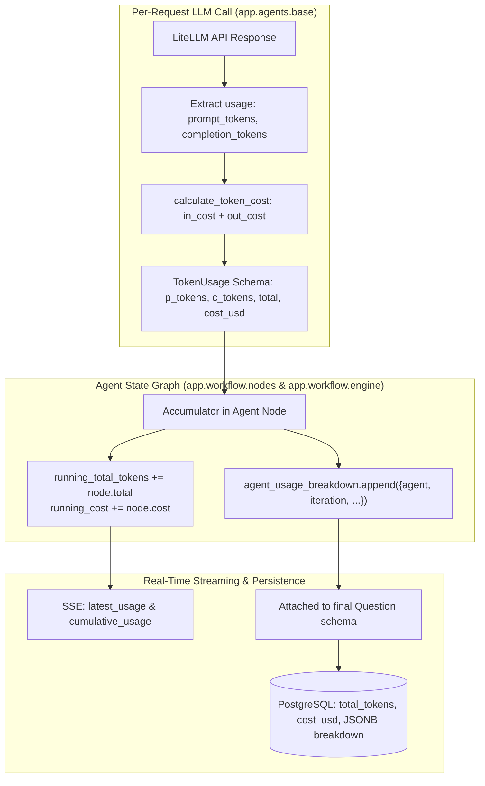

# Per-Request Token Usage & Cost Tracking Specification

Engineered by **[Infynno Solutions LLP](https://infynno.com/)** (*"Infinite Innovations"*).

This document details the token accounting engine, high-throughput pricing rate card, accumulation architecture, database persistence, and frontend observability features built into the **Infynno MCAT Question Bank Generator v2.0**.

---

## 1. Inference Engines & Pricing Rate Cards

The system features multi-provider inference support, seamlessly switchable via `ACTIVE_LLM_PROVIDER=anthropic`, `ACTIVE_LLM_PROVIDER=openai`, or `ACTIVE_LLM_PROVIDER=deepinfra` in `.env`:

### OpenAI Engine: GPT-4o-mini & GPT-4o Family
- **Model Identifiers**: `gpt-4o-mini` (default), `gpt-4o`, `o3-mini`, `o1`
- **Context Window**: 128,000 tokens (up to 200,000 for o1)
- **Official OpenAI Rates**:
  - `gpt-4o-mini`: $0.150 / 1M in ($0.075 / 1M cached prompt), $0.600 / 1M out
  - `gpt-4o`: $2.500 / 1M in ($1.250 / 1M cached prompt), $10.000 / 1M out
  - `o3-mini`: $1.100 / 1M in ($0.550 / 1M cached prompt), $4.400 / 1M out
  - `o1`: $15.000 / 1M in ($7.500 / 1M cached prompt), $60.000 / 1M out
- **Prompt Caching Discount**: Universal 50% discount on cached input tokens (`prompt_tokens_details.cached_tokens`).

### DeepInfra Engine: DeepSeek-V4.1-Flash-1017 & DeepSeek-R1
- **Model Identifier**: `deepinfra/deepseek-ai/DeepSeek-V4.1-Flash-1017`
- **Context Window**: 1,024,000 tokens (1M)
- **Inference Speed**: ~110-140 tokens/second
- **Official Rates**:
  - DeepSeek-V3 / Flash: Input: $0.098 USD per 1,000,000 tokens, Output: $0.294 USD per 1,000,000 tokens
  - DeepSeek-R1: Input: $0.550 USD per 1,000,000 tokens, Output: $2.190 USD per 1,000,000 tokens

### Anthropic Engine: Claude Haiku 5.5
- **Model Identifier**: `claude-haiku-5-5` (or aliases `anthropic/claude-haiku-5-5`, `claude-3-5-haiku-20241022`, `claude-3-5-sonnet-20241022`)
- **Context Window**: 200,000 tokens
- **Inference Speed**: ~100-130 tokens/second
- **Official Claude Haiku 5.5 Rates**:
  - Standard Prompt ($\le$ 100K tokens): $0.10 USD / 1M in, $0.50 USD / 1M out
  - Extended Prompt (> 100K tokens): $0.50 USD / 1M in, $2.50 USD / 1M out
  - Prompt Cache Read: $0.01 / 1M tokens ($\le$ 100K) or $0.05 / 1M (> 100K)
  - Prompt Cache Creation: $0.125 / 1M tokens ($\le$ 100K) or $0.625 / 1M (> 100K)

---

## 2. Mathematical Cost Computation Engine

The calculation is implemented in [`backend/app/agents/base.py`](../backend/app/agents/base.py) via `calculate_token_cost`:

For **DeepInfra**:
$$\text{Cost}_{\text{USD}} = \left(\frac{\text{Prompt Tokens}}{1,000,000} \times 0.098\right) + \left(\frac{\text{Completion Tokens}}{1,000,000} \times 0.294\right)$$

For **Anthropic** (with prompt caching):
$$\text{Cost}_{\text{USD}} = \left(\frac{\text{Base In}}{1,000,000} \times R_{\text{in}}\right) + \left(\frac{\text{Completion}}{1,000,000} \times R_{\text{out}}\right) + \left(\frac{\text{Cache Read}}{1,000,000} \times R_{\text{read}}\right) + \left(\frac{\text{Cache Create}}{1,000,000} \times R_{\text{write}}\right)$$

To preserve numerical accuracy and avoid IEEE 754 floating-point drift, calculations are rounded to **7 decimal places** (sub-micro-cent precision):

```python
def calculate_token_cost(
    prompt_tokens: int,
    completion_tokens: int,
    model: str | None = None,
    cache_read_tokens: int = 0,
    cache_creation_tokens: int = 0,
) -> float:
    """Calculates exact USD cost across DeepInfra or Anthropic with prompt caching."""
    target_model = model or config.DEFAULT_TEXT_MODEL
    if config.is_anthropic_model(target_model):
        in_rate, out_rate = config.get_default_pricing_rates(target_model)
        cache_read_rate = in_rate * 0.10
        cache_creation_rate = in_rate * 1.25

        base_prompt_tokens = max(0, prompt_tokens - cache_read_tokens - cache_creation_tokens)
        in_cost = (base_prompt_tokens / 1_000_000.0) * in_rate
        out_cost = (completion_tokens / 1_000_000.0) * out_rate
        cache_read_cost = (cache_read_tokens / 1_000_000.0) * cache_read_rate
        cache_creation_cost = (cache_creation_tokens / 1_000_000.0) * cache_creation_rate
        return round(in_cost + out_cost + cache_read_cost + cache_creation_cost, 7)

    in_rate = config.COST_PER_MILLION_INPUT_TOKENS
    out_rate = config.COST_PER_MILLION_OUTPUT_TOKENS
    in_cost = (prompt_tokens / 1_000_000.0) * in_rate
    out_cost = (completion_tokens / 1_000_000.0) * out_rate
    return round(in_cost + out_cost, 7)
```

### Calculation Examples

| Scenario | Prompt Tokens ($P$) | Completion Tokens ($C$) | Input Cost | Output Cost | Total Cost (USD) |
| :--- | :---: | :---: | :---: | :---: | :---: |
| **Micro Benchmark (1k / 1k)** | 1,000 | 1,000 | $0.000098 | $0.000294 | **$0.000392** |
| **Fused Draft & Self-Critique Pass** | 720 | 480 | $0.00007056 | $0.00014112 | **$0.00021168** |
| **Blind-Solver Verification Pass** | 650 | 180 | $0.00006370 | $0.00005292 | **$0.00011662** |
| **Generator Pass (Draft v1)** | 450 | 320 | $0.00004410 | $0.00009408 | **$0.00013818** |
| **Independent Reviewer Audit Pass** | 380 | 210 | $0.00003724 | $0.00006174 | **$0.00009898** |
| **Re-Generator Remediation** | 510 | 390 | $0.00004998 | $0.00011466 | **$0.00016464** |
| **2-Cycle Full Question Lifecycle** | 1,720 | 1,130 | $0.00016856 | $0.00033222 | **$0.00050078** |
| **Full Mock Section (50 Questions)** | ~40,000 | ~28,000 | ~$0.00392 | ~$0.00823 | **~$0.01215** |
| **1 Million Input Tokens** | 1,000,000 | 0 | $0.09800 | $0.00000 | **$0.09800** |
| **1 Million Output Tokens** | 0 | 1,000,000 | $0.00000 | $0.29400 | **$0.29400** |

---

## 3. Dedicated AI Image Generation Pricing

The system supports dedicated AI image generation via **OpenAI** (`ACTIVE_IMAGE_PROVIDER=openai`) and **DeepInfra** (`ACTIVE_IMAGE_PROVIDER=deepinfra`).

### 3.1 OpenAI Image Generation Models
The engine automatically routes to official OpenAI Image endpoints with token-metered extraction and rate-card fallbacks:

- **`gpt-image-2.5-flare` (Default)**:
  - **Token-Metered Telemetry**: Calculated from API `usage` if reported ($5.00 / 1M prompt tokens, $30.00 / 1M image output tokens).
  - **Rate Card Fallback**: $0.020 per 1024x1024 base unit, scaled by $(\text{width} / 1024) \times (\text{height} / 1024)$.
- **`gpt-image-2.5-sunburst` (High-Precision Tier)**:
  - **Rate Card**: $0.060 per 1024x1024 base unit, scaled by $(\text{width} / 1024) \times (\text{height} / 1024)$.
- **`dall-e-3`**:
  - **1024x1024**: Standard = $0.040 | HD = $0.080
  - **1024x1792 / 1792x1024**: Standard = $0.080 | HD = $0.120
- **`dall-e-2`**:
  - **1024x1024**: $0.020 | **512x512**: $0.018 | **256x256**: $0.016

### 3.2 DeepInfra FLUX Models
- **`black-forest-labs/FLUX-2-klein-4b`**:
  - Flat base rate of $0.014 per 1024x1024 image, scaled by $(\text{width}/1024) \times (\text{height}/1024)$.
  - Automatically extracts exact provider-reported cost from `inference_status.cost` when present.
- **`black-forest-labs/FLUX-1-schnell`**:
  - $0.0005 per step at 1024x1024 base unit (e.g. 4 steps = $0.002).

### Resolution Variation Cost Matrix

| Model | Resolution | Mode / Quality | Scaling Factor | Cost per Image (USD) |
| :--- | :--- | :---: | :---: | :---: |
| **`gpt-image-2.5-flare`** | 1024 × 1024 | Standard | 1.0x | **$0.020000** |
| **`gpt-image-2.5-flare`** | 512 × 512 | Fast | 0.25x | **$0.005000** |
| **`gpt-image-2.5-sunburst`** | 1024 × 1024 | High-Precision | 1.0x | **$0.060000** |
| **`dall-e-3`** | 1024 × 1024 | Standard | Flat | **$0.040000** |
| **`dall-e-3`** | 1024 × 1024 | HD Quality | Flat | **$0.080000** |
| **`dall-e-3`** | 1024 × 1792 | HD Quality | Flat | **$0.120000** |
| **`FLUX-2-klein-4b`** | 1024 × 1024 | Single pass | 1.0x | **$0.014000** |
| **`FLUX-1-schnell`** | 1024 × 1024 | 4 steps | 4 × $0.0005 | **$0.002000** |

---

## 4. Multi-Agent Accumulation Architecture

Tokens are tracked per-request at the lowest LLM abstraction layer and bubbled up through the LangGraph state graph.



### 4.1 Data Structures

#### `TokenUsage` Schema ([`app/schemas/token.py`](../backend/app/schemas/token.py#L9-L15))
```python
class TokenUsage(BaseModel):
    prompt_tokens: int = Field(0, description="Input tokens processed")
    completion_tokens: int = Field(0, description="Output tokens generated")
    total_tokens: int = Field(0, description="Sum of prompt and completion tokens")
    cost_usd: float = Field(0.0, description="Estimated total cost in USD")
```

#### `agent_usage_breakdown` Item Schema
```json
{
  "agent": "Question Writer & Reviewer",
  "iteration": 1,
  "prompt_tokens": 450,
  "completion_tokens": 320,
  "total_tokens": 770,
  "cost_usd": 0.0001474
}
```

---

## 5. PostgreSQL Persistence & Repository Metrics

Each question persisted in PostgreSQL stores both aggregate summary metrics and the full granular per-cycle audit breakdown:

### Table Columns (`questions`)
| Column Name | SQL Type | Description |
| :--- | :--- | :--- |
| `total_tokens` | `INTEGER DEFAULT 0` | Total tokens consumed across drafting, reviewing, and remediation |
| `prompt_tokens` | `INTEGER DEFAULT 0` | Total input tokens |
| `completion_tokens` | `INTEGER DEFAULT 0` | Total output tokens |
| `cost_usd` | `DOUBLE PRECISION DEFAULT 0.0` | Total USD expense for generating and certifying this question |
| `token_usage_details` | `JSONB` | Granular array of `agent_usage_breakdown` objects |

### Repository-Wide Aggregation
When the client calls `GET /api/questions`, the backend queries repository totals via [`question_repository.py`](../backend/app/repositories/question_repository.py):

```python
total_tokens = sum(q.total_tokens or 0 for q in questions)
total_cost_usd = round(sum(q.cost_usd or 0.0 for q in questions), 5)
```

This delivers global repository cost and token totals directly to the Question Bank header.

---

## 6. UI Observability & User Experience

Token and cost data is surfaced across all active views and specialized domain components in the frontend:

### 1. Active Multi-Batch Concurrency Monitor & Live Stopwatch ([`ActiveMultiBatchMonitor.jsx`](../frontend/src/components/batch/ActiveMultiBatchMonitor.jsx), [`LiveStopwatch.jsx`](../frontend/src/components/common/LiveStopwatch.jsx))
- **Live Worker Telemetry Strip**: Displays live global jobs occupancy (`Global Jobs: X / 4`) and active inference concurrency (`Active Inference: Y / 10`) alongside a high-precision live elapsed stopwatch timer during active batch runs.
- **Micro-Dollar Live Updates**: Visualizes active batch throughput with real-time token accumulation as worker jobs complete.

### 2. Formatted Question Card ([`QuestionCard.jsx`](../frontend/src/components/question/QuestionCard.jsx), [`QuestionCardFooter.jsx`](../frontend/src/components/question/QuestionCardFooter.jsx))
- Displays an emerald/cyan metadata chip in the decomposed question footer:
  `🪙 2,850 tokens • $0.00053`
  giving instant visibility into the generation cost and token breakdown of the displayed question.

### 3. Psychometric Review & Cost Audit Modal ([`ReviewAuditView.jsx`](../frontend/src/components/question/ReviewAuditView.jsx))
- **Summary Metric Cards**: 4-card grid showing Prompt Tokens, Completion Tokens, Total Tokens, and Accumulated Cost.
- **Granular Breakdown Table**: Itemizes every LLM request with prompt tokens, completion tokens, cache reads/writes, total tokens, and sub-micro-cent USD cost.

### 4. Question Bank Repository ([`QuestionBankView.jsx`](../frontend/src/views/QuestionBankView.jsx))
- **Repository Stat Metric**: Displays total accumulated tokens and total expenditure for the entire database:
  `14,250 ($0.0027)`
- **Editorial Card Chips**: Each question card includes a compact chip:
  `🪙 2,850 tok • $0.00053`

### 5. Batch Activity Monitor & Job Cards ([`BatchActivityView.jsx`](../frontend/src/views/BatchActivityView.jsx), [`BatchCard.jsx`](../frontend/src/components/batch/BatchCard.jsx))
- Displays cumulative batch token consumption and aggregate batch cost across all 10 worker jobs.
- Allows educators to inspect individual jobs via [`BatchJobCard.jsx`](../frontend/src/components/batch/BatchJobCard.jsx) with their respective token weights, prompt/completion breakdown, and question scores.

### 6. AI Validated Quality Bank ([`AiValidatedQuestionsView.jsx`](../frontend/src/views/AiValidatedQuestionsView.jsx))
- Header stats bar displays total AI-validated items and total cost of verified inventory.
- Each validated card presents instant token and cost metrics before one-click approval into the canonical bank.
